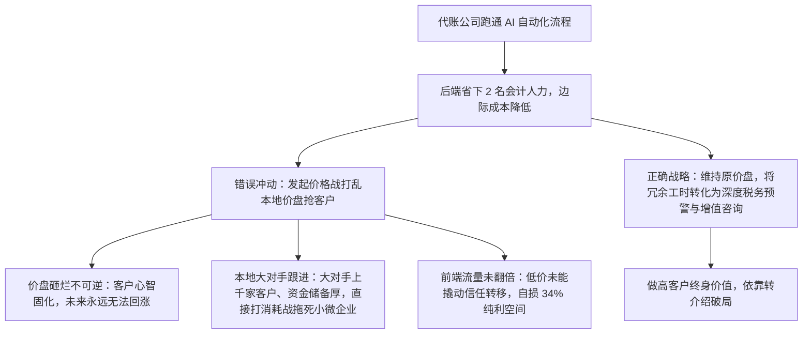
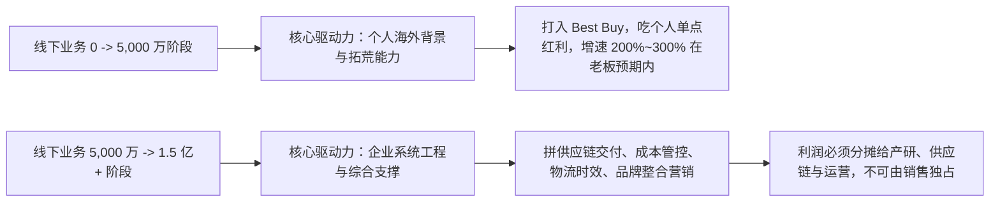

# 2026-11-16 · 产品老曾：代账AI降本勿打价格战、出海渠道高管薪酬博弈与体制下海去光环法则

本次深夜连麦答疑（有效解码音频 1.86 小时，共 587 段逐字发言，3 条时间锚定弹幕全量审阅）深度剖析了四个极具现实穿透力的商业与职场决策大案：针对地方代理记账企业通过 WorkBuddy 跑通 AI 自动化开票报税后欲挑起价格战的冲动，系统论证了“降本绝不能打价格战、核心瓶颈在信任与流量”的商业战略铁律；针对年销 14 亿出海电商大厂北美线下渠道总监在业绩爆发（从 1000 万猛增至 5000 万）后的提点与薪酬博弈，深刻拆解了“从吃个人背景红利到拼系统供应链”的老板分配逻辑，并给出了以增量目标换取确定性底薪大幅上涨的谈判解法；针对体制内副处级干部辞职跳槽民企的迷茫，提出了剥离平台光环的“去光环脱水测试”法则；以及针对两人小团队晋升负责人后的相处困局，确立了“以招兵买马组建班底为唯一抓手、彻底对旧有人际关系脱敏”的管理定力。

---

## 一、地方代账企业借 AI 降本切忌盲目打价格战：存量大对手跟进必死，核心瓶颈在信任与流量

随着以 WorkBuddy 等桌面级 AI 智能体工作台在细分行业中的渗透，部分传统企服小老板率先跑通了日常业务的自动化，但随之而来的却是极其危险的商业战略盲动。

### 1. 案例背景与降价冲动
连麦来访者在河南洛阳经营一家小型代理记账公司，团队共有 7~8 人（包含销售和专职会计），目前手头维护着约 400 家本地中小微企业客户，平均客单价约为 1,500 元/年，年营收约 50 万元，纯利润率在 34% 左右。

该老板自学了 WorkBuddy 桌面工具，成功把基础的日常自动开票、自动做账、纳税申报全流程脚本全部跑通，单人管理客户户数大幅提升，直接省下了 2 名专职会计的人力成本。由于本地同行均尚未掌握该项 AI 自动化能力，该老板产生了强烈的商业冲动：
> “我的成本大幅降下来了，而本地对手还在用传统人工。我现在是不是应该直接发起价格战？比如把原本一年 1,500 元的价盘降到‘两年 2,600 元再送 3 个月’，用低价把本地大对手的客户狠狠抢过来？”

### 2. 老曾深度商业逻辑击穿：为什么借 AI 降本后绝不能打价格战？

老曾对这一自残式的策略给予了当头棒喝，层层剥开代账行业的商业底层本质：

#### （1）价盘一旦砸烂，具有绝对的不可逆性
在小微企业服务市场中，价格具有极强的单向黏性。一旦以“两年 2,600 元送 3 个月”的超低价签单，客户心智中对你的心理定价就被永久锚定在廉价区间。后续当物价上涨、系统维护成本增加或尝试做中高端业务时，客户绝不可能接受涨价，原本 34% 的健康利润空间将被自己亲手彻底掐死。

#### （2）大对手跟进价格战，小微企业必死无疑
小老板自恃“我降了价我依然有利润，对手降了价就会亏损”，这是一种极度天真的战略误判。本地深耕多年的头部代账公司普遍拥有 1,000~2,000 家存量客户，沉淀了极其雄厚的现金流储备。一旦小公司挑起价格战威胁其生存底盘，大公司为了防御必然全面跟进杀价。在残酷的消耗战中，大公司凭借庞大的客户基数和资金厚度可以亏损硬扛两年，而小公司只要出现几十家坏账或客户流失，现金流断裂就会当场猝死。

#### （3）代账的本质是本地强信任业务，核心瓶颈在流量而非成本
老曾直击代账行业的交易心理：小微企业老板找代账，差的绝不是一年几百块钱的差价，核心是“怕记错账、怕虚开漏开发票被税务局稽查罚款”。代账本质上是靠熟人转介绍与本地人脉圈层建立起的信任生意。
- 后端用 AI 提效只解决了“交付产能”问题，并没有解决“前端流量”问题；
- 如果前端获客能力没有实现等比翻倍，单纯把价格砍半，不仅抢不走大对手具备深度客情关系的客户，反而会导致自己手头 400 个存量客户在续费时要求同等打折，自损核心现金流。

#### （4）破局之道：以高维增值服务构筑壁垒
正确的策略是**坚决稳住原价盘**：将 AI 自动化省下来的会计工时和人力精力，转化为客户原本以 1,500 元绝对享受不到的高维增值服务（例如：每月财税合规风险诊断、行业政策补贴申报辅导、小微企业经营数据看板等）。通过服务深度拉开与同行的代际差距，靠极致的客户口碑撬动存量客户转介绍，才是小企业借助 AI 逆袭的健康正道。

---

## 二、出海电商大厂渠道高管薪酬博弈：从吃个人背景红利到拼系统供应链

在跨国贸易与大厂出海领域，业务团队在开辟新市场取得高增长后，常常因公司分配机制的调整而陷入严重的心理失衡。

### 1. 案例背景：美硕高管立下战功后的心理失衡
连麦嘉宾拥有美国本科与硕士背景，去年加入深圳坂田一家年销 14 亿元的知名摄影配件跨境电商大厂。公司以往核心以线上亚马逊等跨境电商渠道为主，北美线上体量约为 1.5 亿元。该高管去年受命负责拓展北美线下渠道，今年因表现优异，老板进一步将澳洲线下渠道也交由其统管。

凭借其在海外生活工作多年的背景优势以及对当地商业规则的熟谙，该高管带领 4 人小团队取得了极具爆发力的战绩：
- **渠道突破**：成功打入北美消费电子线下第一 KA 巨头 **Best Buy**，并敲定了澳洲本土核心零售 KA 体系；
- **业绩暴增**：北美线下业绩从去年的仅 1,000 万元，迅猛飙升至今年预计突破 **5,000 万元**（同比增速高达 200%~300%），明年更被寄予冲刺 1 亿至 1.5 亿元的厚望；
- **薪酬矛盾触发**：公司对该高管实行的是大厂常见的 **OKR 季度绩效制**（基本月薪 2.5 万元，全年按 20 个月发放，总包年薪约 50 万元），**没有任何销售提成**；
- **心理失衡**：外部猎头开出 3 万元底薪加 1~2 个点的销售提成。该高管内心极度不平衡：按行业惯例，线下销售额如果增长 5,000 万元，提成起码能拿 50 万~100 万元；自己一人扛起大几千万增量却只能拿死绩效，陷入了“要不要冲动跳槽，或者该如何向老板争取 70 万元总包”的剧烈纠结。

### 2. 老曾拆解老板视角：核心价值阶段论与利润分配机制

老曾引导该高管跳出销售个人视角的狭隘局限，深度代入企业老板的战略全局进行沙盘推演：

#### （1）从个人拓荒红利走向企业系统作战
- **前期的单点红利**：在从 1,000 万做到 5,000 万的初期阶段，由于公司原本全是纯线上打法、对海外线下两眼一抹黑，该高管的留美背景和跨文化沟通能力确实起到了关键的破冰作用。但这种 200%~300% 的高增速本质上属于“新市场从零起步的自然爆发”，在老板的战略预料之中；
- **后期的系统重资产拼杀**：当体量突破 5,000 万向 1.5 亿乃至 2 亿元冲刺时，游戏规则彻底改变。线下 KA 卖场不再仅看销售个人的私交，而是对**产品的工业设计与质量稳定性、极限制造成本把控、全球海运与海外仓物流周转时效、退换货质保体系，以及全平台的品牌整合营销**提出极高要求。此时真正的护城河在后端供应链与产研，销售只是前端触达的末梢。

#### （2）为什么老板坚决取消提成、推行全员 OKR 绩效？
该高管透露，公司不仅是他，全公司上至高管下至核心员工目前全部取消了传统提成，统一转为绩效制。老曾点出关键：**跨境消费电子的核心壁垒在产品本身。** 老板深知，如果给渠道销售 1~2 个点的暴利提成，不仅会引发产研、供应链团队的剧烈不公与离职潮，更会蚕食本就微薄的制造业毛利。全员绩效制正是为了将企业剩余价值用于反哺研发与供应链升级。

#### （3）成熟高管的薪酬博弈与谈判解法
老曾为该高管开出了极具建设性的谈判策略，告诫其切勿拿外部充满不确定性的画大饼提成做对抗：
- **主动对齐宏大增量目标**：在年度考核与谈薪时，主动向老板立军令状：“北美线上做 1.5 个亿，明年我的线下团队有信心同样做到 1.5 个亿，为公司贡献整整 1 个亿的绝对增量！”；
- **算清账本，换取确定性底薪跃升**：在此宏大目标下，提出薪资诉求：“公司给我增配 4~5 名团队成员，同时鉴于我所承担的责任翻倍，希望公司把我的基本月薪从 2.5 万元调整到 3.5 万元（年薪总包由 50 万元提升至 70 万元）”；
- **老板的接受逻辑**：对于能稳稳扛起 1 个亿增量、打通 Best Buy 体系的渠道负责人，多支出区区 1 万元月薪（全年多发 20 万元），在数千万元的利润盘子面前根本微不足道。通过扛下更大确定性责任来换取高额确定性底薪，既不破坏公司绩效规矩，又合情合理拿到了利益最大化。

---

## 三、体制内跳槽民企的“脱水自省”与预期对齐

现场连麦中，一位体制内副处级干部提问：有一家做民营供应链金融的企业向其抛出橄榄枝，邀请其辞去公职出任高管，负责该民企的国际业务拓展与境外重大项目落地，纠结是否应该辞职下海，以及跳槽后需要完成哪些心态转变。

### 1. 民企出高薪买的到底是什么？
老曾给出了极其冷峻的一语道破：
> “你首先要深刻搞清楚，民企高薪请你过去，买的绝对不是你所谓的通用管理能力、不是你的 PPT 汇报技巧，甚至不是你的专业技术。民企买你的只有三样东西：**你的政策视野、你多年积累的产业人脉，以及你在关键审批关卡上打通关窍的能量！** 他们需要你利用体制内的背景，去解决民营企业自身拼尽全力也解决不了的极为具体的生死卡点。”

### 2. 下海前必做的“去光环脱水测试”
老曾提醒体制内干部，跳槽前必须完成残酷的自我认知脱水：
- **剥离平台身份的真实检验**：必须冷静叩问内心——你在体制内时跟各方大佬谈笑风生、打招呼好使，到底是因为你个人魅力能力强，还是因为你背后所代表的那个公权力单位和副处级职务？
- **人走茶凉的现实风险**：一旦正式办理离职脱下制服，变成了一家民营企业的普通雇员，昔日的下属、同僚和行业朋友，是否还会像以前一样买你的账？如果失去了职务背书，你自以为坚固的关系网络在面临合规红线时，是否会瞬间失效？

### 3. 预期管理与代价评估
- **明确民企要你解决的具体问题**：在签字画押之前，必须把企业最核心的诉求摆在桌面上拆解清楚。企业希望你搞定的牌照、批文、境外资金通道或项目资质，在合规边界上是否存在巨大法律风险？为了这些收益，你个人需要承担多大的法律与信用代价？
- **提前主动降低企业预期**：如果觉得自己脱离身份后并不能百分之百摆平所有卡点，必须提前与民企老板坦诚对齐边界，切莫为了拿到高薪或股份而开出无法兑现的海口，否则一旦项目受挫，下海干部极易迅速被边缘化或当成替罪羊抛弃。

---

## 四、极小团队晋升管理者的“破局脱敏”法则

现场一位连麦学员提问：自己原本所在的业务部门仅有 2 个人，自己最近被大老板提拔为该业务部门的负责人，并且老板批准其招人扩建团队。该学员陷入了严重的社交内耗：“现在只剩下我和原来的那个老同事，我成了他的直接上级，平时抬头不见低头见，我该如何处理和他的同事关系？怎样才能不伤和气？”

### 1. 彻底斩断内耗：不用处理！
老曾对此给出了极其干脆的管理定论：
> **“不用处理！你在两个人的小团队里谈人情世故，完全是本末倒置！”**

### 2. 用业务增量自然重塑管理秩序
老曾剖析了极小团队走向扩编时的管理动态：
- **管理者的核心抓手在扩建增量**：老板提拔你的核心意图，是让你扛起该业务线的结果，并赋予了你招兵买马的开火权。管理者的首要任务是立刻制定招聘标准，尽快招募 3~4 名符合业务要求的新员工进组；
- **旧格局的自然解体**：当团队从 2 个人扩充到 5~6 个人时，新员工天然会认同你作为业务负责人的实线管理权威。在全新的团队组织秩序下，原来唯一的那位老同事瞬间变成了团队中的“少数派”。他若想保住工作，唯一的选择就是主动适应新体制、积极与新团队协同；若其心怀不满故意挑刺，在拥有绝对多数的新团队面前也会被彻底孤立并被业务结果淘汰；
- **管理者的身位脱敏**：新任管理者切忌把宝贵的心智浪费在与个别前同事的人情人际周旋上，唯有雷厉风行抓业务、打粮食、建班底，才能用客观结果在企业中立下坚不可摧的威信。
