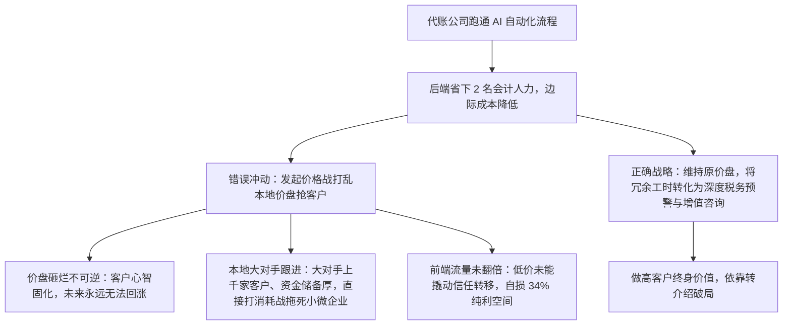
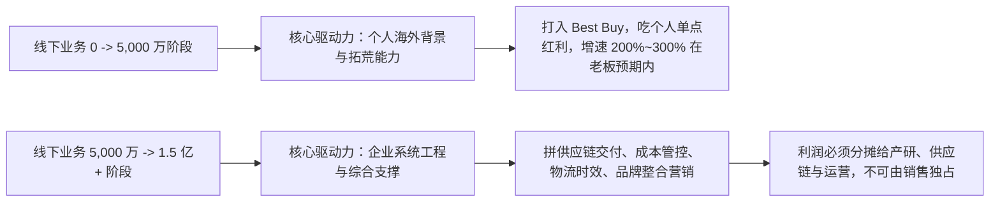
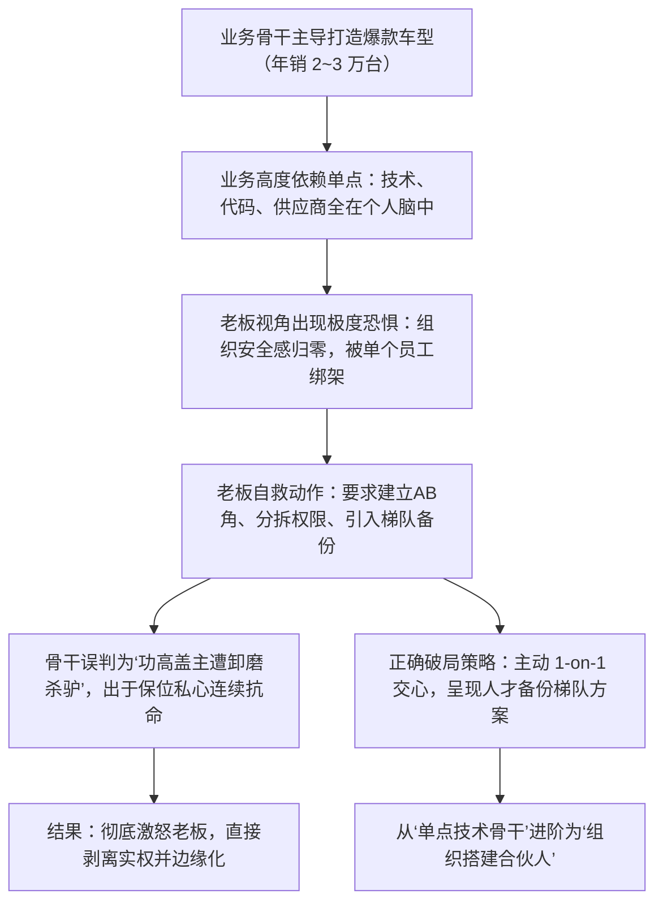

# 2026-11-16 · 产品老曾（全夜全景）：代账降本定价铁律、出海总监薪酬博弈、骨干削权安全感危机与副职破局

本场直播总长 3.47 小时（全息合并当晚相隔 18 分钟中场休息的 Session 139 与 Session 141，共 1,180 段逐字有效发言，11 条时间锚定弹幕全量审阅），深度剖析了七个极具现实穿透力与组织灰度的商业决策与职场博弈大案：
针对地方代账企业跑通 AI 自动化后欲打价格战的冲动，系统论证了“降本绝不能打价格战、核心瓶颈在信任与流量”的商业战略铁律；针对年销 14 亿出海电商大厂北美线下渠道总监在业绩爆发后的薪酬博弈，深刻拆解了“从吃个人背景红利到拼系统供应链”的分配逻辑，并给出了以确定性增量换取高额确定性底薪的谈判解法；针对车企核心研发骨干立大功后遭遇突然削权，戳破了“功高盖主”的自我感动幻觉，看清老板真正的单点失效安全感危机与梯队备份诉求；针对基层主管自发搞 AI 提效却招致“减半裁员回旋镖”，给出了穿透部门墙做大增量的自救路径；针对技术骨干升副职沦为“吉祥物”，确立了分担正职硬骨头与借力 +2 跨级对齐的抓手；针对体制内副处级干部辞职下海的迷茫，提出了剥离平台身份的“去光环脱水测试”；以及针对两人小团队晋升负责人的相处困局，确立了“以招兵买马组建班底为唯一抓手、对旧有人际关系彻底脱敏”的管理定力。

---

## 一、地方代账企业借 AI 降本切忌盲目打价格战：存量大对手跟进必死，核心瓶颈在信任与流量

随着以 WorkBuddy 等桌面级 AI 智能体工作台在细分行业中的渗透，部分传统企服小老板率先跑通了日常业务的自动化，但随之而来的却是极其危险的商业战略盲动。

### 1. 案例背景与降价冲动
连麦来访者在河南洛阳经营一家小型代理记账公司，团队共有 7~8 人（包含销售和专职会计），目前手头维护着约 400 家本地中小微企业客户，平均客单价约为 1,500 元/年，年营收约 50 万元，纯利润率在 34% 左右。

该老板自学了 WorkBuddy 桌面工具，成功把基础的日常自动开票、自动做账、纳税申报全流程脚本全部跑通，单人管理客户户数大幅提升，直接省下了 2 名专职会计的人力成本。由于本地同行均尚未掌握该项 AI 自动化能力，该老板产生了强烈的商业冲动：
> “我的成本大幅降下来了，而本地对手还在用传统人工。我现在是不是应该直接发起价格战？比如把原本一年 1,500 元的价盘降到‘两年 2,600 元再送 3 个月’，用低价把本地大对手的客户狠狠抢过来？”

### 2. 老曾深度商业逻辑击穿：为什么借 AI 降本后绝不能打价格战？

老曾对这一自残式的策略给予了当头棒喝，层层剥开代账行业的商业底层本质：

#### （1）价盘一旦砸烂，具有绝对的不可逆性
在小微企业服务市场中，价格具有极强的单向黏性。一旦以“两年 2,600 元送 3 个月”的超低价签单，客户心智中对你的心理定价就被永久锚定在廉价区间。后续当物价上涨、系统维护成本增加或尝试做中高端业务时，客户绝不可能接受涨价，原本 34% 的健康利润空间将被自己亲手彻底掐死。

#### （2）大对手跟进价格战，小微企业必死无疑
小老板自恃“我降了价我依然有利润，对手降了价就会亏损”，这是一种极度天真的战略误判。本地深耕多年的头部代账公司普遍拥有 1,000~2,000 家存量客户，沉淀了极其雄厚的现金流储备。一旦小公司挑起价格战威胁其生存底盘，大公司为了防御必然全面跟进杀价。在残酷的消耗战中，大公司凭借庞大的客户基数和资金厚度可以亏损硬扛两年，而小公司只要出现几十家坏账或客户流失，现金流断裂就会当场猝死。

#### （3）代账的本质是本地强信任业务，核心瓶颈在流量而非成本
老曾直击代账行业的交易心理：小微企业老板找代账，差的绝不是一年几百块钱的差价，核心是“怕记错账、怕虚开漏开发票被税务局稽查罚款”。代账本质上是靠熟人转介绍与本地人脉圈层建立起的信任生意：
- 后端用 AI 提效只解决了“交付产能”问题，并没有解决“前端流量”问题；
- 如果前端获客能力没有实现等比翻倍，单纯把价格砍半，不仅抢不走大对手具备深度客情关系的客户，反而会导致自己手头 400 个存量客户在续费时要求同等打折，自损核心现金流。

#### （4）破局之道：以高维增值服务构筑壁垒
正确策略是**坚决稳住原价盘**：将 AI 自动化省下来的会计工时和人力精力，转化为客户原本以 1,500 元绝对享受不到的高维增值服务（例如：每月财税合规风险诊断、行业政策补贴申报辅导、小微企业经营数据看板等）。通过服务深度拉开与同行的代际差距，靠极致的客户口碑撬动存量客户转介绍，才是小企业借助 AI 逆袭的健康正道。

---

## 二、出海电商大厂渠道高管薪酬博弈：从吃个人背景红利到拼系统供应链

在跨国贸易与大厂出海领域，业务团队在开辟新市场取得高增长后，常常因公司分配机制的调整而陷入严重的心理失衡。

### 1. 案例背景：美硕高管立下战功后的心理失衡
连麦嘉宾拥有美国本科与硕士背景，去年加入深圳坂田一家年销 14 亿元的知名摄影配件跨境电商大厂。公司以往核心以线上亚马逊等跨境电商渠道为主，北美线上体量约为 1.5 亿元。该高管去年受命负责拓展北美线下渠道，今年因表现优异，老板进一步将澳洲线下渠道也交由其统管。

凭借其在海外生活工作多年的背景优势以及对当地商业规则的熟谙，该高管带领 4 人小团队取得了极具爆发力的战绩：
- **渠道突破**：成功打入北美消费电子线下第一 KA 巨头 **Best Buy**，并敲定了澳洲本土核心零售 KA 体系；
- **业绩暴增**：北美线下业绩从去年的仅 1,000 万元，迅猛飙升至今年预计突破 **5,000 万元**（同比增速高达 200%~300%），明年更被寄予冲刺 1 亿至 1.5 亿元的厚望；
- **薪酬矛盾触发**：公司对该高管实行的是大厂常见的 **OKR 季度绩效制**（基本月薪 2.5 万元，全年按 20 个月发放，总包年薪约 50 万元），**没有任何销售提成**；
- **心理失衡**：外部猎头开出 3 万元底薪加 1~2 个点的销售提成。该高管内心极度不平衡：按行业惯例，线下销售额如果增长 5,000 万元，提成起码能拿 50 万~100 万元；自己一人扛起大几千万增量却只能拿死绩效，陷入了“要不要冲动跳槽，或者该如何向老板争取 70 万元总包”的剧烈纠结。

### 2. 老曾拆解老板视角：核心价值阶段论与利润分配机制

#### （1）从个人拓荒红利走向企业系统作战
- **前期的单点红利**：在从 1,000 万做到 5,000 万的初期阶段，由于公司原本全是纯线上打法、对海外线下两眼一抹黑，该高管的留美背景和跨文化沟通能力确实起到了关键的破冰作用。但这种 200%~300% 的高增速本质上属于“新市场从零起步的自然爆发”，在老板的战略预料之中；
- **后期的系统重资产拼杀**：当体量突破 5,000 万向 1.5 亿乃至 2 亿元冲刺时，游戏规则彻底改变。线下 KA 卖场不再仅看销售个人的私交，而是对**产品的工业设计与质量稳定性、极限制造成本把控、全球海运与海外仓物流周转时效、退换货质保体系，以及全平台的品牌整合营销**提出极高要求。此时真正的护城河在后端供应链与产研，销售只是前端触达的末梢。

#### （2）成熟高管的薪酬博弈与谈判解法
老曾为该高管开出了极具建设性的谈判策略，告诫其切勿拿外部充满不确定性的画大饼提成做对抗：
- **主动对齐宏大增量目标**：在年度考核与谈薪时，主动向老板立军令状：“北美线上做 1.5 个亿，明年我的线下团队有信心同样做到 1.5 个亿，为公司贡献整整 1 个亿的绝对增量！”；
- **算清账本，换取确定性底薪跃升**：在此宏大目标下，提出薪资诉求：“公司给我增配 4~5 名团队成员，同时鉴于我所承担的责任翻倍，希望公司把我的基本月薪从 2.5 万元调整到 3.5 万元（年薪总包由 50 万元提升至 70 万元）”；
- **老板的接受逻辑**：对于能稳稳扛起 1 个亿增量、打通 Best Buy 体系的渠道负责人，多支出区区 1 万元月薪（全年多发 20 万元），在数千万元的利润盘子面前根本微不足道。通过扛下更大确定性责任来换取高额确定性底薪，既不破坏公司绩效规矩，又合情合理拿到了利益最大化。

---

## 三、“功高盖主”的认知幻觉与老板的业务安全感危机：车企爆款研发负责人削权案

在快速扩张的实体与制造业企业中，研发或业务线一把手在立下汗马功劳后，往往最容易陷入“功高盖主遭老板嫉妒猜忌”的心理误区，从而做出自毁前程的对抗动作。

### 1. 案例背景：立下汗马功劳后的突然削权
连麦来访者在国内一家新能源汽车及特种车制造企业担任整车研发负责人。过去两到三年间，他带领团队从零到一攻坚，主导研发了一款轻型纯电代步小车，推向市场后一炮打响，实现年销量 2~3 万台，成为公司最为核心的现金牛和支柱爆款车型。

然而，就在车型销量冲高企稳之际，公司大老板却突然采取了一系列人事与权力调整：
- 从外部挖来新的技术高管，名义上协同研发，实质上逐步接管整车项目的关键接口；
- 老板多次找他谈话，要求他交出一部分项目主导权，将研发团队分拆，并安排几位年轻骨干作为副手深度参与整体架构设计；
- 当事人产生了强烈的戒备与抗拒心理，连续在多个人事与分工安排上消极抵抗、甚至公开与老板抗辩，认为“老板这是在过河拆桥、卸磨杀驴”。最终，老板直接剥夺了其项目一把手的实权，将其调整至一个边缘的预研岗位。

### 2. 老曾深度组织剖析：不是老板嫉妒你，而是你把业务私有化引发了老板的生存恐慌

#### （1）民企老板从来不怕下属能干，怕的是“业务被单点绑架”
在商业竞争中，没有任何一个理性的老板会嫉妒一个能帮自己一年卖出 2~3 万台车、带来数亿元现金流的下属。老板最深层的恐惧，是**单点失效风险（Single Point of Failure）**：
- 整车所有的技术细节、外协厂核心参数、研发文档全在负责人一个人脑子里；
- 如果明天当事人被竞争对手两倍薪资挖走，或者突发意外、甚至以辞职相要挟索要股份，整条产线和企业生命线将瞬间瘫痪。
- 老板要求安排副手、要求团队分拆，本质上是在为企业做**系统性的灾备与容灾机制**，这是企业规模化发展的必经之路。

#### （2）破局与挽回路径：主动 1-on-1，交心认错，升维为“组织合伙人”
1. **放下情绪，主动约老板进行深度 1-on-1**：明确承认自己过去认知格局狭隘，深刻认识到公司业务系于一人身上的巨大系统隐患；
2. **主动呈递人才梯队建设方案**：主动拿出团队内 2~3 名年轻骨干的培养计划，列出自己在未来 3~6 个月内标准化文档沉淀与知识交割的时间表；
3. **完成身位跃迁**：将自身定位从“守着旧项目的技术项目经理”，提升为“帮老板识别技术人才、搭班子、攻坚下一个新战役的组织合伙人”，打消老板的安全感顾虑。

---

## 四、自发搞 AI 降本增效的“回旋镖裁员”陷阱：存量博弈下的增量自救法

在 AI 浪潮下，业务主管利用 AI 智能体推动内部提效，若缺乏对组织政治的敬畏，极易变成砍向自己团队的人事屠刀。

### 1. 案例背景：热心提效换来部门裁员 50%
某中型零售商贸企业的供应链与采购部门主管带领 6 个人负责日常供应链订单录入、库存盘点核对、供应商资质审核以及采购对账。该主管自学低代码平台与桌面 AI 工具，自行编写自动化对账脚本，将部门日常作业工时大幅缩减近一半。

该主管向公司 CEO 汇报邀功，强调“在引入 AI 自动化后，原本需要 6 个人全天运转的工作，现在只要 3 个人就能轻松搞定”。结果汇报第二天，HR 负责人便约谈了他：“鉴于你证明了 AI 可以替代一半人力，公司决定采购部门编制核减至 3 人，请在本周内提报裁员 3 人名单。”

### 2. 老曾深度商业逻辑击穿：内部降本必须以业务扩张为前置
- **在存量业务中向老板宣称“提效”，等于主动递刀裁员**：如果公司总业务量没有翻倍增长，后台支持部门的提效汇报，老板眼里看到的只有“冗余”。你证明了 3 个人能干完原本 6 个人的工作，就等同于主动证明过去部门在吃空饷；
- **第一原则：严禁将“节约工时”直接等同于“富余人力”**：内部汇报必须严格锚定**增量价值**。正确汇报方式是：“通过 AI 工具将繁琐事务自动化后，全员释放出宝贵精力，主动承接了**上游供应链动态比价监控**和**门店缺货预测**，帮公司直接挤出采购水分 15 万元”；
- **紧急止损预案**：立即重构汇报模型，将富余产能穿透部门墙向前端业务外溢，用新业务量填满冗余工时，以“业务新增量”保全团队编制。

---

## 五、摆脱副职“吉祥物”困局：分担正职硬骨头与借力 +2 跨级制衡

在企业中层管理中，“副职”往往是最容易被架空或陷入内耗的灰色地带。

### 1. 案例背景：技术骨干晋升副组长后被彻底架空
某软件开发企业技术骨干被大老板提拔为副组长。履新后正组长极其强势且防备心极重，核心周会、汇报、关键架构评审均绕开他，只分派边角料琐事，当事人消极躺平一年。近期大老板电梯偶遇抽查业务，当事人支支吾吾答不上来，陷入强烈危机。

### 2. 老曾深度破局剖析：副职的核心不是要权力，而是承接压力与借力制衡
- **正职为什么排挤副职？** 一是害怕被取而代之；二是副职没有提供任何管理减负价值，只想要权力却不愿分担管理痛苦；
- **对正职：主动认领“脏活、累活、硬骨头”**：主动挑起部门最难缠的跨部门撕扯、延期救火模块或代码质量巡检，甘当正职的“防弹衣”，消除其防备心；
- **对 +2 大老板：主动对齐战略大局观**：严禁打小报告，而是整理部门全局性技术演进瓶颈与系统风险，做定期简短汇报，展示随时补位接盘的全局视野，借大老板关注确立正统抓手。

---

## 六、体制内跳槽民企的“脱水自省”与预期对齐

现场连麦中，一位体制内副处级干部面对民营供应链金融企业的高薪邀请，纠结是否应该辞职下海负责海外重大项目落地。

### 1. 民企出高薪买的到底是什么？
老曾给出了极其冷峻的一语道破：
> “民企买你的只有三样东西：**你的政策视野、你多年积累的产业人脉，以及你在关键审批关卡上打通关窍的能量！** 他们需要你利用体制内的背景，去解决民营企业自身拼尽全力也解决不了的生死卡点。”

### 2. 下海前必做的“去光环脱水测试”
- **剥离平台身份的真实检验**：你在体制内打招呼好使，到底是因为你个人能力强，还是因为你背后所代表的那个公权力单位和副处级职务？
- **人走茶凉的现实风险**：一旦脱下制服变成民企普通雇员，昔日的关系网络在面临合规红线时，是否会瞬间失效？
- **预期管理与代价评估**：必须把企业最核心的诉求摆在桌面上拆解清楚，评估牌照、资质背后的法律与信用代价，提前主动降低企业预期，切莫开出无法兑现的海口。

---

## 七、极小团队晋升管理者的“破局脱敏”法则

现场一位连麦学员提问：业务部门原本仅有 2 个人，自己被提拔为负责人并获准招人扩建团队，陷入了不知如何面对原本并肩作战的老同事的内耗。

### 1. 彻底斩断内耗：不用处理！
老曾给出了极其干脆的管理定论：**“不用处理！你在两个人的小团队里谈人情世故，完全是本末倒置！”**

### 2. 用业务增量自然重塑管理秩序
- **管理者的核心抓手在扩建增量**：老板赋予你的是开火权，首要任务是立刻制定标准招募 3~4 名新员工进组；
- **旧格局的自然解体**：团队扩充到 5~6 人时，新员工天然认同你的管理权威，老同事瞬间变成少数派，必须主动融入新团队协同，否则将被客观业务结果淘汰；
- **管理者的身位脱敏**：切忌把心智浪费在与个别前同事的人情人际周旋上，唯有雷厉风行抓业务、打粮食、建班底，才能用客观结果立下坚不可摧的威信。

---

## 结语：管理升维的底层，是对组织人性的深层洞察

无论是代账企业借助 AI 降本后的稳价护盘、核心骨干立功遭削权后的安全感重塑、内部提效背后的增量保编制博弈，还是副职打破架空的上下制衡，老曾在这一整夜连麦中揭示的根本逻辑是高度一致的：**在商业与职场中，单纯的技术能力与做事成果从来不是唯一的护城河。看清老板的安全感底线、敬畏组织的利益分配逻辑、主动站在更高维度为组织消化风险，才是从单兵走向成熟经营者的必修课。**
