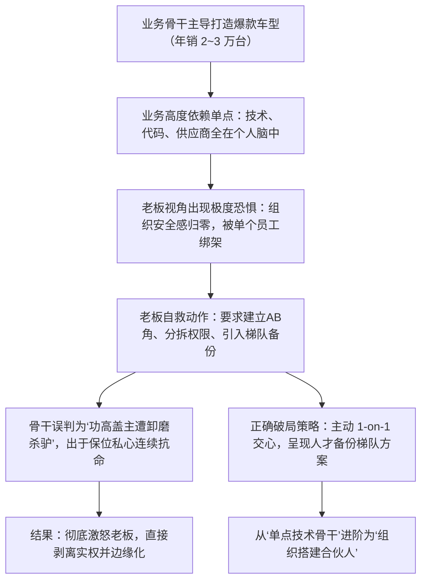
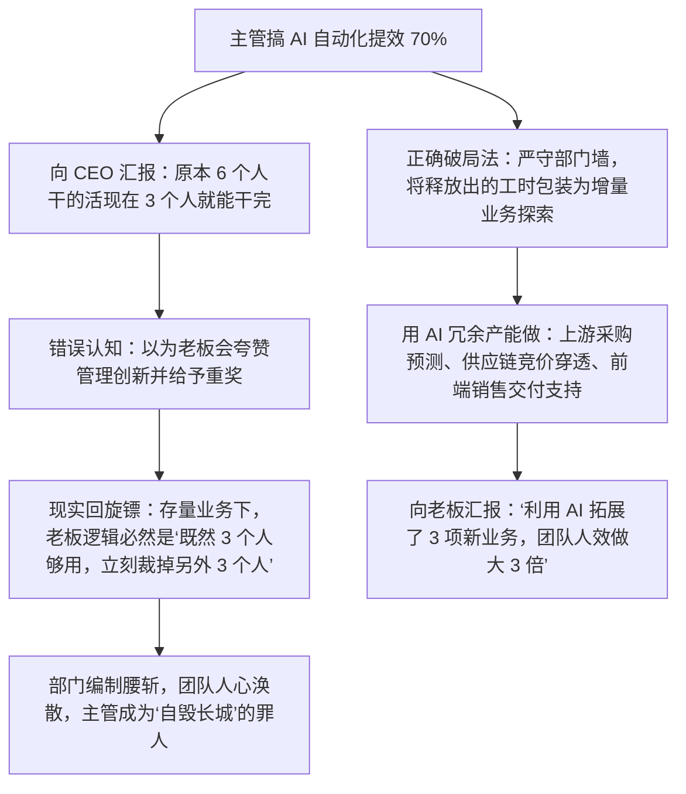
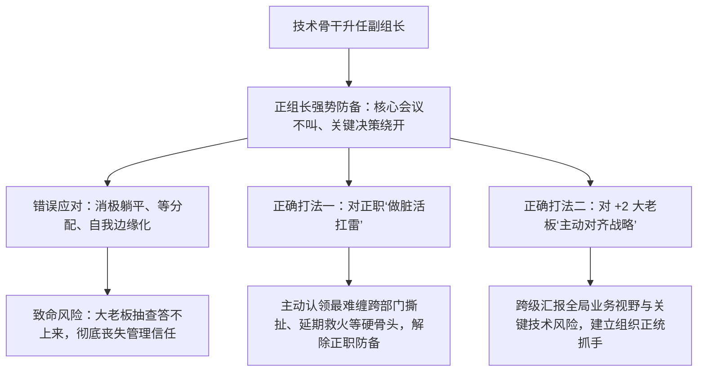

# 2026-11-16 · 产品老曾（深夜场）：骨干削权与安全感危机、AI降本回旋镖裁员与副职破局

本次深夜答疑（有效解码音频 1.61 小时，共 593 段逐字发言，8 条时间锚定弹幕全量审阅）系统剖析了三个直击职场组织中枢与管理灰度的真实困局：车企核心研发负责人开发爆款立大功后遭遇突然削权，如何戳破“功高盖主”的自我感动幻觉，看清老板真正的安全感危机与梯队备份诉求；基层管理者自发借助 AI 推动部门流程自动化向老板邀功，却意外遭遇“减半裁员回旋镖”，如何在存量博弈中穿透部门墙以增量业务保全编制；技术骨干晋升副组长后沦为“吉祥物”被正职架空，如何打破被动等待心态，通过分担硬骨头脏活与借力 +2 跨级对齐重塑管理存在感。

---

## 一、“功高盖主”的认知幻觉与老板的业务安全感危机：车企爆款研发负责人削权案

在快速扩张的实体与制造业企业中，研发或业务线一把手在立下汗马功劳后，往往最容易陷入“功高盖主遭老板嫉妒猜忌”的心理误区，从而做出自毁前程的对抗动作。

### 1. 案例背景：立下汗马功劳后的突然削权
连麦来访者在国内一家新能源汽车及特种车制造企业担任整车研发负责人。过去两到三年间，他带领团队从零到一攻坚，主导研发了一款轻型纯电代步小车，推向市场后一炮打响，实现年销量 2~3 万台，成为公司最为核心的现金牛和支柱爆款车型。

然而，就在车型销量冲高企稳之际，公司大老板却突然采取了一系列人事与权力调整：
- 从外部挖来新的技术高管，名义上协同研发，实质上逐步接管整车项目的关键接口；
- 老板多次找他谈话，要求他交出一部分项目主导权，将研发团队分拆，并安排几位年轻骨干作为副手深度参与整体架构设计；
- 当事人产生了强烈的戒备与抗拒心理，连续在多个人事与分工安排上消极抵抗、甚至公开与老板抗辩，认为“老板这是在过河拆桥、卸磨杀驴”。最终，老板直接剥夺了其项目一把手的实权，将其调整至一个边缘的预研岗位。

当事人倍感委屈，连麦老曾时发问：
> “项目是我一手带出来的，核心专利和供应链全在我脑子里，年销两三万台的功臣为什么换来的是排挤？难道在民企里真是功高盖主、老板容不下能干的人吗？”

### 2. 老曾深度组织剖析：不是老板嫉妒你，而是你把业务私有化引发了老板的生存恐慌

老曾毫不留情地击碎了当事人的心理滤镜，将老板视角下的组织安全感底牌彻底亮出：

#### （1）民企老板从来不怕下属能干，怕的是“业务被单点绑架”
在商业竞争中，没有任何一个理性的老板会嫉妒一个能帮自己一年卖出 2~3 万台车、带来数亿元现金流的下属。老板最深层的恐惧，是**单点失效风险（Single Point of Failure）**：
- 整车所有的技术细节、外协厂核心参数、研发文档全在负责人一个人脑子里；
- 如果明天当事人被竞争对手两倍薪资挖走，或者突发意外、甚至以辞职相要挟索要股份，整条产线和企业生命线将瞬间瘫痪。
- 老板要求安排副手、要求团队分拆，本质上是在为企业做**系统性的灾备与容灾机制**，这是企业规模化发展的必经之路。

#### （2）“保位私心”引发老板的终极安全感危机
当老板试探性地要求搭建梯队时，当事人的第一反应不是站在老板的角度理解风险，而是出于保护自身不可替代性的私心，捂着业务不放、阻挠新人介入。
这种消极抵抗在老板眼中，不仅不是忠诚，反而坐实了最坏的猜想：“这小子仗着自己懂技术，已经在把公司的核心资产变成他个人的私产，甚至打算以此要挟公司。”一旦老板对核心骨干丧失了基本的心理安全感，哪怕拼着项目震荡、甚至付出几百万损失的代价，也必然会坚决将该骨干连根拔起。

#### （3）破局与挽回路径：主动 1-on-1，交心认错，从“技术单兵”升维为“组织合伙人”
老曾为当事人设计了极具实操性的破局自救脚本：
1. **放下情绪，主动约老板进行深度 1-on-1**：
   明确承认自己过去认知格局狭隘：“老板，之前我年轻气盛，站在自己一亩三分地的角度，总觉得您要换我，心里有了抵抗情绪。经过这段时间的冷静反思，我意识到自己大错特错。公司一年卖两三万台车，如果全系于我一个人身上，对公司来说是极其危险的经营隐患。您要搭梯队、做容灾，是真正把企业做大的企业家格局。”
2. **主动呈递人才梯队建设方案**：
   主动拿出团队内 2~3 名年轻骨干的培养计划，甚至主动建议在哪些模块从外部引入更高阶的技术专家，明确列出自己在未来 3~6 个月内如何完成标准化文档沉淀与知识交割。
3. **完成身位跃迁**：
   将自己的定位从“守着旧项目的技术项目经理”，提升为“帮老板识别技术人才、搭班子、攻坚下一个新战役的组织合伙人”。只有彻底打消老板的安全感顾虑，才能重新夺回在核心业务上的主导话语权。

---

## 二、自发搞 AI 降本增效的“回旋镖裁员”陷阱：存量博弈下的增量自救法

在 AI 浪潮下，许多业务主管热衷于利用 AI 智能体和自动化工作流在内部搞降本增效，但若缺乏对组织政治的敬畏，提效极有可能直接变成砍向自己团队的人事屠刀。

### 1. 案例背景：热心提效换来部门裁员 50%
某中型零售商贸企业的供应链与采购部门主管，带领 6 个人负责日常供应链订单录入、库存盘点核对、供应商资质审核以及采购对账等繁杂工作。

为了体现个人创新能力与管理前瞻性，该主管利用业余时间研究了一系列低代码平台与桌面 AI 工具，自行编写了自动化抓取与对账脚本，并搭建了采购智能体，将繁琐的录入、比对和审核流程自动化率提升了 70%，部门日常作业工时大幅缩减近一半。

该主管兴高采烈地制作了极其精美的 PPT 向公司 CEO 汇报邀功，强调“在引入 AI 自动化后，我们部门的运营效率提升了 100%，原本需要 6 个人全天运转的工作，现在只要 3 个人就能轻松搞定”。

然而汇报结束后的第二天，HR 负责人便约谈了他：
> “鉴于你汇报中证明了 AI 可以替代一半人力，公司结合当前的现金流压力，决定响应集团降本增效号召，采购部门的编制核减至 3 人，请你在本周内提报拟裁员的 3 人名单。”

### 2. 老曾深度商业逻辑击穿：内部降本必须以业务扩张为前置

老曾直指该主管在职场政治与商业常识上的幼稚：

#### （1）在存量业务中向老板宣称“提效”，等于主动递刀裁员
在任何一家成熟企业中，如果公司总业务量没有翻倍增长，任何单纯针对后台支持部门（如采购、财务、行政、运维）的提效汇报，老板眼里看到的只有两个字——**冗余**。
你证明了 3 个人能干完原本 6 个人的工作，就等同于主动向管理层证明“过去的两年里你一直在纵容部门吃空饷，或者当前有 3 个人在公司白拿薪水”。在降本控费的大环境下，老板顺水推舟砍掉编制是唯一的经济学最优解。

#### （2）自发搞 AI 的第一原则：严禁将“节约工时”直接等同于“富余人力”
内部创新的汇报必须严格锚定**增量价值**，绝不能孤立汇报“节省时间”：
- **错误汇报**：“通过 AI 脚本，我们省去了每天 4 个小时的人工录入，节省了 3 个全职人力。”（直接引来裁员指标）
- **正确汇报**：“通过 AI 工具将繁琐的基础事务自动化后，部门全员释放出了宝贵精力，我们主动承接了原本由于人手不足而无法落地的**上游供应链动态比价监控**和**各门店缺货预测**，在过去一个月里帮公司直接挤出采购水分 15 万元。”

#### （3）突发裁员指令下的紧急止损策略
对于该主管面临的裁员死局，老曾给出了紧急阻击预案：
1. **立即重构汇报模型**：
   紧急向 CEO 提交《采购部门基于 AI 赋能的业务扩容规划书》，明确指出保留下来的全员正在全面介入前端销售支持与供应商深挖体系。
2. **将产能外溢至其他部门**：
   主动穿透部门墙，向运营部门和销售部门“输送产能”——利用本部门沉淀的 AI 自动化对账能力，帮前端门店做自动化盘点和即时报表生成，用其他部门的业务诉求填满冗余工时，以“业务新增量”作为挡箭牌保全团队编制。

---

## 三、摆脱副职“吉祥物”困局：分担正职硬骨头与借力 +2 跨级制衡

在企业中层管理中，“副职”往往是最容易被架空或陷入内耗的灰色地带。当正职强势且排挤副手时，被动躺平只会加速自身的边缘化与淘汰。

### 1. 案例背景：技术骨干晋升副组长后被彻底架空
连麦来访者在一家软件开发企业担任技术团队副组长已有一年时间。此前他是部门内的核心开发骨干，因为技术扎实、交付稳定被大老板提拔为副职。

然而履新之后，他却陷入了极度尴尬的处境：
- 正组长极其强势且防备心极重，部门核心的项目周会、对大老板的汇报、关键架构评审均不叫他参与；
- 正组长只分派一些边角料琐事给他，甚至直接越过他向基层开发指派任务；
- 当事人感到自尊受挫，逐渐产生了消极抵抗的“躺平”心态，过去一年多里“正职不叫我就不参与，每天按部就班打卡，遇到问题也不吭声”，彻底沦为办公室里的透明人。

近期大老板在电梯里偶然碰见他，随口问了一句“最近你们组那个新模块进展怎么样？”，当事人支支吾吾答不上来。大老板皱了皱眉头走开，这让他感受到了强烈的职场危机感。

### 2. 老曾深度破局剖析：副职的核心不是要权力，而是承接压力与借力制衡

老曾指出，当事人虽然名义上晋升了副组长，但思维意识依然停留在“基层员工被动等派活”的初级阶段：

#### （1）正职为什么排挤副职？
正职对副职的天然防备只有两个原因：
1. **害怕被取而代之**：尤其当副职是由更高层大老板直接任命时，正职天然会把副职视为安插在自己身边的“密探”或潜在威胁；
2. **副职没有提供任何管理减负价值**：副职只想要权力、要面子，却不愿主动为正职分担真正的管理痛苦与业绩风险。

#### （2）对正职的破局点：主动认领“脏活、累活、背锅活”
老曾强调，要想打破正职的防御心，就必须主动成为正职不可或缺的“防弹衣”：
- 主动找正组长沟通，挑选部门里最难推进的跨部门协调沟通、最容易背锅的延期交付救火模块、或者最繁琐的代码质量巡检工作，直接表态：“组长，这个烂摊子大家都不愿意接，我来负责把它兜底解决，所有的跨部门撕扯我来冲锋，绝不让这些琐事分您的心。”
- 当你主动替正职排雷、分担管理痛苦，而不是去争抢向老板汇报露脸的明星项目时，正职对你的敌意就会迅速瓦解，甚至在很多硬仗中不得不主动依赖你。

#### （3）对 +2 大老板的博弈点：跨级汇报不是打小报告，而是对齐大局观
对于提拔自己的 +2 大老板，严禁采取“告正职刁状”的幼稚手段，而是要展现出高维度的业务掌控力：
- 整理部门内部全局性的技术演进瓶颈、系统架构潜在风险或研发人效改进点，主动约大老板做定期的简短汇报；
- 汇报要点永远围绕“如何帮公司保障交付质量、如何为部门大目标服务”，坚决不掺杂个人恩怨；
- 只有通过高频的业务大局观展现，让大老板看到你随时具备补位接盘的能力，副职的名号才能真正转化为不可动摇的职场资本。

---

## 结语：管理升维的底层，是对组织人性的深层洞察

无论是立功骨干被削权后的安全感修复、AI 工具提效背后的增量保编制博弈，还是副职打破架空的上下求索，老曾在此次连麦中揭示的根本法则是高度一致的：**在职场中，单纯的技术能力与做事成果从来不是唯一的避风港。看清老板的安全感底线、敬畏组织的利益分配逻辑、主动站在更高维度为组织消化风险，才是从技术走向成熟管理者的必修课。**
