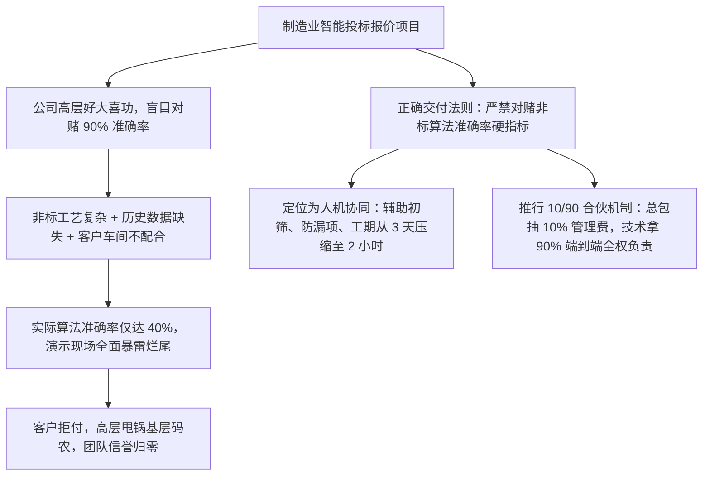
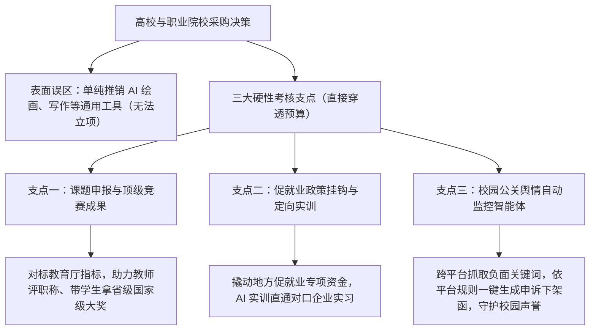

# 2026-11-16 · 企智AI落地派 · 第1场直播

本场长达 11.05 小时的跨夜马拉松式深度直播（有效解码音频 39,768.53 秒，共 2,994 段逐字发言，642 条时间锚定弹幕全量审阅）是一场将企业 AI 落地直接推进到制造车间、供应链采购、高校考核与国产算力集群深水区的硬核实战复盘。针对当下技术团队承接制造业项目普遍面临的“盲目对赌算法准确率导致暴雷烂尾、脱离业务流程沦为玩具、高校预算抓不准刚需”等核心痛点，郭总与现场多位资深交付老兵、实体企业主展开了极其深刻的案例研读与方案推演：系统反思了一起制造业智能投标报价项目盲目许诺 90% 准确率导致全面烂尾的惨痛教训，树立了“非标场景严禁对赌准确率、以初筛防漏项为指标、推行总包抽 10% 管理费而技术合伙人拿 90%”的端到端交付闭环；现场一位兼具工业品商贸、塑料包装制造与环保水处理三家实体的 80 后老板倾情拆解了其真实的“40 万工业品 SKU 秒级报价、工程自动比价防腐排除项目经理寻租、以及车间多维生产数据蒸馏老师傅塑料配方”三大硬核落地大案；深入拆解了穿透高校与职校预算的课题竞赛、促就业补贴与校园公关舆情自动监控三大刚性支点；实测评估了 DeepSeek 开源大模型在华为昇腾国产算力集群上的软硬件协同与风车网络优化；并在保定与雄安 OPC 创业园联动中，确立了“垂直 SaaS 共建拒绝空头支票、专业分工重构 FDE 咨询与系统交付”的产业舰队模式。

---

## 一、制造业 AI 报价项目暴雷反思与 10/90 独立 FDE 合伙机制

在当前企业 AI 改造的热潮中，不少传统 IT 外包团队转型承接制造业数字化大单，但往往由于对大模型技术特性的认知偏差与商务谈判中的浮夸许诺，导致项目直接沦为灾难性的烂尾。

### 1. 盲目对赌 90% 准确率的惨烈暴雷案例
现场一位开发者连麦倾诉了其入职仅一个月即遭遇的职场暴雷经历：
- **项目背景**：该开发者所在的技术公司承接了一家重型制造企业的“智能投标报价核算系统”项目，旨在通过 AI 识别工程图纸、物料清单与工艺工时，实现制造业投标时的自动成本核算与快速报价；
- **商务致命许诺**：公司高层在前期商务洽谈中急于拿单，毫无技术敬畏地向客户白纸黑字立下军令状，盲目承诺“**AI 报价核算算法准确率必须达到 90% 以上**”；
- **交付现场彻底崩盘**：在实际开发推进中，由于制造业非标定制件工艺变量极其复杂、历史手工数据严重缺失，加之客户一线车间管理人员担心被挑刺而采取消极抵抗态度，系统实际跑出的准确率仅有约 **40%**。在正式向客户管理层演示时，数据错漏百出当场暴雷，客户当即拒绝签字验收并扣留全款；公司管理层为了甩锅逃避责任，迅速将项目失败的责任全部转嫁给新入职的试用期技术人员并将其辞退。

### 2. 企智团队给出的工程与商业交付铁律
企智导师与资深交付老兵针对该案例给出了极具穿透力的规则重塑：
- **铁律一：非标工业场景严禁承诺算法准确率指标**：大语言模型与多模态技术底层本质上是基于概率的生成机制，存在不可完全消除的参数波动与幻觉风险。在面对数万种非标机械零部件的加工工艺时，任何声称“纯大模型准确率达 90%”的承诺都是对工程常识的背叛。商务合同中绝不能签订算法准确率对赌，必须将交付标准明确定义为“**人机协同辅助系统**”——以“辅助初审快速标出潜在漏项、将原本 3 天的繁琐物料查表工期缩短至半天以内、降低人工核算疲劳错漏率”等业务效能为真实验收基准；
- **铁律二：推行 10/90 独立 FDE 合伙分账机制**：企智深入剖析了传统软件外包中“销售层层抽成、把单子甩给底层码农、责任与利益脱节”的制度死结。企智平台自身所践行的交付机制为：平台作为总包方只收取 **10% 的品牌信誉与财务合规管理费**，其余 **90% 的项目款项全额归属于技术合伙人**。相应地，技术人员必须从“等产品经理给需求再写代码的纯码农”，主动进化为“深入工厂现场摸清非标工序、参与商务谈判对齐预期、端到端对业务结果负全责”的独立 FDE。唯有利益与责任高度对齐，才能彻底根除烂尾甩锅。

---

## 二、实体企业主的硬核实操：SKU 自动报价、比价防腐与配方蒸馏

在直播间充斥着关于通用聊天机器人探讨的间隙，一位同时经营工业品商贸、塑料包装制造与环保水处理三家实体的 80 后实体老板登上连麦，直言痛批市面上绝大多数脱离业务实际的 AI 玩具，倾囊分享了自己实体业务中刀刀见血的三大落地实操。

### 1. 落地场景一：40 万个大宗工业品 SKU 知识建模与秒级报价
- **痛点**：该老板旗下的工业品供应链贸易公司（业务模式类似京东工业、震坤行），每天承接大量工矿企业的海量复杂询价。由于包含劳保用品、五金工具、机械备件等数十个细分大类，公司原本配备了大量专职文员与业务员，每天需在成百上千份历史 Excel 表格与供应商企微中翻找比对，耗时耗力且人员离职就会导致价格数据断层；
- **AI 解法**：该老板亲自将公司沉淀的 **40 万个工业品 SKU 历史数据与供应商底价进行结构化建模并投喂给 AI**。现在大客户询价单输入后，系统在**数秒内自动完成规格匹配、追溯历史合作供应商并输出最优报价底线**。不仅原本需要数天核算的询价单在分钟级完成响应，而且文员无需再在海量数据中反复搬砖，企业报价吞吐量大幅暴增。

### 2. 落地场景二：工程维修测绘与智能比价防腐（干掉项目经理寻租）
- **传统工程痛点**：在承接大型厂房与市政维修工程时，传统流程必须派遣项目经理赴现场实地测量测绘，随后由项目经理估算物料消耗与人工工时。这一环节存在极其严重的“灰色寻租空间”——项目经理往往利用信息不对称，与外部包工头或材料商串通虚报工料，索取回扣，企业老板既无法精准监控又难以追责；
- **AI 智能比价防腐模型**：该企业将历年所有工程的物料实际采购价格与工人工日单价投喂给定制 Agent，构建自动化测绘估算模型。系统根据现场尺寸与历史工料标准自动向入库的多家合作供应商发起背靠背比价，并在算法中**设定 10% 左右的合理容错浮动余量**。一旦供应商报价超出该基准，系统立刻标红预警；
- **商业成效**：通过这套自动化比价防腐机制，企业直接将存在道德风险的项目经理中间层彻底去除，采购成本透明度大幅拉满，彻底杜绝了吃回扣漏洞，单笔工程利润率直接提升 8%~12%。

### 3. 落地场景三：塑料包装车间老师傅核心配方的“数据蒸馏”
- **制造行业痼疾**：在传统塑料包装制造领域（如农用中包料、热收缩膜），吹膜与改性塑料的精细配方（如 2426K、7042 等原料牌号的微量添加配比与温控参数）长期被高薪聘请的老师傅当做私人底牌牢牢垄断。车间使用的传统 ERP 只能记录领料总量，根本无法还原精准工艺配比；企业一旦与师傅发生矛盾或遭遇挖角，整个车间生产立刻陷入瘫痪；
- **工艺数据“反向蒸馏”**：该企业借助物联网与边缘计算探针，在车间实际生产过程中高频采集投料记录、熔体温度、螺杆转速、膜厚均匀度与成品抗拉强度等全量连续数据。通过 AI 大模型对数以万计的工艺波动与力学检验数据进行参数关联分析与模式聚类，**成功将深藏在老师傅脑中的非标准化“手艺”，反向逆向“蒸馏”出了高精度的标准生产配方与容错曲线**；
- **资产沉淀价值**：企业一举摆脱了对个别技术工人的绝对人身依附，将脆弱的手艺彻底沉淀为企业完全自主掌控的算法数字资产，即使全面换用普通熟练工，生产稳定性与良品率依然保持在顶峰水平。

---

## 三、穿透高校与职校 AI 预算的三大硬性考核支点

针对部分企服团队尝试开拓高校与职业教育院校市场、却经常由于“需求对不齐、项目难立项”而碰壁的现状，现场联合多位具备校企合作背景的资深专家，系统剖析了校方采购决策的底层心理。

### 1. 支点一：对标教育厅年度考核，助力课题申报与顶级竞赛拿奖
高校领导与院系负责人的首要考核利益，在于每年的教学成果奖、部委课题立项以及国家级/省级大学生技能大赛（如挑战杯、“互联网+”等）。单纯向学校推销通用 AI 软件，院系根本没有对应的采购科目。服务商必须将 AI 技术深度包装为**教学成果转化载体**——帮助专业带头人联合申报省级产学研教改课题，或者基于该垂直系统指导学生团队在顶级大赛中摘金夺银，才能真正让校方领导动用学科建设专项预算。

### 2. 支点二：深度挂钩地方政府“促就业专项资金”
当前各大高职高专院校最焦虑的核心考核指标是**应届毕业生对口就业率与留存率**。许多地方发改委与人社局下拨了巨额的“促就业专项补贴”，但往往缺乏有说服力的落地载体。企服团队应将 AI 实训平台与产业端真实用人需求深度打通（如电商 AI 选品、工业自动化数据标注、智能客服实训），以“定向输送实训与对口就业协议”为抓手，既解决了学校的就业率考核，又顺利穿透了政府促就业专项资金。

### 3. 支点三：低成本开发校园公关舆情一键申诉下架智能体
现场某公关团队分享了其为高校定制的轻量化舆情监控方案：
- **高校声誉刚需**：微博、抖音、小红书等社交平台上针对高校食堂卫生、宿舍纠纷、考评争议等“避雷帖”极易迅速发酵为全网公共事件，令校方公关处如坐针毡；
- **智能体闭环机制**：开发低成本爬取与合规分析 Agent，全天候监控涉及该校名称的关键舆情；一旦监测到负面发酵苗头，系统**自动调取各大平台法务社区违规判定条例，在数分钟内自动撰写出符合各大主流平台格式规范的合规申诉下架函并附带事实举证证据**，协助校方以极低的人工成本将舆情掐灭在萌芽期。

---

## 四、国产智算私有化集群落地实务：DeepSeek 与华为昇腾

随着政企客户对数据主权与合规安全要求的日益提升，私有化部署一体机与局域网智算集群正成为实体企业采购的刚需。

### 1. 国产硬件选型与生态现实
现场资深算力调度专家结合工程一线实测指出：
- 在当前的国内政企私有化智算中心与企业一体机部署中，国产硬件路线几乎全面以**华为昇腾（Ascend，如 910B 系列）**为主流基石，开源大模型底座则高度集中于**深度求索（DeepSeek）**系列开源权重；
- **单卡算力代差与客观认知**：工程实测表明，在纯浮点算力与单卡吞吐表现上，昇腾单卡与英伟达高端算力卡（如 H100/H800）之间依然存在约 **3:1 至 5:1 的客观性能代差**。技术人员在规划集群时必须尊重这一物理事实，切忌盲目宣称单卡性能超越。

### 2. 华为风车网络互联优化与“1+1>2”集群规模协同
尽管单卡算力存在差距，但在实际系统工程层面，华为通过强大的网络通信与集群架构实现了高效弥补：
- **类似 NVLink 的风车网络互联技术**：华为在多卡与多节点之间采用了高带宽、低延迟的风车网络集群互联架构，大幅削减了分布式模型并行（Tensor Parallelism / Pipeline Parallelism）中的跨卡通信瓶颈；
- **算子级深度优化**：DeepSeek 团队与华为昇腾底层算子库（CANN）进行了极高深度的软硬件协同调优，针对注意力机制与矩阵乘法算子实现了端到端硬件指令级映射；
- **工程结论**：在 8 卡至 32 卡规模的局域网工作集群中，通过优异的网络拓扑与算子调度，国产集群整体能够稳定释放出“1+1>2”的协同效能，能够以远低于海外硬件的成本满足实体企业千亿参数模型微调、RAG 知识库检索以及高并发业务推理的生产级要求。

---

## 五、雄安与保定 OPC 产业园联动：垂直 SaaS 共建实务

在推动河北保定周边产业带与雄安新区 OPC（一人公司）创新生态的协同中，郭总与现场创业园负责人共同探讨了本地化企服生态的构建法则。

### 1. 寻找技术团队共建平台：坚决拒绝空头支票
针对部分传统资源方“想做行业垂直 SaaS，四处拉拢程序员合伙共建”的现象，现场给出了极其严肃的警示：
> “你找技术团队合作，绝对不能跑上去跟人家画大饼、开空头支票！说什么‘你出技术我出资源，产品做出来卖出去咱俩分钱’，这种话在今天根本忽悠不了任何人。技术人员写代码是有真金白银机会成本的。你既然是资源方，要么前期支付合理的基础研发费用为技术兜底，要么拿出极具法律效力的排他性商业合同与清晰分账比例。没有确定性的投入，任何所谓的‘合伙共建’必定在半途不欢而散。”

### 2. 重构 FDE 长链路：分工协同的联合舰队
面对中小企业复杂多变的数字化需求，企智倡导建立专业分工的 OPC 联合舰队模式：
- **链条过长带来的单兵局限**：一个完整的 FDE 交付覆盖“行业深度调研、高层商务公关、系统架构设计、核心代码开发、现场驻厂培训、售后持续运维”六大环节，极少有单打独斗的技术极客能够全盘精通；
- **前后端专业化分工**：
  - **前端业务合伙人**：深耕特定产业带（如保定汽车零部件、白沟箱包、安新羽绒），负责高密度的老板客情维护、挖掘真实业务卡点并树立商务信任；
  - **后端技术 OPC**：专注底层算法调优、工作流编排与私有化环境部署；
- 平台以清晰的分润机制与信誉兜底把散兵游勇聚合为联合舰队，让专业的人专注干专业的事，才能在产业数字化落地的深水区行稳致远。
