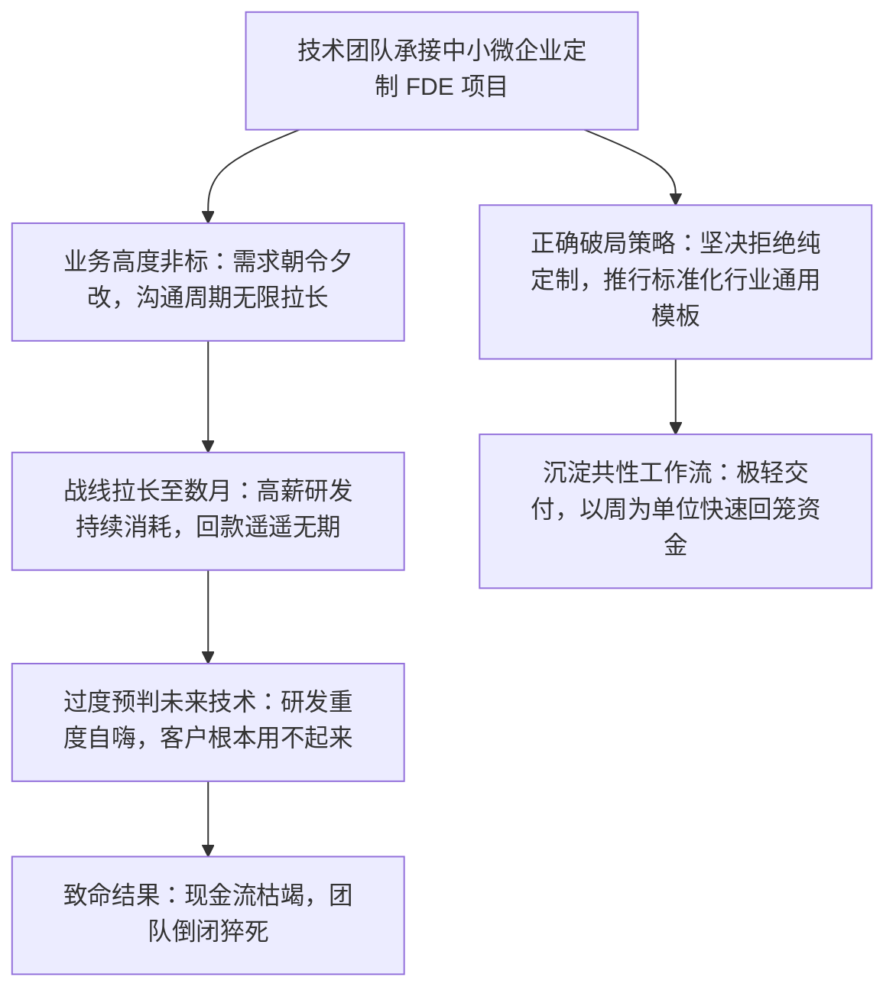
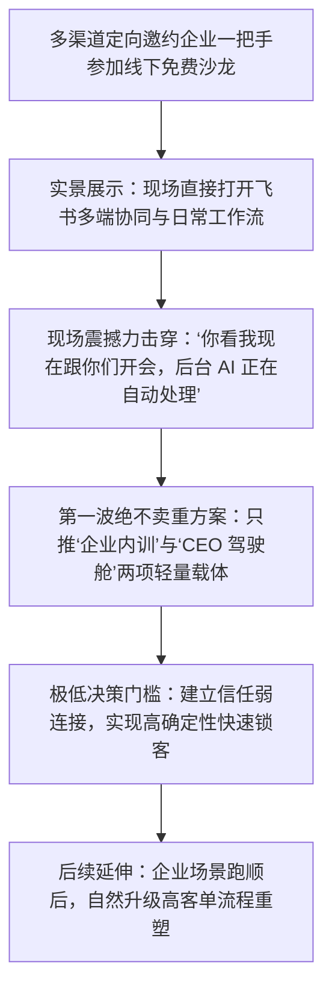

# 2026-11-17 · 刀文AI商业：定制FDE倒闭潮反思、线下沙龙实景锁客漏斗、具身智能历史成本铁律与商业生存哲学

本次晚间直播（有效解码音频 4.47 小时，共 1,868 段逐字发言，182 条时间锚定弹幕全量审阅）系统剖析了当前 AI 商业化与企服落地中最接地气、也最具争议的四个生死命题：针对企服圈大搞定制 FDE 引发的普遍倒闭潮，深刻击穿了“非标沟通成本过长拖垮团队、技术过度预判未来导致烧钱猝死”的商业死穴，给出了标准化行业通用模板的破局策略；详细公开了刀文团队每周常态化运转的“线下免费沙龙”流量漏斗，系统拆解了用实机操作展示现场震撼力建立信任、用“企业内训+CEO驾驶舱”两项轻量工具实现低摩擦快速锁客的操作细节；针对具身智能与机器人落地热潮，以工业历史发展规律击穿了脱离成本的算法空想，论证了“造价跌破老百姓和企业承受阈值才是唯一商业拐点”的硬成本铁律；并在与硬件创业者的激烈交锋中，深刻确立了“离开真实交易流水与正向现金流的技术情怀皆是空中楼阁”的商业生存哲学。

---

## 一、定制 FDE 的商业伪命题：沟通周期黑洞与过度预判未来引发倒闭潮

在当前 AI 企服圈，许多从互联网大厂或技术背景出身的创业团队，言必称学习硅谷 Palantir 的 FDE（现场部署工程师）模式，试图为中小微企业提供深度的定制化智能体系统。然而现实却是极其残酷的倒闭潮与烂尾潮。

### 1. 定制 FDE 倒闭潮的深层死穴
刀文直言不讳地指出了市面上大量 FDE 创业公司吃不起饭、甚至关门倒闭的底层原因：
- **并非单纯交付太重，而是沟通周期太长**：中小微企业的业务流程高度非标、数据底座薄弱、老板想法朝令夕改。从需求调研、原型确认到多轮评审，技术团队被卷入了极其漫长的沟通拉锯战中；
- **过度预判未来导致的现金流猝死**：技术团队往往沉迷于宏大的全流程架构，在没有跑通正向商业闭环的前提下，招聘大量高薪研发人员烧钱研发，提前“预判未来三年的技术形态”。然而现实中客户的预算有限且回款缓慢，战线一旦拉长到三到六个月，企业日常开销就会直接将初创团队拖垮断流。

### 2. 行业通用模板破局法
刀文给出了极具穿透力的商业解法：
- **做通用模板而非个案定制**：中小企业面临的日常办公提效、合同审核、社媒排版、线索归集等痛点具有极高的相似度。将共性痛点封装为高度成熟的“行业通用模板”，而非针对单家客户重写底层代码；
- **控制交付边界与时间线**：把软件交付压缩到极短周期内，坚决不陪客户在非标流程上无限内耗，才能在当前激烈的存量竞争中活下来。

---

## 二、线下沙龙的流量漏斗：从“实机协同震撼力演示”到轻量工具高确定性锁客

面对企业主对 AI 工具普遍存在的“既好奇又戒备、既想降本又怕被割韭菜”的复杂心理，传统打电话、发传单或概念宣讲式的销售动作早已全面失效。

### 1. 为什么坚决不做空洞的产品推销？
刀文强调，如果销售人员一上来就拿着 PPT 向老板推销 AI 软件，不仅极度疲惫，而且会瞬间将自己置于低价值“软件推销员”的被动地位：
- 市场上各类所谓 AI 工具与培训鱼龙混杂，企业老板被各类打着大模型旗号的机构骚扰得极其厌烦，心理防御机制极高；
- 单纯讲大模型的参数、Token 处理能力与算法突破，传统实体老板根本听不懂，也无法建立对业务提效的直观体感。

### 2. 刀文团队常态化线下沙龙运营方法论
刀文详细公开了其团队每周在线下跑通的获客转化闭环：

#### （1）用“实景开会协同”展现现场震撼力
沙龙现场不搞空洞的说教培训，最关键的动作是**实机打开给老板看**：
- 讲师在台上与观众交流的同时，直接投屏展示团队内部如何利用飞书多端与桌面级智能体（如腾讯 WorkBuddy）自动协同：多端会议纪要秒级生成、跨岗位任务自动下发、日常宣发物料一键排版；
- 当企业老板亲眼看到真实的业务如何在自己眼前被 AI 几秒钟跑通时，“现场震撼力”会瞬间击碎其所有的心理防线，彻底确信 AI 的生产力价值。

#### （2）双轻量载体锁客策略
在沙龙现场的转化环节，严格遵循低门槛漏斗：
- **坚决不卖重度数字化方案**：重度方案决策周期长、客单价高，现场推销只会引发客户戒备；
- **首选双轻量工具锁客**：
  1. **企业内训**：派驻讲师入企 2~3 天，手把手教会员工使用 WorkBuddy 等日常工具，解决小红书排版、营销朋友圈文案与日常对账，老板立刻能看到员工工时缩减；
  2. **CEO 驾驶舱**：为老板搭建直观的数字化监控看板，让管理层随时掌握各部门员工使用 AI 产出了多少有效物料与线索。通过这两项低决策摩擦的轻量载体建立弱连接，牢牢锁住客户。

---

## 三、具身智能与机器人落地的“历史成本铁律”：买得起才是唯一的商业拐点

直播中，有连麦嘉宾高谈阔论人形机器人、具身智能（Embodied AI）与大模型的前沿结合，认为这是 AI 下一步必须不惜代价押注的制高点。刀文对此给予了极其清醒的常识打假。

### 1. 科技落地的历史规律：成本重于技术
刀文回顾工业与消费电子的发展史指出，技术的先进性从来不是决定商业普及的核心因素：
- **电动机与流水线普及史**：引用百度在行业大会上的论述，当前的 AI 就如同当年刚发明了电动机，虽然技术具备革命性，但尚未形成标准化的工业流水线；
- **计算机与手机普及史**：早期的计算机需要占用整栋大楼或一个房间，普通企业和家庭根本用不起；只有当半导体工业将其体积大幅缩小、批量化流水线将造价打下来之后，个人电脑（PC）时代才真正爆发。

### 2. 跌破老百姓与企业的心理承受阈值
刀文直指具身智能商业化的命门在于**制造成本（BOM 成本）**：
- **价格决定购买力**：普通大众和中小微企业在评估是否采购一个智能硬件或服务机器人时，首要考核的是“买不买得起、算不算得过来账”；
- **两千元临界点定律**：如果一台具备基础能力的辅助机器人售价能够降到一两千元人民币，哪怕其底层算法并不完美、偶尔有瑕疵，大众和企业也会蜂拥采购，市场会瞬间被引爆；反之，若一台机器人售价高达数万乃至数十万元，即便参数再高阶、动作再灵敏，在实际场景中也只能沦为展厅观赏的玩具。

---

## 四、技术情怀与商业现实的尖锐交锋：离开交易额与正向现金流的“搏未来”皆是空中楼阁

在直播后半段连麦中，一位从事硬件与机器人研发的创业者情绪激动，坚称自己投入全部身家做机器人是“为了搏未来”，哪怕眼下不赚钱也要坚守技术情怀。刀文随即展开了极具穿透力的灵魂连环三问。

### 1. 现场交锋实录：刀文的“开门见山三连问”
面对创业者对前沿概念的滔滔不绝，刀文当场打断并直切经营实质：
> **“开过公司吗兄弟？正面回答我的问题！”**
> **“有没有过亿？没有。有没有过千万？正面回答我，累计卖了多少台？真实交易额是多少？”**
> **“你管理几个人在卖？你不要跟我谈很会卖，我们只看客观结果！”**

创业者支支吾吾，最终承认目前出货量极少、公司尚无稳定的销售团队，主要依靠融资和个人垫资苦苦支撑。

### 2. 商业操盘手的生存底线法则
刀文深刻指出，技术背景的创业者最容易犯的致命错误，就是用“搏未来”的宏大情怀掩盖当下经营能力的极度匮乏：
- **活在当下是创业的最高道德**：在残酷的商业世界中，一家企业的首要责任是养活员工、跑通正向现金流。在没有验证哪怕单点商业闭环（Unit Economics）的前提下，盲目扩大研发团队、大肆铺设重资产，本质上是在用投资人的钱或自己的身家进行胜率极低的赌博；
- **销售能力与客户买单是检验真理的唯一标准**：任何没有转化为客户实际对公打款的技术，在商业上都不具备真实价值。创业者必须从虚幻的“产品自嗨思维”彻底转变为“商业经营思维”，唯有在当下打下粮食、守住现金流底线，才有资格在未来继续坐在牌桌上。

---

## 结语：在狂热浪潮中做清醒的商业务实派

整场直播中，刀文始终展现出极其冷峻的商业现实主义：**当技术狂热者沉迷于定制 FDE 的复杂架构与具身智能的宏大叙事时，真正成熟的操盘手早已转向了极度务实的地面战役。坚决拒绝无休止的非标定制、用实景协同震撼力激活线下沙龙、用轻量化工具牢牢锁定企业客户、敬畏成本底线与现金流法则——唯有活在当下、持续打粮食，才能在喧嚣的 AI 商业大浪淘沙中立于不败之地。**
