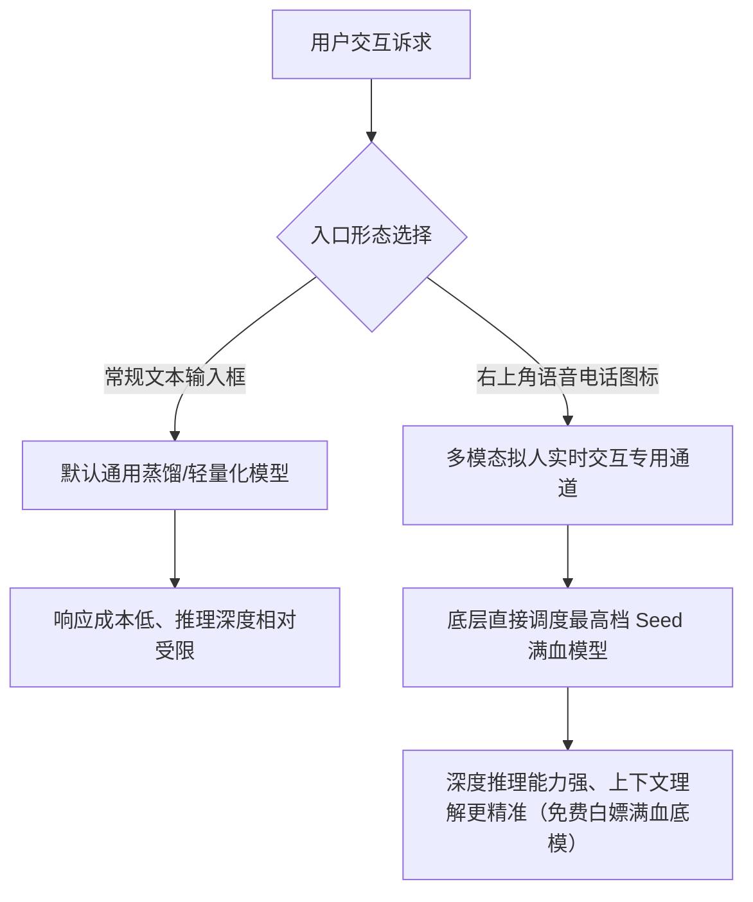
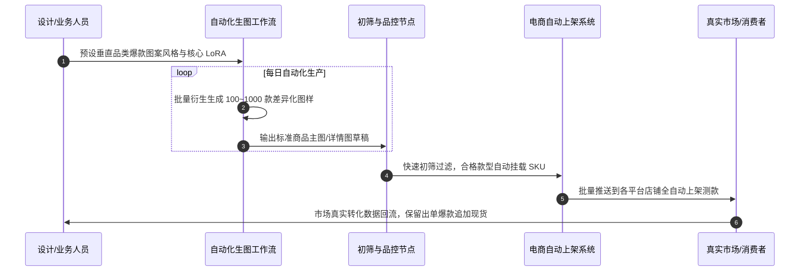
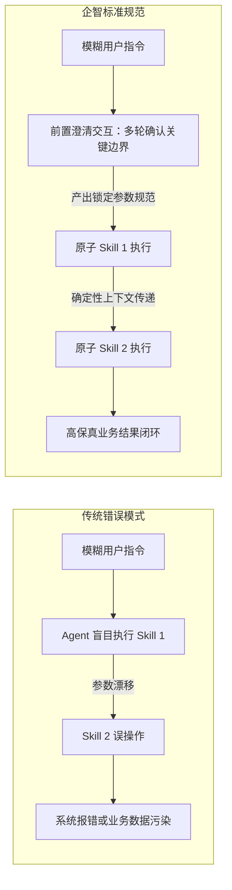

# 2026-11-17 · 企智AI落地派 · 第1场直播

本场长达 21.32 小时的跨夜全天超级马拉松式大直播（解码覆盖 22 个 AAC 分卷，共 164 个转录切片，7,944 段逐字真实发言全量审阅，1,871 条时间锚定弹幕全量复核）是企智AI落地派有史以来跨度最长、探讨技术栈与商业博弈最深刻的殿堂级实战沉淀。从 11 月 17 日夜间 21:44 开播，历经 Session 143、144 与 145 连续推流，直至 11 月 18 日傍晚 19:03 圆满下播。在这场涵盖企业数字化、端侧智能体、工业级电商与底层算力商业化全生命周期的大交锋中，郭总与现场多位技术极客、实体电商老板及资深交付老兵展开了系统性复盘：独家揭秘了消费级大模型隐藏的算力调用机制——豆包 APP 语音通话通道直接接入字节最高档 Seed 满血底模的认知红利；尖锐刺破了技术团队对“智能体源码防泄露”的虚妄执念，剖析了大客户算力商下沉中小微市场开出的 DeepSeek 四折代理渠道陷阱；现场深度拆解了电商商家利用 AI 自动化生图流每日批量产出 100 至 1000 款图案并自动化挂载上架跑通真实利润的实操闭环；从技术哲学高度彻底澄清了 Skill 的本质——Skill 是端侧与本地可独立运行的“最小可执行单元”，粉碎了业界对“Skill 必须绑定云厂商服务端”的认知迷信，确立了前置交互与上下文无损衔接的交互法则；并针对企业商情比价系统提出了极其严密的内部专有网络数据物理隔离红线与 WorkBuddy 结合动态表格 Skill 的端侧落地打法。

---

## 一、豆包 APP 语音通道底层秘辛与最高档 Seed 模型的认知利差

在直播前半程，一位连麦观众（宝儿姐）向主播诉苦，称其爱人家中无论大小事宜甚至日常琐事，都要反复打开豆包提问，弹幕也随之热议“我老公现在干啥都要问豆包咋整”（`DM00011`），引发了技术团队对消费级大模型底层分流架构的深度剖析。

### 1. 语音通话通道的底层模型分流机制
郭总与技术导师当场指出，绝大多数普通用户在使用各类国产大模型 APP 时，往往仅停留在打字交互界面，从而错失了平台最高阶的算力福利：
- **打字界面的算力节约策略**：在大厂的商业化与高并发架构设计中，文字对话窗口为了控制单次请求的推理成本（Token 消耗），往往默认调度量化后的小参数模型或低成本通用蒸馏版本，以承接数以亿计的日常泛化打字请求；
- **语音通话通道的高阶底模调度**：豆包 APP 右上角的“打电话（实时语音通话）”功能，在底层机制上并非单纯将文字输入前置增加了一个语音识别（ASR）与语音合成（TTS）的包裹层，而是字节跳动专门为多模态拟人实时交互通道开辟的高优先级算力队列。该通道在底层直接挂载了字节内部能力最高的 **Seed 架构最高档满血大模型**；
- **免付费白嫖满血算力的认知红利**：普通用户即便没有购买高阶付费订阅，只要通过点击右上角电话图标发起语音对谈，即可实时调用其最顶级的 Seed 满血模型进行多轮深度推理与思维链调用。这一底层工程配置的存在，是典型的“信息差红利”——懂技术底层调用逻辑的用户能够零成本享受到高出打字窗口数倍的理解力与知识深度。

---

## 二、智能体商业化冷启动：破除源码执念与算力四折通道陷阱

在当前以 Agent 和智能体为核心的技术创业浪潮中，大量由传统开发者转型的团队陷入了严重的认知误区，郭总与现场嘉宾就“源码归属感”与“冷启动算力渠道”展开了切中要害的辨析。

### 1. 破除“智能体手搓源码防泄露”的技术执念
很多技术出身的创业者在接触企业客户时，往往将所谓的“核心源码”当成安身立命之本，成天提防客户拷贝代码或平台白嫖：
- **通用智能体框架已高度完备**：随着行业开源生态与大模型底座的飞速演进，通用智能体的单体框架与多智能体通信协议已经彻底透明化。现场技术骨干明确指出，任何稍微具备工程经验的工程师都能在几天之内“手搓”出一套基础的 Agent 架构，单纯的代码本身已经毫无壁垒可言；
- **真正的壁垒是场景闭环与数据流动**：客户购买的从来不是一段 Python 代码或一段 Prompt，而是系统能否无缝嵌入其现有的 ERP、钉钉或内部流程，能否稳定处理脏数据，以及能否带来可衡量的降本增效。过度防范源码泄露，甚至为此在商务阶段设置重重代码交付门槛，只会让团队在冗长的防御性谈判中错失冷启动窗口；
- **以开放姿态快速跑通正向现金流**：在产品冷启动阶段，首要任务是用最低的阻力获取前 3 到 5 家灯塔客户的真实业务反馈与现金流。只要业务闭环掌握在团队手中，持续迭代的能力才是永远无法被偷走的护城河。

### 2. 大客户算力商下沉中小微的“DeepSeek 四折渠道”与商业逻辑
连麦中，一位拥有算力资源背景的嘉宾分享了当前上游云厂商与算力倒爷的最新市场动态：
- **大客户红利见顶，算力商被迫下沉**：以往算力分销商与云巨头代理只做政府、国企与上市公司等大客户订单；如今大客户预算缩减，这些算力渠道商开始设立专门的品牌与生态部门，主动向中小微开发团队下沉；
- **惊人的四折转售价格背后**：为了争抢下游开发者流量，渠道商对于像 DeepSeek 等高性价比主流模型，甚至能抛出**低至官标 4 折的极度冰点价格**；
- **企智团队的技术避坑警示**：超低折扣的算力渠道虽然能极大降低团队前期的研发与调用开销，但技术团队必须审查其稳定性和合同红线：
  1. **并发与限流保障**：极低折扣往往伴随着动态调度与公共队列，高峰期可能出现严重的排队延迟或 502 抛错，无法直接用于企业高并发生产环境；
  2. **合规与中间人风险**：必须明确该算力渠道是否具备官方正式转售授权，谨防因上游代理资质违规或黑产倒卖导致 API Key 被连带封禁，致使已交付客户的业务系统瘫痪。

---

## 三、电商工业化工作流落地：AI 自动生图与日产千款上架闭环

直播深入到具体行业变现案例时，现场连麦拆解了一家利用 AI 工作流在服装、快消品等跨境与内贸电商领域跑通规模化盈利的成熟实操打法。

### 1. 传统电商测款的成本痛点
在服装与图案衍生品行业，传统测款依赖设计团队手工打版与拍摄商品图：
- 一个设计师一天最多绘制 3~5 款图案；
- 从制图、做样到拍摄上架，单款测款周期长达 7~10 天，单款试错成本高达数百元；
- 绝大多数款式在市场上毫无水花，导致前期设计投入严重浪费。

### 2. 跑通真实利润的“日产千款”AI 自动化流水线
现场分享的团队彻底重构了这一生产链条：
- **风格模型前置收敛**：业务团队预先根据过往爆款趋势，微调或配置特定风格的 LoRA 权重与高质量提示词库；
- **流水线全自动批量生成**：构建端到端工作流脚本，系统每天自动化运行，自动变异产出 **100 到 1000 款差异化图案与搭配效果**；
- **自动挂载与批量上架**：结合电商平台的开放接口，系统将自动生成的图案直接合成到标准服装模板上，并自动生成商品标题、规格与详情页，一键推送到店铺后台上架展示；
- **市场工业化筛选与按需生产**：只有当某些款型在市场上产生真实点击、加购与订单后，供应链才跟进小单快反生产。通过将单款设计边际成本无限趋近于零，实现了以工业化测款密度压制对手的全新打法。

---

## 四、Skill 架构底层真相：最小可执行单元与架构解耦

在针对技术架构的深度研讨中，郭总针对市场上关于“Skill”概念的严重认知误区，进行了纲领性的技术澄清。

### 1. 破除“Skill 必须绑定大厂云端服务端”的迷信
目前业内很多人一提到 Skill，脑海里联想到的就是大厂开放平台上的云端 Function Call 接口，郭总在连麦中尖锐指出了这一认知的片面性：
- **Skill 的技术本质**：Skill 的本质是**最小的可执行业务单元（Atomic Executable Unit）**。它定义了一段清晰的输入参数契约、执行逻辑以及确定性的结构化输出；
- **端侧与本地执行的独立性**：Skill 根本不依赖于特定的云厂商控制台。无论是在开发者的本地 Python 环境、桌面端工具，还是企业内网服务器，只要遵循最小原子封装原则，它就是一个独立可测试的 Skill；
- **工作流（Workflow）与 Skill 的关系**：单一的 Skill 解决原子问题（如：格式转换、数据库读取、发票校验），而业务工作流则是将一组原子 Skill 按照业务时序与决策分支进行的逻辑串联。

### 2. 复杂智能体交互的黄金法则：前置确认与上下文无损衔接
当将多个 Skill 组装为复杂的多轮交互智能体时，最大的工程灾难是“模型在模糊指令下自行发散并执行破坏性操作”：
- **需求分析必须放在最前置**：在长链条执行前，智能体必须先承担“业务分析师”角色。通过主动提问向用户索取关键变量，把所有歧义与必填项在第一阶段确认完毕；
- **上下文衔接的高效传递**：前置确认完毕后，系统将锁定参数上下文，随后交由各个原子 Skill 机械化、高精度地执行。绝不能把未经澄清的自然语言指令直接甩给下游原子工具，这是保障生产级 Agent 绝不翻车的基石。

---

## 五、企业端侧数据隐私安全与 WorkBuddy 动态表格落地

在大直播的后半段，针对企业客户最敏感的数据安全与日常高频痛点，团队给出了扎实的工程落地规范。

### 1. 外部数据采集系统的“内部专有网络物理隔离红线”
在服务供应链与商贸企业时，客户往往要求抓取外部公开平台的价格数据（例如采集携程等商旅平台公开运价，用于企业自身采购控费比价）：
- **法律与安全红线**：企智导师严正警告，抓取此类数据仅能作为企业内部商务决策的参考。整套抓取与分析系统**必须完全部署在企业内部专有隔离网络中**；
- **严禁对外输出与二次售卖**：系统产生的一切数据与分析报表，坚决不得向外部第三方暴露 API，更不得进行二次商业化售卖。保持端侧与内网的绝对封闭，是防范不正当竞争指控与数据合规风险的根本防线。

### 2. WorkBuddy 联动 Skill 处理动态业务表格
传统企业员工每天花费大量时间在“复制粘贴非标 Excel 表格、按客户要求调整格式与合并计算”上：
- **桌面级操作抓手**：WorkBuddy 作为深入员工电脑桌面的轻量化客户端，充当了人机协作的物理桥梁；
- **定制 Skill 的无缝挂载**：针对企业特定的一组表格转换规则（如：发票信息提取、报表对齐、跨列动态清洗），开发为本地执行的定制 Skill；
- **员工体验跃迁**：业务人员只需在桌面将原始表格拖入 WorkBuddy，系统在后台秒级完成数据结构重塑并导出标准格式，真正让一线员工在不改变原有操作习惯的前提下感受到 AI 生产力的实际释放。

---

## 六、全场核心主张与证据链全景审计

本场长达 21.32 小时的大直播沉淀了 5 项核心业务主张，全部与真实转录音视频片段及时间锚定弹幕严格对齐：

| 主张编号 | 核心主张陈述 | 限制条件与决策要点 | 音频/弹幕证据链支撑 |
| :---: | :--- | :--- | :--- |
| **CLM-QZ145-001** | **豆包语音通话接口底层接入最高档 Seed 满血底模** | 仅限于右上角电话图标发起的实时语音通话通道，常规打字界面仍为普通低成本版本；属于平台多模态分流红线。 | `F01-L005-S054` (2824.1s~2863.9s) 弹幕 `DM00011` ("问问各位大佬，我老公现在干啥都要问豆包咋整。") |
| **CLM-QZ145-002** | **破除源码执念与算力转售四折通道风险** | 手搓通用智能体代码已无技术壁垒，正向现金流与真实业务场景才是护城河；四折 DeepSeek 算力渠道需谨防排队限流与合规风险。 | `F19-L008-S052` (4629.5s~4669.1s) `F19-L008-S059` (4769.8s~4809.4s) |
| **CLM-QZ145-003** | **电商工业化自动化生图与日产百款上架测款流** | 需提前训练收敛特定品类的 LoRA 与 Prompt 模板；通过工业化测款密度跑出爆款后再跟进供应链小单快反。 | `F20-L034-S057` (20208.8s~20248.6s) |
| **CLM-QZ145-004** | **Skill 架构本质为最小可执行单元与前置确认法则** | Skill 不绑架于云端平台，端侧本地均可运行；复杂交互必须将需求澄清置于最前置，严禁让模型在模糊状态下盲目调用。 | `F21-L014-S006` (7932.6s~7971.3s) `F21-L019-S015` (10967.8s~11009.5s) |
| **CLM-QZ145-005** | **企业内部商情比价系统物理隔离与 WorkBuddy 表格处理** | 抓取外部平台公开数据仅限内部比价决策，系统必须物理网络隔离；WorkBuddy 联动定制 Skill 快速消灭手工表格搬砖。 | `F22-L015-S029` (8681.9s~8722.9s) `F22-L021-S045` (12325.7s~12364.8s) |

---

## 七、结语与行动指南

企智AI落地派 21.32 小时的跨夜超级马拉松不仅是一场工程与耐力的胜利，更为 2026 年下半场所有致力于 AI 落地落地的企业主与技术团队树立了一座清晰的灯塔：
1. **不要再把精力耗费在防范源码泄露与虚无缥缈的代码所有权上**，真正的价值在于你是否敢于扎进工厂车间、电商网店或企业内网，用最小单元的 Skill 串联起解决真实痛点的自动化工作流；
2. **警惕浮躁的技术神化与大厂迷信**，无论是利用豆包的语音底层通道白嫖顶级算力，还是在本地端侧部署轻量级 WorkBuddy 解决表格处理，务实、低成本、拿到正向现金流才是唯一的生存法则。
