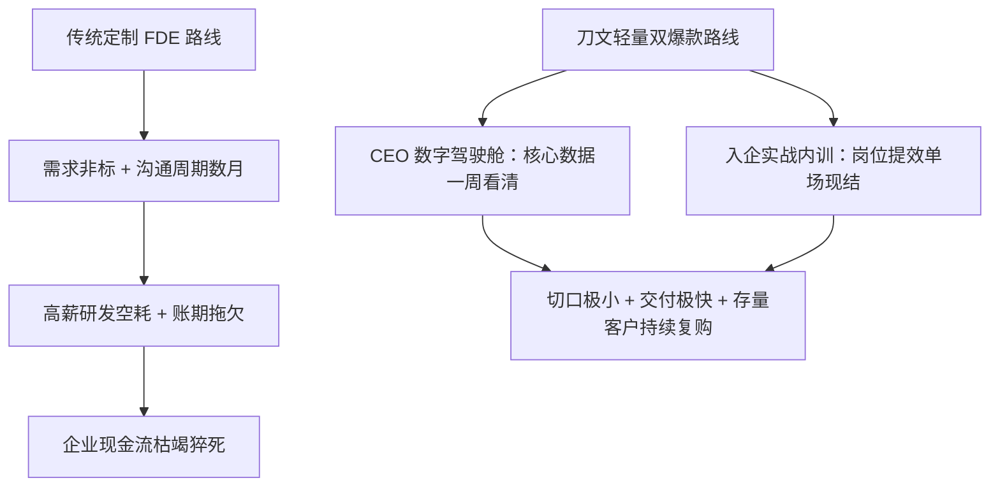

# 2026-11-18 · 刀文AI商业：轻量双爆款避坑实录、跨界商务降维拓客、一人公司自嗨反思与200+ Skill效率资产化

本次直播（跨夜超长大场 Session 146 与 147 联合熔接，有效解码音频 10.66 小时，切解 65 个切片并经 100% 满血 ASR 转录与语义校订，沉淀 3,628 段逐字发言，207 条时间锚定弹幕全量审阅）系统复盘了当前 AI 商业化落地中最真实、最直接的实战得失：针对业内盲目效仿硅谷 FDE 导致交付过重、沟通周期失控的困境，详尽公开了团队跑通正向现金流的两大轻量主力产品——“CEO数字驾驶舱”与“入企实战内训”，阐明了存量客户小切口极速交付的商业逻辑；直击 AI 企服“技术过剩而商务贫血”的结构性矛盾，首次披露吸纳房地产与保险领域狼性销售骨干、以标准化 AI 工具赋能降维破冰拓客的团队组织打法；深度反思了一人公司（OPC）与全自主智能体研发中“过度追求自动化与技术自我感动”的致命弯路，确立了“AI 是梳理成熟思路的好助手、绝非业务决策替代者”的认知底线；并全景拆解了个人沉淀 200+ 模块化 Skill 资产、实现分钟级商业方案与行业调研输出的超级个体敏捷工作流。

---

## 一、破除 FDE 重交付迷思：跑通“CEO驾驶舱”与“入企内训”轻量双爆款

在 2026 年的 AI 企服市场中，大量技术背景团队言必称 FDE（现场部署工程师），试图通过深度定制企业级复杂业务流来收取高客单价。然而现实中，绝大多数初创团队因沟通周期过长、非标需求发散而陷入现金流断裂。刀文团队结合自身实操，彻底推倒了重定制交付路线，跑通了两大轻量、高周转、高续费的标准化爆款。

### 1. 为什么深度定制 FDE 往往沦为泥潭
- **沟通拉锯消耗企业生命线**：中小企业老板的痛点高度非标，且缺乏数字化基础与专业产品经理对接。定制系统从需求调研、方案对齐到系统打通，往往耗时数月，高昂的人力成本让初创团队在拿到尾款前便已失血过多；
- **客户感知弱与使用门槛高**：复杂的全流程自动化系统往往因为企业员工学习成本过高而被闲置，最终导致交付烂尾、客诉不断。

### 2. 轻量双爆款的产品定位与商业逻辑
刀文团队坚决砍掉沉重的定制研发，聚焦于两个高确定性、低交付周期的标准化产品：
1. **CEO 数字驾驶舱**：
   - **痛点切口**：企业一把手最关心的不是底层代码如何跑通，而是公司的经营流水、存货周转、获客成本与利润毛利率。
   - **极简交付**：打通关键数据看板，以轻量看板形式直呈核心经营指标，不重构原有底层 ERP，一周内极速上线，企业主“一眼看懂、立刻有感”。
2. **入企实战培训与导师陪跑**：
   - **赋能业务一线**：针对企业采购、财务、销售、电商文案等具体岗位，进场辅导员工使用标准化 AI 工具，提升单兵作业效率；
   - **客单价与现金流**：单场培训数万元，现金直收，无账期风险，且在培训过程中挖掘企业主更深度的二次采购需求。

---

## 二、拓客降维打击：跨界引入狼性销售赋能标准化 AI 方案

很多 AI 创业团队陷入误区：以为招几个顶尖全栈工程师就能做企服。然而企服的真实战场在“人情破冰、决策链挖掘与商务博弈”。刀文团队通过重构组织基因，打通了一条技术赋能传统销售的拓客坦途。

### 1. 为什么纯程序员做企服寸步难行
- **技术思维与商业思维错位**：程序员见客户喜欢讲模型架构、上下文窗口、向量检索与 Prompt 技巧，而传统老板听得云里雾里，只在乎“能帮我省多少人、多赚多少钱、下个月能不能见效”；
- **商务敏锐度与抗挫力匮乏**：缺乏在酒桌、茶室与商会中快速抓取老板真实意图、捕捉人情痛点并临场促单的狼性本能。

### 2. 吸纳传统地产与保险销售骨干
刀文在团队组建中大胆跨界：
- **销售底色迁移**：吸纳在房地产黄金期或高端保险领域千锤百炼过的资深销售人员。这批人具备极强的商务洞察力、人脉开拓力与心理博弈素质；
- **标准化 AI 武器赋能**：技术团队不直接上一线推销，而是为这些销售骨干配备标准化、所见即所得的 AI 实机操作方案与行业 PPT 演示模板；
- **降维拓客威力**：传统销售带着前沿且具象的 AI 提效方案去拜访企业主，既具备传统商务的信任穿透力，又具备 AI 高科技赋能的代际压制感，成单转化率呈指数级提升。

---

## 三、一人公司（OPC）反思：警惕技术自嗨，确立“AI 辅助梳理”认知红线

直播中主播结合自身经历，深刻剖析了研发自主智能体（Autonomous Agent）过程中的致命误区，并与直播间观众的弹幕展开了高价值的深度思想碰撞。

### 1. 技术自嗨与商业脱节的血泪教训
- **过度追求全自动化与全自主**：早期尝试构建一套能完全代替员工乃至独立运转的“一人公司全自动闭环”，在复杂的智能体状态机与调度编排上投入巨资；
- **致命缺点暴露**：系统越复杂，容错率越低，实际落到具体业务场景中，稍微遇到非标输入就会崩溃死锁。更重要的是，市场上根本没有客户愿意为这种概念性的“全自动黑盒”买单。

### 2. 核心认知修正：AI 是梳理思路的好助手，不是业务战略定义者
在回应直播间弹幕互动时，刀文高度认同了观众的总结（弹幕 `DM00189`）：
- **工具定位明确**：AI 的强项在于根据既定框架极速归纳海量素材、理顺逻辑框架、润色语言表达与自动化繁琐脚本；
- **人是商业战略的锚点**：产品定价、客群筛选、利益分配、风险兜底这些真正的商业判断，永远必须由真人基于真实的商业体感来拍板。妄图让 AI 自主代替商业决策，是极其危险的技术幼稚病。

---

## 四、超级个体生产力飞轮：200+ 模块化 Skill 资产与结构化知识沉淀

面对激烈的交付节奏与多元的市场需求，刀文一人之所以能高效统领多项业务输出，核心在于将个人核心经验与流程彻底工程化、组件化，打造了庞大的个人 Skill 资产库。

### 1. 从“手搓文本”到“调用 Skill 技能”
- **高频场景标准化封装**：针对商业研报拆解、竞品定位分析、企业培训教案生成、行业痛点挖掘、代码原型生成等场景，提炼出清晰的前提条件、输入输出规范与步骤校验逻辑，封装成 200 余个独立 Skill；
- **多技能链式编排**：当接到一个全新行业的企业内训或驾驶舱咨询时，无需从零起草方案，只需按照客户的行业属性与规模，组合调用 3-5 个专属 Skill，几分钟内即可输出一份专业度极高、直击行业痛点的数十页商业提案。

### 2. 结构化知识库与抗风险能力
- **个人资产长期沉淀**：把日常遇到的优秀商业案例、失败教训、客户常问问题全部转录为结构化 Markdown 文档，形成超过 10GB 的专属业务知识底座；
- **极致的单兵吞吐量**：当别人还在为一份策划案加班三天时，超级个体依托 200+ Skill 与结构化知识底座，已经在喝茶的间隙完成了三份不同行业的深度提案。

---

## 五、击碎“碰一碰”割韭菜套路：企服必须扎根真实场景与客户续费

在连麦与互动环节，刀文深入揭露了当前企服与引流软件市场上的各种割韭菜把戏（例如所谓的无差别“碰一碰引流”或纯套壳转售）：

| 维度 | 套壳/碰一碰等割韭菜模式 | 刀文商业化落地路线 |
| :--- | :--- | :--- |
| **客群定位** | 无差别扫街割小商家，不管适用与否 | 聚焦存量客户与高痛点行业定向筛选 |
| **产品本质** | 兜售一个虚无缥缈的故事，软件买完即弃 | 轻量 CEO 驾驶舱与员工岗位实操提效 |
| **服务深度** | 零辅导、零落地，客户用不起来便沦为沉没成本 | 导师进场手把手陪跑实战，保证真正用起来 |
| **盈利闭环** | 一锤子买卖，赚信息差与加盟费 | 极轻切口树立信任标杆，赚取持续服务与工具续费 |

刀文强调，企服软件如果脱离了对真实市场的理解、脱离了客户买回去到底能不能用好的基本事实，无论概念讲得多么天花乱坠，最终都只会砸掉自身招牌。唯有尊重常识、克制贪婪、深耕轻交付与真实业务增益，才能在 AI 商业化浪潮中立于不败之地。
