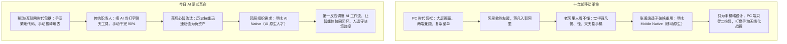
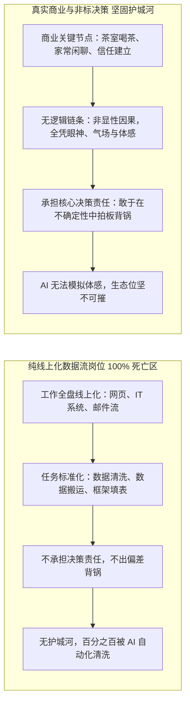
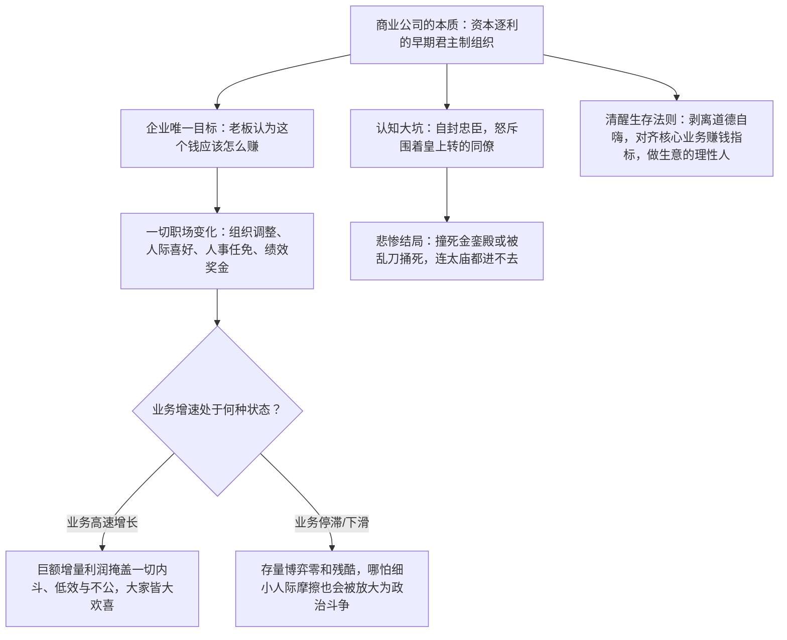

# 2026-11-18 · 产品老曾（全夜全景）：十年前蒋凡Mobile Native与今日AI Native、商业茶室无体感论断、所有职场问题本质是业务问题与中层夹生饭破局

本场直播总长 3.44 小时（全息合并当晚相隔 16 分钟中场休息的 Session 148 与 Session 150，共 970 段逐字有效发言，18 条时间锚定弹幕全量审阅），是产品老曾从历史商业变革、技术原生心智、底层权力结构到具体管理实战的一次极其透彻的高密度思想输出。针对观众在当前“魔幻且充满不确定性”的职场环境中面临的被替代焦虑、岗位整合迷茫与管理困局，老曾拉开未来十年的长周期视野，展开了极其硬核的规律推演：
系统复盘了十年前阿里张勇逍遥子破格重用蒋凡开启无线化战役的深层组织逻辑，指明了时代更迭时历史经验皆为包袱、必须寻找“Native（原生）”人才的历史铁律，并由此确立了今日职场人必须具备的“AI Native 脑回路”与死磕现场的工程动手能力；提出了震动全场的“商业茶室没有体感”核心论断，论证了为什么大量关键商业交易只能在线下茶室聊家常中达成，并划清了“纯线上化流程化岗位必被淘汰，唯有非标人际关系与决策背锅责任不可替代”的职场生死线；针对 Java 后端开发与数据开发是否会被工具合并（Judy 之问），指明了从单一功能开发跃迁至全域业务数据工程的破局抓手；用辛辣的“封建君主制皇朝隐喻”戳破了职场自命清高的“忠臣自嗨陷阱”，确立了“职场本质是做生意，所有职场问题归根结底都是老板怎么赚钱的业务问题，业务高速增长可掩盖一切矛盾”的底层共识；深入拆解了高管层级技术 Leader 与产品 Leader 互相覆盖的空间博弈，并给出了中层管理者化解“上压、下闹、横向争利”夹生饭困境的空降首胜法与刺头下属治理打法；最后剖析了国企央企自上而下的转型传导规律，严正重申了职场跨界“转岗不转行，转行不转岗”的带资产迁移铁律。

---

## 一、十年前移动原生（Mobile Native）到今日 AI 原生（AI Native）：人才重构与破格提拔的组织逻辑

面对弹幕中观众对“职场环境魔幻、局势何时稳定”（`DM00013`）的焦虑，以及对“十年”（`DM00004`）职业周期的迷茫，老曾将视角拉回十年前的移动互联网转型期，借由阿里与蒋凡的经典历史大案，揭示了技术范式更替时期企业选人、用人与提拔的最底层逻辑。

### 1. 张勇逍遥子破格重用蒋凡的历史复盘
当年阿里收购友盟，蒋凡作为被收购团队的核心成员加入阿里，但在当时的阿里传统管理层与老员工眼里，很多人完全理解不了为什么这位年轻人会受到 CEO 张勇（逍遥子）如此不可思议的器重：
- **老员工的困惑与认知偏差**：老阿里人私下议论，觉得蒋凡这个人“性格比较愣、很不合群、甚至显得很奇怪，天天坐在工位上抱着个手机低头划拉”；
- **最高层的战略破局考量**：老曾指出，当时张勇之所以将阿里最为关键的手机淘宝无线化重任全权交托给蒋凡，核心原因在于阿里正面临从 PC 时代跨向移动时代的生死关头。在 PC 时代成长起来的优秀产品经理与技术架构师，脑子里全都是 PC 时代的成功经验——大屏幕信息流排版、双端功能映射、让用户在网页端下载安装包等。对于移动转型而言，**这些辉煌的历史经验全部变成了严重的转型负资产**；
- **Mobile Native（移动原生人才）的定义**：蒋凡是真正的移动原生代。他的大脑里从来没有 PC 端的概念，如果让他做一个产品，他只会从 0 到 1 纯粹为移动端打造。PC 页面对他来说毫无价值，最多放一张宣传官网和一个下载 APP 的二维码。正是凭借这种纯粹的移动原生思维，他彻底摆脱了 PC 时代的思维束缚，帮助阿里拿下了移动电商最关键的一役。

### 2. 今日历史重演：必须进化为 AI Native（AI 原生代）
老曾将这一历史规律直接映射到当下的 AI 大变革中：
- **未来十年的职场分水岭**：未来十年，企业真正抢夺并破格提拔的人才，必须是 **AI Native（AI 原生人才）**。所谓 AI 原生，绝不是“我自己吭哧吭哧写完代码或做完方案，最后打开对话框让 AI 帮我润色一下错别字”；
- **AI 原生的真实思维链路**：活在未来的 AI 原生人才，脑子里完全没有手动干活的概念。面对任何复杂的业务任务，其第一反应一定是：
  1. “这件事情 AI 应该怎么做？”
  2. “我应该调度哪几个不同专长的 AI 智能体协同执行？”
  3. “我如何构建一个自动化流水线，把多轮分析和初稿生成串联起来，让它们自主交付，不要来反复打扰我确认？”
- **海外大厂 99% Native 的实战状态**：老曾透露，目前很多找他做高阶职场咨询的硅谷一线工程师（来自 Google、Meta、微软、亚马逊），其“AI Native”程度已经达到 90%~99%。他们真实的工作状态是：人坐在工位上喝茶、关注核心进度与业务指标，底下的代码编写、测试用例、日志排查全部交给多个智能体自动化闭环；
- **核心双核能力组合**：除了具备把一切任务交给 AI 的原生认知架构外，AI 原生人才还必须具备**极强的现场动手能力与下场死磕推进的工程意愿**。在没有现成任务派发的前提下，能够遇山开路、遇水架桥，运用 AI 武器将一个模糊的目标彻底推进落地。

---

## 二、“商业茶室没有体感”核心论断：线上化数据流岗位被全盘清洗与不可替代的非标决策护城河

针对大量技术与职能人员担心“自己辛辛苦苦积累的专业经验被 AI 彻底蒸馏取代”的恐慌，老曾提出了震动全场的“商业茶室没有体感”论断，深刻划分了机器与人的不可逾越之界。

### 1. 真实商业世界中的“茶室喝茶无逻辑链”
老曾指出了纯技术思维在理解商业运作时的最大盲区：
- **商业交易不是线上比价逻辑**：很多工程师认为商业合作就像电商下单一样，是由一连串严密的线上因果逻辑链构成的。但现实生活中，大量金额高达数千万甚至上亿元的商业大单，最后的成交往往发生在一个幽静的茶室里，双方老板喝了一下午茶，聊的全是孩子上学、老家风物、个人爱好等家庭琐事，最后合同顺理成章地签了下来；
- **AI 无法感知的“商业体感”**：这种成交是没有线上化逻辑链条的，没有“因为你报价便宜了 5%，所以对方就签字”的显性公式。它的本质是**人与人之间通过眼神、微表情、语气顿挫、性格相投建立起的人际信任与势能共鸣**。AI 缺乏这种物理世界与心理世界的“体感”，它根本无法判断“这杯茶我到底该喝还是不该喝，对方随口说的一句话到底是试探还是承诺”。由于缺乏逻辑输入，AI 永远无法在这类关键商业拐点上代替人类做决策。

### 2. 职场岗位的生死线判别标准
老曾据此为所有职场人划定了两极分化的生死红线：
- **必死无疑的危险岗位**：如果你的工作内容是完全线上化的、数据流化的、邮件流化的，每天的任务就是在公司内部 IT 系统里搬运数据、在固定的分析框架里填表格，且自己从不承担最终决策责任——这种岗位没有任何护城河，百分之百会被 AI 彻底吞噬；
- **坚不可摧的安全岗位**：
  1. **深耕非标人脉与线下经验**：岗位依赖大量的线下沟通、政企博弈、客户非标诉求挖掘与信任维系；
  2. **承担最终决策与“背锅责任”**：做决策本身有两种，一种是拥有远超 AI 的全域深刻理解；另一种是**敢于为决策结果承担责任并负责背锅**。因为 AI 是算法，算法绝不会进监狱，也不会承担公司亏损的行政与法律责任。只要公司需要人类来承担决策风险，具有决策拍板权的人位就永远存在。

### 3. Judy 之问：Java 后端开发与数据开发是否会被工具合并？
连麦中一位名为 Judy 的后端工程师发问：“目前技术栈发展飞快，未来 Java 后端开发与数据开发岗位会不会被合并？”老曾结合上述逻辑给出了极其精准的定性：
- **低维初级岗位必死**：如果你所谓的数据开发只是做简单的数据抓取、清洗和打标签，如果后端的开发也只是照着接口文档写重复的 CRUD，那么在自动化工具（如 WorkBuddy 及各类代码智能体）的渗透下，这种机械岗位必然会被大幅合并压缩；
- **高维跃迁的破局点**：合并本身不是坏事，关键在于你能否把数据能力与业务后端流程深度捆绑。未来的开发者不能只做狭隘的单一功能模块，而要理解整个业务流是如何产生数据的、数据如何反哺业务决策。让自己从一个单纯的“调库程序员”进阶为“全域业务数据架构师”，才能在岗位合并的大潮中反向主导团队。

---

## 三、“封建君主制皇朝隐喻”：职场本质是做生意，所有职场问题归根结底都是业务问题

在直播中段，针对职场人常有的“怀才不遇、看不惯同事溜须拍马、领导偏心奸臣”等道德内耗，老曾用辛辣至极的“封建君主制皇朝隐喻”进行了彻底的认知脱水。

### 1. 任何商业公司在内部管理上都是君主制
老曾直言不讳地指出，不要被现代企业光鲜亮丽的科技名词和所谓“扁平化管理”所蒙蔽：
- **君主制的权力结构**：无论是号称 AI 最先进的 OpenAI，还是国内顶级的阿里、腾讯、字节跳动，只要是一家市场化公司，其内部权力架构本质上都属于早期的“君主制”。老板就是君主，董事会就是太上皇；
- **“忠臣陷阱”与自我感动**：很多打工人自命清高：“我要当刚正不阿的忠臣，我天天埋头苦干，我看不惯那些奸臣天天围着皇上转、溜须拍马。”老曾当头棒喝：在君主制的权力模型里，抱持这种道德自嗨心态的人，最终能得到的最好结局就是在金銮殿上撞死，或者死在沙场上被乱刀捅死，最后公司最多在江边给你立个碑，甚至连太庙都进不去；
- **同事背叛的人性真相**：为什么原本关系极好的同事在利益关头会毫不犹豫地捅你一刀把你卖掉？因为在公司生存的存量博弈中，面对“你死还是我死”的零和选择，任何人都会本能地选择自己活下来。职场是做生意的地方，做生意遵循的是资本逐利与自我保全，绝非江湖道义。

### 2. “所有职场问题都是业务问题”的铁律
老曾给出了看透职场一切纷争的总钥匙：
- **生意的唯一目标就是赚钱**：不论行业、不论岗位、不论老板性格，商业公司的唯一目的就是完成资本的增值与扩张。赚短期的钱、赚长期的钱、赚小众的钱、赚大众的钱；
- **业务好，一切皆好**：你在公司里遇到的所有困惑——为什么组织突然架构调整？为什么老板喜欢那个能力不如我的人？为什么部门之间互相推诿？老曾断言：**所有问题归根结底都是业务问题，是老板认为这个钱应该怎么赚的问题**；
- **增长掩盖一切矛盾**：当业务处于爆发式增长期时，丰厚的利润与不断扩大的增量空间会掩盖团队内部所有的扯淡、低效、管理混乱与个人恩怨；而一旦业务增长停滞，存量利益见底，所有的细微矛盾都会立刻演变成激烈的生存厮杀。因此，不要在人际关系和情绪内耗中打转，要想在公司立于不败之地，唯一的解法是死死锚定核心业务增长点，帮老板解决赚钱问题。

---

## 四、技术 Leader 与产品 Leader 空间博弈与中层管理“夹生饭”突围实操

针对走上管理岗位的骨干人员，老曾深入拆解了高管层级的权力重合与中层管理者的“夹生饭”困境。

### 1. 高管层级没有纯粹的技术与产品之分
现场有观众提问：“在未来的科技公司里，到底是技术 Leader 发展空间大，还是产品 Leader 空间更大？”
- **一线工人的狭隘视角**：老曾指出，纠结“技术大还是产品大”是一线执行层的思维方式。到了总监、VP 乃至合伙人级别，大家关心的核心事务完全一致——向上管理、业务闭环、团队统筹、战略汇报与商业变现；
- **权力覆盖的本质是老板信谁**：
  - 如果技术老大懂业务、善汇报、故事讲得圆，拿到了老板的最高信任，技术老大就会主导整家公司，产品部门只能给他打下手；
  - 反之，如果产品负责人商业嗅觉敏锐，深得老板认可，产品部门就会主导研发，技术只能做交付配合；
  - 甚至在极端资本博弈期（如黄仁勋遭遇外部董事会风波时），接替 CEO 职位的既不是技术也不是产品，而是 CFO（首席财务官）。因为董事会只看财报数据与资本关系，谁能在这个阶段解决出资人的核心诉求，谁的空间就最大。

### 2. 中层管理者的“夹生饭”困局与实战破局
中层管理是整个职场体系中最难受、最容易被内耗的层级：
- **夹生饭状态**：上有高管的苛刻业绩指标与无限推责，下有一线员工带不动、老油条推诿，横向还有兄弟部门虎视眈眈抢资源、甩黑锅；
- **空降管理者的 Landing 五步法**：空降到新团队的中层切忌一上来就烧“三把火”搞流程变革，这只会激起旧势力的集体抱团反弹。正确的做法是：快速摸清真实的利益攸关方，以极小的代价找准一个边缘突破口，**快速交付一个能够让老板看得见的业务“首胜”**，借此立威后再稳步推进团队梳理；
- **管老同事与刺头下属的心智转换**：被就地提拔管理昔日平级老同事时，新主管最容易犯的错误是“试图在专业技术上处处压制下属以显威风”。老曾告诫：
  - 彻底放弃专业比拼的狭隘心态；
  - 主管的核心价值在于纵向找老板要资源、定考核，横向帮团队挡子弹；
  - 大胆将业务攻坚的主舞台让给那些有能力的刺头骨干，让他们充当冲锋陷阵的先锋。**下属取得的一切辉煌战果，在公司组织账本上最终全部归结为主管的管理政绩**。

---

## 五、国企央企传导链与职场跨界“转岗不转行”资产迁移铁律

在直播后半程，针对国企、传统企业人员在面对数字化与 AI 浪潮时的职业焦虑，老曾给出了极具操作性的护城河迁移指南。

### 1. 国企央企的转型传导节律
针对有国企背景的观众，老曾梳理了真实的体感传导节奏：
- 目前国企央企总部与省公司层面对 AI 培训、技术升级的预算投入非常庞大，从上到下都有明确的政治与业务考核要求；
- 基层分支机构与末端单位属于传导链条的最末端，往往需要相当一段时间才会感受到实质性的考核压力；
- 身处基层的体制内与国企员工不必过度焦虑，切勿在没有看清局势前盲目激进裸辞。

### 2. “转岗不转行，转行不转岗”的资产迁移铁律
面对职业换道与转型，老曾再次强调了价值保护原则：
- **同时转行又转岗是职场自杀**：如果在没有任何资源支撑的情况下，既扔掉原来深耕多年的行业，又丢掉原来熟悉的工作职能，赤身肉搏冲入一个完全陌生的领域，相当于将过去十几年积累的人脉、专业认知与行业语境全部清零，成为任人宰割的职场新兵；
- **带资产平滑迁移**：
  - 如果要转岗（例如从传统后端开发转向全域业务数据，或者从财务核算转向经营分析 BP），一定要依托现有的成熟行业背景，利用对行业上下游的深刻理解作为支点；
  - 如果要换行业，则必须坚决保留自己最擅长的核心能力杠杆。唯有把过去的经验资产带到新战场，才能在风云变幻的职场风暴中立于不败之地。

---

## 六、全场核心主张与证据链全景审计

本场全夜 3.44 小时直播共凝练出 4 项核心管理与商业主张，全部与真实转录音视频片段严格对齐：

| 主张编号 | 核心主张陈述 | 边界条件与实操准则 | 音频/弹幕证据链支撑 |
| :---: | :--- | :--- | :--- |
| **CLM-LZ150-001** | **十年前移动原生（蒋凡案）到今日 AI 原生的人才重构规律** | 技术范式变革时历史经验皆为负资产，企业必须破格重用无包袱的 Native 原生代；今日必须具备调度 AI 工作流的原生脑回路与现场工程死磕力。 | `F01-L007-S002` (3593.3s~3631.9s) `F01-L007-S005` (3693.0s~3733.0s) 弹幕 `DM00004` ("十年") |
| **CLM-LZ150-002** | **“商业茶室没有体感”论断与纯线上岗位清洗铁律** | 关键商业大单发生于线下茶室聊天，依托眼神气场与人际信任纽带，无线上逻辑链；纯线上流程化岗位必被淘汰，唯有非标关系与背锅决策不可替代。 | `F01-L009-S002` (4797.9s~4838.1s) `F01-L009-S004` (4845.0s~4878.4s) |
| **CLM-LZ150-003** | **“封建君主制皇朝隐喻”与所有问题都是业务问题** | 公司本质是君主制逐利组织，切忌自嗨当忠臣；所有矛盾本质全是老板如何赚钱的业务问题，业务高速增长可掩盖一切组织与人际矛盾。 | `F02-L004-S062` (2358.9s~2368.6s) `F02-L005-S003` (2404.0s~2418.0s) `F02-L005-S016` (2553.7s~2564.4s) |
| **CLM-LZ150-004** | **高管技术/产品空间博弈与中层管理“夹生饭”实战打法** | 高层发展空间看业务故事完整度与老板信任；中层空降切忌大拆大建，首胜立威；管老同事放弃专业比拼，把舞台让给刺头，下属战果即为主管政绩。 | `F01-L013-S004` (7269.3s~7296.1s) `F01-L013-S006` (7325.7s~7355.6s) `F02-L008-S001` (4188.0s~4225.1s) |

---

## 七、结语与行动建议

在这场充满智慧与实战交锋的深夜连麦中，老曾为所有在职场风暴中感到迷茫的奋斗者指明了一条清醒的生存法则：
1. **彻底摒弃道德自嗨与打工受害者心态**，用商业做生意的客观视角审视公司的权力运作。老板不是慈善家，公司不是道德法庭，所有的焦虑与不公在高速增长的业务结果面前都会烟消云散；
2. **把自己武装成无懈可击的 AI Native 复合人才**，将自己的时间精力从机械、可线上化的重复搬砖中抽离出来，勇敢地走向线下茶室、走向复杂人际博弈与关键商业决策的现场。唯有掌握“机器无法计算的体感”，才能在未来十年的技术大洗牌中傲然屹立。
