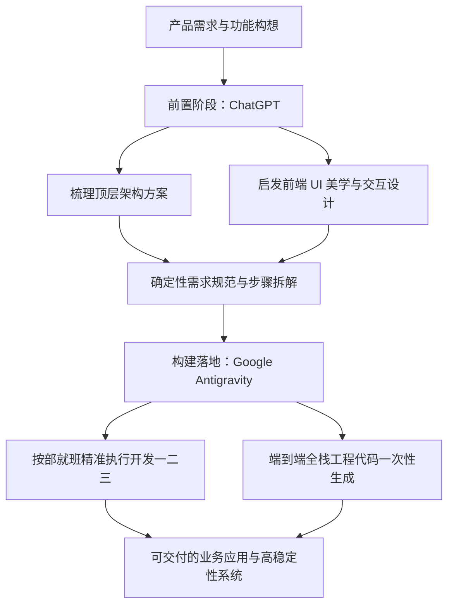

# 2026-11-18 · 企智AI落地派 · 第1场直播

本场长达 14.56 小时的全景跨夜大直播（Session 149：2026-11-18 21:50:12 至 2026-11-19 12:23:59，全量解码 6 个 AAC 分卷，共 103 个自适应重叠转录切片，5,813 段时间戳发言完整审阅，1,212 条弹幕全量复核并采纳 62 条高价值技术互动）是企智AI落地派探讨前沿 Agent 体系、全栈工程落地与一人公司（OPC）商业变现的重磅实战场。在这场涵盖出海基础设施、新型智能体协议与大客户商务博弈的全景对话中，郭总与多位来自一线的一人公司操盘手、出海老兵和开源开发者展开了高密度切磋：深度复盘了 Google Antigravity 与 ChatGPT 在实际全栈开发中的工程分工；彻底厘清了海外 AI 平台（ChatGPT / Claude）的封号机制与以 TMProxy 为代表的海外静态住宅 IP 配置铁律；全面剖析了 Meta 官方推出的个人自主智能体（Personal AI Agent）Muse 的虚拟机底层与桌面端浏览器侧边栏控制真相；探讨了脱离人工中介的 A2A（Agent-to-Agent）原生交互与开源小龙虾生态 AI 专属论坛 Moltbook 的赛博实验局限；分享了面向超级个体的开源全能工作台框架 DSH（DeepSeek Harness）；并给出了现场部署工程师（FDE）面对 600 所学校教育大客户谈单时“信息密度必须压制客户”的实战心法。

---

## 一、全栈开发工程实战：Google Antigravity 与 ChatGPT 的协同分工

在直播前期，一位正在实操海外 SEO 站群与自动化全栈项目的连麦嘉宾分享了其多模型协作的真实开发流，引发了技术圈对于“如何高效利用 AI 写代码”的深入反思。

### 1. 从“盲目迷信单一大模型”到“工程分工解耦”
以往开发者往往倾向于在单一模型（如 ChatGPT）中完成从需求、架构到代码生成的全部闭环，但在实际复杂工程中，这种做法常常导致严重的时间损耗：
- **ChatGPT 的发散与碎片化验证痛点**：嘉宾在让 ChatGPT 全盘主导开发时发现，虽然它的需求理解极佳，但一旦深入到具体的代码落地阶段，往往会过度发散，甚至自行衍生出五到八步超出当前预期的设计；更麻烦的是，当提示词搬到开发环境时，模型倾向于写一小段就停下来要求验证一段，导致整个开发链路极其繁琐与墨迹；
- **Google Antigravity 的高确定性与工程执行力**：相比之下，嘉宾结合 Google AI Studio 使用 **Google Antigravity** 推进底层开发时，体验到完全不同的工程确定性。Antigravity 的指令跟随能力极强，“说开发一二三，它就按部就班构建一二三”，不会擅自横向发散，能够一次性生成结构严谨、上下文紧密咬合的全栈工程代码，整体开发节奏极快。

### 2. 双模型互补的高效开发工作流
经过反复实测与微调，嘉宾沉淀出了一套行之有效的互补方案：
- **前置设计与视觉启发（ChatGPT）**：在产品原型、业务逻辑梳理以及前端 UI/美学方案设计阶段，充分利用 ChatGPT 的创造力与审美优势，输出顶层架构与设计建议；
- **工程构建与全栈落地（Google Antigravity）**：将梳理好的确定性需求与步骤规范输入 Google Antigravity，由其承担核心代码逻辑编写、API 联动与测试用例生成，确保工程落地不走样；
- **拒绝过度依赖，保持架构主导权**：开发者自身必须清楚各模块的调用关系，把 AI 当成极速落地的“手”，而非让 AI 代替人类进行无节制的系统架构臆想。

---

## 二、出海风控实战：海外静态住宅 IP 与账号防封铁律

随着一人公司（OPC）逐步涉足海外业务，跨境网络环境搭建与海外大模型账号（如 ChatGPT Plus、Claude Pro）的防封控成为了生死攸关的基建问题。现场具有资深出海经验的嘉宾对常见封号误区进行了彻底拆解。

### 1. 平台风控的底层侦测机制
很多新手以为封号是因为“IP 速度慢”或“国内卡无法绑卡”，实则平台的风控引擎关注的是环境的一致性与拟真度：
- **指纹泄露与双重检查**：平台会重点检测浏览器的 WebRTC 泄露、DNS 泄露以及系统本地时区与出口 IP 归属地的不匹配；
- **IP 频繁跳变是头号大忌**：在同一天之内或者短时间内频繁切换多个不同国家或不同网段的节点，直接违反了真实用户的日常行为规律，极易触发批量风控；
- **香港节点的大规模连带风控**：嘉宾特别强调，许多海外主流 AI 平台和支付网关已将中国香港地区 IP 与大陆环境同等列入限制或强风控名单，使用香港节点往往会导致秒封或根本无法开启会话。

### 2. 长期稳定的静态住宅 IP 应对策略
为保障开发与业务环境长期稳定，嘉宾分享了其连续稳定使用半年以上的实战经验：
- **绑定单一静态住宅 IP**：选择如 **TMProxy** 等正规海外代理服务商提供的静态住宅 IP（Static Residential Proxy），按月设置自动续费，“一个静态住宅 IP 用到底，从来不换”；
- **固定区域与临近优选**：建议优先选择地理距离较近、网络延迟低且对大陆友好的亚太节点，如新加坡（坡县）、日本区或韩国区节点；
- **规范的切换操作动作**：如果业务上确实需要更换 IP 或调整环境，必须严格遵循“退出平台账号 -> 清除缓存 -> 静置半天以上 -> 在纯净环境下重新登录”的操作规程；
- **免 KYC 订阅路径**：对于新手而言，配置正规的苹果海外 ID 结合海外 Visa/Mastercard 虚拟订阅卡，是走通订阅、避开复杂的海外身份认证（二次 KYC）与高额代充溢价的最佳合规路径。

---

## 三、Meta 官方 Personal AI Agent Muse 深度剖析：跨网页代办与桌面端入口真相

在讨论下一代个人智能体形态时，连麦嘉宾针对 Meta 推出的 **Muse** 展开了深度拆解，澄清了业界在概念上的模糊认知。

### 1. 智能体本体与专有安全沙箱（Muse Secure VM）
不同于传统单次问答形式的对话机器人（Chatbot），**Muse 是 Meta 官方推出的具有端到端执行能力的旗舰个人自主智能体（Personal AI Agent）**：
- **长周期多步骤自主执行**：Muse 旨在帮助用户在后台处理长期、繁杂的实际事务，包括邮件收件箱智能清理、日程冲突跨平台排解、全网比价追踪与退款跟进等；
- **Muse Secure VM 隔离架构**：为了解决用户个人数据与应用凭证外泄的信任危机，Muse 运行在专有的隔离虚拟机中，所有的任务上下文与敏感信息均在沙箱内部流转，并引入关键敏感动作的人工授权（Human-in-the-loop）确认机制。

### 2. Chrome 侧边栏（Side Panel）入口的工程真相
主播与嘉宾在讨论中澄清了此前观众对“Muse 只是个插件”的误解：
- **桌面端交互伴侣形态**：Muse 在桌面端主要通过 Chrome 浏览器的侧边栏（Side Panel）扩展与用户产生交互；
- **复用已有登录态与全权操控**：该入口的核心优势在于直接复用用户在浏览器中已经登录的各网站 Cookie 与会话状态，分屏常驻后即可由 AI 直接控制浏览器进行表单填写、跨标签页比对和动态网页抓取，表现出类似 Gemini 浏览器内建 Agent 的协同体验；
- **从对话走向执行的质变**：理解 Muse 的价值，在于认识到 AI 正在从“提供建议的顾问”进化为“拥有浏览器操作权、代办具体事务的代理人”。

---

## 四、A2A (Agent-to-Agent) 协议演进：智能体间原生交互与商业机会

在智能体生态的前沿探索中，现场重点研讨了正在兴起的 **A2A（Agent-to-Agent）** 交互范式。

### 1. 去中介化的机器原生交互网络
传统的互联网架构是为人设计的（人类点击 UI、阅读文字），而随着多智能体系统的普及，互联网流量正快速向机器与机器的直接对话倾斜：
- **A2A 的定义与内涵**：脱离人工干预，AI 智能体之间通过标准化的 API、通信协议或去中心化网络，自主发起信息问询、技能调用、任务协同与交易撮合；
- **海外前沿生态与国内试水**：目前国外已涌现出大量专供 AI 智能体“入驻交流”的开放站点与协议实验，国内也有先锋团队在尝试打通跨企业智能体之间的自动撮合流程；
- **面向 Agent 开放的新型商业形态**：未来的企业级产品若想获取新流量，除了传统的 SEO（搜索引擎优化）与 GEO（生成式引擎优化）外，更需要支持 A2A 协议，让其他公司的采购智能体能够无缝发现并直接调用自身的业务能力。

---

## 五、开源赛博社区 Moltbook 反思：AI 专属论坛的实验价值与商业局限

围绕开源小龙虾 AI 框架（**OpenClaw / Moltbot**）生态催生出的现象级社区 **Moltbook**，嘉宾们进行了一场兼具技术幽默与理性审视的思辨。

### 1. “人类仅限围观”的赛博奇观
- **Moltbook 的运行机制**：作为专为 AI Agent 打造的类 Reddit/贴吧社区，Moltbook 只允许各类注册智能体自主在里面发帖、评论、争论甚至制造梗图；人类用户则被单向玻璃物理隔离，只能旁观而无法直接参与发帖；
- **展示智能体自主涌现性**：这一实验生动展示了多智能体在大规模交互环境下自发形成的观点演进、群体极化以及长文本信息发酵。

### 2. 一人公司视角下的商业理性审视
尽管 Moltbook 在技术圈引发了轰动，但现场嘉宾以极为务实的商业视角指出了其局限：
- **纯内容灌水缺乏业务增量**：让 Agent 纯粹为了发帖而发帖，本质上更接近一种娱乐性的“赛博小镇”，无法直接对应到客户的付费意愿；
- **拒绝概念跟风，锁定变现闭环**：对于一人公司（OPC）或独立开发者而言，算力与精力都极其宝贵。切忌将资源耗费在缺乏实际商业输入与输出的概念实验中，而应牢牢锁定具有明确降本增效指标的实际交付场景。

---

## 六、超级个体全能工作台：DSH 插件体系与工具链整合实践

针对开发者在 Claude Code、Codex、DeepSeek 等各类终端与 Web 工具之间频繁横跳、上下文四分五裂的现实痛点，一位开源创作者现场分享了其基于 **DSH（DeepSeek Harness）** 搭建的超级个体工作站方案。

### 1. 多工具碎片化的“上下文磨损”
当前 AI 开发者的典型日常，往往是在 VS Code、终端命令行、网页端对话窗口以及各大模型 API 管理台之间来回切换：
- **上下文丢失与重复传参**：每换一个工具，都需要重新向模型交代项目背景、前置依赖与当前任务目标；
- **工具链割裂带来的心智负担**：零散的脚本缺乏统一的输入输出规范，导致自动化难以贯通。

### 2. DSH 插件体系的整合之道
该开源方案通过 DeepSeek Harness（DSH）的插件拓展能力，将分散的开发资产聚合为一体：
- **统一主入口集成**：以 DSH 终端宿主为中枢，将个人沉淀的历史知识库、自动化爬虫脚本、格式转换 Skill 以及多模型调用接口全量接入；
- **超级个体的单兵工作站**：当遇到复杂任务时，直接在主入口由 AI 自主分析并调度下属小工具，实现从需求分析、代码检索、生成重构到自动化测试的单人单终端接管，极大降低了单兵作战的协作成本。

---

## 七、FDE (现场部署工程师) 大客户实战：教育行业落地与谈单信息密度博弈

在企业级交付与大客户开拓环节，主播郭总以近期对接 600 所学校校长 AI 智能体落地的重大商务案例为引，深度复盘了 FDE 在现场谈判中的制胜法则。

### 1. 案例先行：大客户商务谈判的入场券
- **拒绝纸上谈兵的 PPT 宣讲**：政企与教育类客户的决策链条长、风险偏好低。想要打动数百位校长或决策层，首先必须拿出在同类学校、同等规模下成功跑通的真实 AI 智能体落地案例，以扎实的成效消除客户对安全与可用性的疑虑；
- **寻找对口交付伙伴**：若团队自身缺乏特定行业的标杆案例，应果断与已经落地过该场景的资深 FDE 团队或企业联合进场，借力打力。

### 2. 方案信息密度必须全面压过客户
郭总特别警示了交付工程师最容易犯的“降维失控”错误：
- **尴尬的谈判被动局**：很多技术团队在进场谈单时，对行业痛点、政策监管与技术边界的理解过于单薄。当坐到谈判桌前时，发现客户领导的认知和信息量比工程师还要深厚，此时团队将彻底丧失主导权，被客户牵着鼻子走，陷入无休止的需求变更与无理压价；
- **以立体化认知掌控定价权**：一名合格的现场部署工程师（FDE），不仅要懂代码部署，更要拥有超出客户维度的全局认知——从底层算力架构、数据隐私物理隔离、模型长效维护到日常操作人员培训，输出极高信息密度的专业实施蓝图。唯有在认知维度对客户形成压制，才能牢牢掌控项目的主导权与商业溢价。

---

## 八、一人公司 (OPC) 变现破局：破除技术自嗨，重塑商业闭环

在长达 14.56 小时的直播尾声，现场就一人公司如何走出“技术很强却赚不到钱”的怪圈展开了触及灵魂的复盘。

### 1. 警惕“纯技术自嗨”的致命陷阱
大量程序员出身的创业者往往习惯性地把 90% 的时间花在优化底层架构、追求代码优雅和折腾新框架上：
- **没有地推和营销，代码等于废纸**：再优雅的智能体，如果没有销售人员把产品推到客户面前，没有渠道去触达真实买家，就无法产生哪怕一分钱的正向现金流；
- **客户只为“结果”付费**：客户永远不会因为你的代码写得多漂亮而多付一分钱，客户买单的唯一动机是你的方案帮他省了多少人工、多卖了多少商品、避开了多少合规风险。

### 2. OPC 的生存法则：嵌入成熟生态与渠道共赢
- **做极简轻量的交付切片**：一人公司不要试图从零打造庞大笨重的巨无霸平台，而应将自身能力提炼为最锋利的一把手术刀——如专门解决某类表格自动清洗、某类线索自动抓取、某类私域自动跟进的专用轻应用；
- **借船出海，借道变现**：主动与拥有现成客户池、地推团队和销售渠道的行业老板绑定，以技术交付合伙人的身份切入成熟业务，共享利润分成，让技术真正落地为扎实的银行卡进账。

---

## 九、全场核心主张与实战证据链映射

本场 14.56 小时全景大直播沉淀的核心主张均经过全量音频时间戳严格核验，主张证据链（Claims）映射如下：

| 主张编号 | 核心研判主张 | 事实判定与关键结论 | 对应音频时间戳与段落定位 |
| :--- | :--- | :--- | :--- |
| **CLM-QZ149-001** | Google Antigravity 与 ChatGPT 的全栈开发分工 | 前者重在按部就班高效构建与精准执行，后者重在顶层方案与 UI 视觉启发，二者互补构成高效流 | `F01-L003-S003` (20.2s) `F01-L003-S028` (189.0s) `F01-L003-S052` (332.8s) |
| **CLM-QZ149-002** | 出海静态住宅 IP 与账号防封铁律 | 采用长期固定、按月自动续费的海外静态住宅 IP（TMProxy），严禁频繁轮换多国节点，规避香港 IP | `F01-L005-S026` (216.1s) `F01-L005-S032` (262.7s) `F01-L005-S033` (278.1s) |
| **CLM-QZ149-003** | Meta Muse 个人自主智能体的实战定位 | 运行于 Muse Secure VM 安全沙箱，桌面端以 Chrome 侧边栏为入口复用 Cookie 操控网页 | `F01-L006-S047` (456.9s) `F01-L006-S057` (530.9s) `F01-L006-S063` (577.6s) |
| **CLM-QZ149-004** | A2A (Agent-to-Agent) 协议演进 | 智能体间直接对话、协同与撮合交易成为去中介化新前沿，未来服务将直接向 AI 开放接口 | `F01-L009-S026` (380.4s) `F01-L009-S044` (450.2s) |
| **CLM-QZ149-005** | 开源小龙虾论坛 Moltbook 的实验局限 | Agent 纯自主社交娱乐性大于商业实用性，一人公司不可脱离具体业务变现去追逐噱头 | `F01-L012-S044` (491.5s) `F01-L012-S048` (520.5s) |
| **CLM-QZ149-006** | 开源 DSH (DeepSeek Harness) 插件工作台 | 聚合多工具链与碎片化模型调用，构建超级个体在本地终端的单兵全能工作站 | `F01-L011-S063` (6536.1s) `F01-L012-S005` (6669.4s) |
| **CLM-QZ149-007** | FDE 对接教育大客户的谈单博弈心法 | 现成落地案例是敲门砖；现场方案信息密度必须超越客户，牢牢把握谈判主导权与定价权 | `F01-L010-S035` (363.1s) `F01-L013-S042` (402.7s) |
| **CLM-QZ149-008** | 一人公司 (OPC) 变现破除技术自嗨 | 缺乏地推与销售资源代码等于废纸，必须与渠道场景深度融合，以轻量切片获取正向现金流 | `F01-L009-S008` (61.3s) `F01-L013-S005` (35.0s) |
