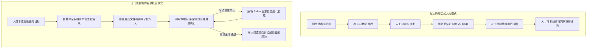
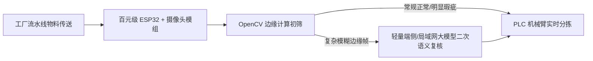

# 2026-11-19 · 刀文AI商业：彻底淘汰对话式编程、WorkBuddy桌面智能体进化、MiniMind大模型脱敏、ESP32视觉边缘落地与一人公司多Agent分工

本次直播（Session 151：2026-11-19 13:35:10 至 2026-11-19 21:27:14，全量解码 3 个 AAC 分卷，共 56 个自适应重叠转录切片，3,343 段时间戳发言完整审阅，247 条弹幕全量复核并采纳高价值技术互动）系统剖析了超级个体与一人公司在 2026 年底迎来的“开发范式大跃迁”与“技术认知脱敏”：刀文与多位硬核技术操盘手、出海与制造业老兵展开了高密度连麦切磋，痛批依然停留在“ChatGPT 网页对话框复制代码、手动粘贴到 VS Code 编译”的落后手工模式，确立了以桌面自主智能体（WorkBuddy / Codex）全权接管本地工程目录、端到端自主拆解调试的现代化标准；深度拆解了腾讯生态 WorkBuddy 从最初的端侧轻量办公提效走向桌面 AI 操作系统的演化路径；总结了“豆包构思方案、WorkBuddy 产出原型、商业助理深化落地”的多 Agent 组合拳法则；针对开发者对大模型底层技术的神秘化盲目崇拜，力推几兆体量的开源教学原型 MiniMind，破除技术玄学；复盘了百元级 ESP32 嵌入式硬件搭配开源 OpenCV 计算机视觉切入中小微工厂检测流水线的降维获客路径；并深入剖析了智能体一次性输入的认知边界与错误自愈的工程本质。

---

## 一、彻底淘汰对话式编程：以自主文件接管与工具链编译实现开发生产力跃迁

在 2026 年的今天，大量初学者甚至部分老程序员在利用 AI 编程时，仍然延续着两年前的落后习惯：在网页聊天窗口中输入“请帮我写一段 Python 脚本”，然后手动点击右上角复制按钮，切换到本地编辑器（如 VS Code）粘贴，自己保存文件，再打开终端手动运行；一旦遇到报错，再把报错日志全选复制，贴回网页对话框问“这个报错怎么解决”。

连麦技术大牛与刀文对此给出了极其犀利的技术定性：**这种“人肉中转器”式的对话交互编程，在真正的智能体时代已经彻底落伍，属于严重的生产力内耗。**

### 1. 对话式复制代码的致命缺陷
- **上下文断层与幻觉放大**：网页对话框无法感知开发者本地完整的项目拓扑、依赖环境（`node_modules` / `pip` 虚拟环境）以及文件树关系，AI 只能基于用户片面投喂的代码片段做“盲人摸象”式的推断，极易引入命名冲突和已被废弃的 API；
- **巨大的人肉搬运损耗**：随着项目规模扩大，涉及十几个文件的联动修改时，人工查找对应行、复制、替换、再手动执行测试的时间，远远超过了写代码本身；
- **错误循环无闭环**：终端环境的动态报错（如动态链接库缺失、文件权限、网络超时等），人类在复制给 AI 时往往漏掉关键的堆栈信息，导致双方陷入死循环争吵。

### 2. 现代工程标准：目录接管与端到端自主自愈
现代桌面自主智能体（以 WorkBuddy、OpenAI Codex 工作流等为标杆）带来了生产力代际跃迁：
- **工程目录托管（Folder Mount）**：智能体直接挂载并接管本地项目根目录，具备完整的文件读写、目录遍历与全局搜索权限；
- **自主分解与原子化落盘**：接收人类高级业务目标（如“在当前项目增加一个带 JWT 鉴权的用户认证接口及前端测试页”）后，智能体自行遍历现有代码结构，自主规划修改点，直接就地修改或创建目标文件；
- **本地工具链自主调用**：智能体在沙箱环境中自主调起本地解释器、构建编译器（如 `cargo build`, `npm run build`, `python test.py`），实时抓取进程退出的 Exit Code 与标准错误输出（stderr）；
- **自适应错误修复循环**：遇到编译报错或单测失败，智能体无需人类干预，自主读取回溯堆栈，定位到具体代码行完成重构重试，直到所有用例全部通过，最后才将通过验证的成品交付人类验收。

---

## 二、WorkBuddy 定位演进：从端侧桌面办公走向智能体操作系统

在直播中，刀文多次提及并实操了由腾讯生态推进的桌面自主智能体系统 **WorkBuddy**（刀文在口播中俗称“中国版小龙虾”）。

### 1. 为什么称其为“中国版小龙虾”？
此前海外开源界的小龙虾（OpenClaw）架构以能够直接操控桌面 GUI、接管键鼠、调度本地进程而风靡技术圈。而国内开发者在部署海外架构时，常常遭遇网络环境恶劣、合规风险、缺少本地化软件适配等痛点。WorkBuddy 针对国内办公和开发场景，将端侧自主执行能力做到了开箱即用：
- **深度扎根桌面环境**：不仅支持常规的 Web 抓取与文本处理，更支持直接读取本地 Excel、Word、PDF、代码工程目录及桌面窗口；
- **权限可控与安全沙箱**：针对企业数据敏感的顾虑，提供本地文件访问范围界定与操作确认机制，避免恶意脚本误删生产数据。

### 2. 从“自动化小工具”到“桌面 Agent 操作系统”
刀文强调，如果只把 WorkBuddy 当作一个帮自己批量重命名文件或者清洗 Excel 表格的小脚本，那就是极大的浪费：
- **超级个体的中央调度台**：WorkBuddy 正在向“端侧个人操作系统”演化。它可以作为主中枢，向下调起不同垂直领域的专业小模型或自动化工具（如 Python 自动化、本地 OCR、文档解析器）；
- **商业落地的轻量载体**：一人公司操盘手可以基于 WorkBuddy 的自动化工作流，将其封装成面向中小企业主定制的提效解决方案，无需为每个客户单独开发一套沉重的 SaaS 平台。

---

## 三、多智能体专业分工法则：豆包方案、WorkBuddy 原型与商业助手协同

面对错综复杂的商业需求与产品落地，业内常有人走入“试图用一个通用大模型直接从头写到尾”的误区。刀文在直播中公开了团队打磨出的“多 Agent 矩阵组合拳”，用不同模型的特长互相掩护，跑通极速商业交付。

### 1. 为什么单一模型全包必然崩溃
- 擅长发散与中文创意思维的模型，在写严谨代码时容易引入隐蔽 Bug；
- 代码工程力极强的智能体，在理解商业模式、设计营销钩子与撰写接地气宣传文案时，语言往往显得生硬呆板、缺乏商业感染力。

### 2. 三位一体的协同流水线
刀文团队确立了分阶段、由浅入深的流水线协同：
1. **第一棒：宏观方案与商业创意构思（豆包 / 通用大模型）**：
   - 充分发挥本土模型对中文互联网语境、消费者心理学与本土商业场景的高敏感度；
   - 快速头脑风暴，输出商业项目立项建议书、定位框架与核心卖点提炼；
2. **第二棒：本地工程与功能原型落地（WorkBuddy / 桌面编程 Agent）**：
   - 将上一步梳理出的功能规格说明书直接丢给 WorkBuddy；
   - 由 WorkBuddy 接管工程目录，以闪电速度构建前端页面、本地数据存储与核心交互原型，让客户在几十分钟内看到可点击、可交互的实机 Demo；
3. **第三棒：商业营销与客户促单闭环（垂直营销助手）**：
   - 原型就绪后，调动内部预先灌注了特定行业话术与客诉博弈库的“商业营销师”Agent；
   - 自动生成针对企业老总的 Pitch 幻灯片、商业报价清单与答疑 FAQ，完成从商业构思到合同促单的全闭环。

---

## 四、大模型认知脱敏：开源几兆 MiniMind 极简原型与技术祛魅

在直播问答环节，不少学员对大语言模型充满深深的技术畏惧：“我不是清华北大的计算机博士，不懂高深的数学，怎么敢做大模型相关的业务？”

连麦的技术专家对此给出了彻底的技术脱敏建议：**推荐所有人去 GitHub 下载并亲手跑一遍极简开源大模型项目 MiniMind（作者 jingyaogong）。**

### 1. 动辄千亿参数带来的“黑盒崇拜与虚幻恐惧”
商业炒作往往将千亿参数、万卡集群包装成凡人无法触碰的“数字神迹”，导致大量想入局 AI 的普通开发者和创业者产生自卑心理，要么沦为只会在网页端点点的韭菜，要么在面对大客户技术问询时心虚露怯。

### 2. MiniMind 的核心价值：普通个人电脑几小时跑通底层全流程
MiniMind 是开源社区中一个极具教学意义的极简大模型项目：
- **体量极小**：模型参数量仅有几兆（数百万到上千万参数级别），普通家用电脑甚至轻薄本单靠 CPU 就能在几小时内完整跑通；
- **全生命周期无保留暴露**：包含从最底层的 Tokenizer 词表切分、Transformer 核心注意力矩阵计算（Multi-Head Self-Attention）、因果掩码（Causal Mask），到无监督预训练（Pre-training）、指令微调（SFT）以及人类偏好对齐（RLHF）的完整代码，没有任何工业级冗余框架的干扰；
- **一扫玄学认知**：亲手运行过 MiniMind 的开发者会彻底明白：**所谓的“大模型”，本质上就是一个以概率预测下一个 Token 的非线性数学函数拟合器。** 只有看清了这个本质，创业者在技术选型时才不会被厂商的高大上包装牵着鼻子走，才能准确评估什么时候该用 Agent 拆解、什么时候该做微调、什么时候只靠提示词工程即可解决问题。

---

## 五、实体制造业降本实战：ESP32 嵌入式硬件 + OpenCV 视觉识别系统降维获客

除了纯软件和桌面办公，本次直播中连麦的硬件专家分享了其在传统实体制造业中的降维突围战术：利用百元级嵌入式硬件切入工业视觉质检。

### 1. 传统工业质检的巨大成本痛点
很多中小微五金厂、包装厂、注塑厂的老板，流水线上依赖大量人工肉眼检查瑕疵（如缺角、划痕、标签漏贴），不仅人工成本高昂，而且工人长时间盯梢极易疲劳漏检。市面上的成熟工业视觉方案往往要求搭配昂贵的高性能工控机、进口工业相机和昂贵的商业软件许可，动辄十几万甚至几十万一套，中小企业根本无力承受。

### 2. ESP32 + OpenCV 的极低成本落地方案
实战派专家采取了极致降本策略：
- **百元级硬件载体**：采用乐鑫科技的 **ESP32** 模组（成本仅数十元），搭配百元级摄像头传感器；
- **轻量算法与边缘端初筛**：通过开源 **OpenCV** 库执行边缘轮廓检测、颜色直方图比对与模板匹配等轻量级视觉算法，在设备端直接完成 95% 以上常规瑕疵的实时剔除；
- **结合云端或本地大模型进行异常复判**：对于边界模糊的偶发复杂缺陷，再将关键帧上传至局域网本地轻量大模型做二次语义理解；
- **商业降维杀伤力**：整套硬件成本控制在数百元以内，服务商以一至两万元的价格向工厂老板整体交付并收取年度维护费。对老板而言，省去了一名质检工人两个月的工资即可收回全部成本，签单周期极短、现金流立竿见影。

---

## 六、目标导向与报错自愈循环：智能体一次性指令输入的边界与迭代交付本质

在直播尾声，刀文解答了广大学员对“全自主智能体”最普遍的认知偏差——“是不是我只要给它一句话，它就必须 100% 毫无错误地把一个几十万行代码的复杂系统一次性交出来？”

### 1. 戳破“神仙化一次性生成”的幻觉
- **自然语言与严谨机器指令的本质冲突**：人类的大脑在用自然语言表达需求时，必然包含大量的未明说默认假设与上下文省略。期望智能体凭空猜出所有隐性逻辑并一次性完美交付，在工程数学上是根本不可能的；
- **过度追求“单次完美”只会导致死机**：单次让大模型输出极长、未经检验的上下文，会导致注意力分散、局部逻辑矛盾和严重的幻觉累加。

### 2. 智能体的真正工程价值：自动化自愈循环（Self-Healing Loop）
智能体之所以超越传统软件生成器，不是因为它不会犯错，而是因为**它拥有低成本感知错误并闭环自愈的能力**：
- **定义原子目标而非宏观口号**：人类管理者的职责是将宏大愿景切分为具体的、可自动验证的验收标准（Acceptance Criteria）；
- **依靠反馈自愈推进**：只要环境能提供明确的反馈（编译日志、单测报告、页面 HTTP 状态码），智能体就能在 3~5 轮自愈循环中把 Bug 全部消除；
- **一人公司的角色演进**：超级个体从“写代码的泥瓦匠”彻底转变为“设立验收关卡的质量总监”。人类负责定义“什么是对的”，智能体负责在报错自愈的循环中“把东西做对”。

---

## 七、总结与超级个体行动清单

1. **升级个人开发基础设施**：立刻戒除在网页端复制粘贴代码的手工操作习惯，将主力工作流迁移至支持本地目录接管与编译工具链自主调用的桌面智能体环境；
2. **构建多 Agent 协同矩阵**：不再苛求单一模型全能，前端用本土创意模型梳理商业框架，中间用桌面智能体极速构建可交互原型，后端用商业助手输出报价与方案；
3. **完成底层技术认知脱敏**：下载并亲手在本地跑通 MiniMind，彻底看清大语言模型的数学拟合与 Token 预测本质，在面对技术概念包装时保持清醒判断；
4. **探索软硬结合轻量切口**：关注 ESP32 + OpenCV 等百元级边缘计算硬件与 AI 的融合场景，面向中小企业痛点输出“立竿见影、极速回本”的实体降本方案；
5. **掌握智能体自愈交付法则**：放弃“一次性全自动神话”，建立“清晰目标定义 + 阶段性自动化测试验收 + 报错自主循环”的敏捷迭代心智。
