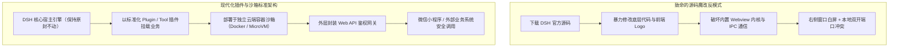
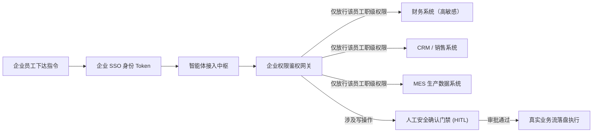

# 2026-11-19 · 企智AI落地派 · 第1场直播

本次直播（Session 155：合并开播试音碎片与正式大直播，2026-11-19 21:43:00 至 2026-11-20 08:56:00，全量解码 21 个 AAC 分卷，共 88 个自适应重叠转录切片，3,871 段时间戳发言完整审阅，819 条弹幕全量复核并采纳 809 条业务与技术深度互动）是企智AI落地派针对开源智能体二开架构、大客户企业级权限治理与多 Agent 统一调度工作台开展的深度实战跨夜研讨。在这场持续 11.19 小时的高能切磋中，郭总与一线全栈工程师、企业数字化系统顾问及一人公司操盘手展开了高密度复盘：深度剖析了一线开发者二次开发开源标杆 DeepSeek Harness（DSH）时“擅自魔改底层源码导致浏览器内核与窗口白屏崩溃”的严重踩坑教训，确立了 DSH 原生“创作者插拔式插件架构”与云端容器沙箱隔离部署的标准范式；直击单机版智能体切入传统中大型企业核心生产系统时的最大卡点——跨多套异构业务系统（ERP、CRM、OA、MES）的细粒度数据权限治理与统一鉴权网关设计；探讨了多模型多智能体工具链割裂背景下，以开源本地优先控制面板 Ekko Studio 为代表的多 Agent 统一工作台演化趋势；并进一步分享了端侧 WorkBuddy 在具体文档批量处理与小程序后端轻量封装中的落地边界。

---

## 一、DeepSeek Harness 二开避坑准则：插件生态优先与云端沙箱隔离

在直播后半段，一位连麦学员带着满头大汗向郭总和技术社区求助：他在自己的电脑上二开开源智能体框架 **DeepSeek Harness（DSH）**，试图修改其内置逻辑做一套面向招投标文书自动解析的小程序后端。结果魔改之后，原版客户端右侧的核心内容预览窗口直接黑屏打不开，而且本机同时运行两个实例还发生了诡异的进程互锁与端口冲突。

郭总与连麦技术导师对此给出了极其严厉且具代表性的架构纠偏：**这是典型的“把现代化插件式框架当成古董单体源码去魔改”的初学者误区。**

### 1. 为什么盲目魔改 DeepSeek Harness 源码必遭反噬
- **破坏底层 Chromium / Webview 宿主内核**：DSH 客户端之所以能丝滑呈现右侧富文本、流程图与代码执行结果，底层依赖高度定制的桌面微虚拟机与浏览器渲染环境。开发者在不完全理解其 IPC（进程间通信）机制的情况下随意修改源码，极易造成渲染进程与主逻辑断链；
- **本地多实例资源踩踏**：在同一台物理机上直接部署修改版和官方原版，两个实例共用本地存储路径与默认端口，必然产生缓存污染与状态覆盖；
- **违背 DSH 设计初衷**：郭总指出：“DeepSeek Harness 原本设计就是创作者模式，核心理念是‘万物皆可插件，随时往上插’。官方把源码开源，不是让你去改它的 logo 或者在源码里硬塞业务，而是让你利用其标准插件协议往上扩展能力。”

### 2. DSH 二次开发的正确工程姿势
- **架构解耦：核心引擎与业务逻辑分离**：保持 DeepSeek Harness 底层引擎原封不动，业务逻辑全部以自定义插件（Plugin / Tool）的形式动态挂载；
- **云端容器沙箱部署（Sandboxed Environment）**：将 DSH 部署在完全隔离的云端微服务器或 Docker 容器沙箱内。沙箱不挂载宿主机的真实根文件目录，避免任何恶意脚本或崩溃影响本地工作机；
- **外层封装标准 Web 接口**：若要为微信小程序或外部网页提供服务，应在 DSH 外层架设一层轻量的 FastAPI / Node.js 鉴权中转层，通过标准 HTTP/WebSocket 与 DSH 的沙箱实例通信，完美解决并发与调用权限隔离。

---

## 二、企业级智能体交付深水区：跨多生产系统的数据权限与网关治理

很多技术开发者在自己的笔记本上跑通了单机版 Agent，就自信满满地去见大中型企业客户，结果往往在“数据权限”这道硬关卡面前撞得头破血流。

### 1. 单机版 Agent 切入企业系统的致命痛点
企业内部绝不是一个无差别的纯文本数据库，而是由多个存在严格权限壁垒的业务系统构成（如财务用 SAP、销售用 Salesforce、人事用 Workday、生产用 MES）：
- **越权读取风险**：如果让单机版 Agent 拥有全局数据库访问权限，一个普通车间主管问一句“上个月公司高管奖金发了多少”，大模型就会顺着数据链路调出机密财务报表，这是任何企业 CEO 都不可能容忍的合规灾难；
- **操作权限混乱**：AI 到底是“只读建议”还是具备“直接点击审批流”的操作权限？如果 AI 自动发起了采购付款指令，审计责任谁来承担？

### 2. 企业权限网关（Permission Gateway）的落地解法
针对现场客户顾问的困惑，郭总与嘉宾梳理了企业级交付的标准中台设计：
1. **身份认证透传（Identity Context Passing）**：
   - 智能体与员工交互时，必须严格承载该员工在企业内部的 SSO（单点登录）身份 Token；
2. **多系统权限动态映射**：
   - 在 AI 与底层生产系统之间建立一层专用的“权限鉴权网关”。员工向 Agent 提问时，网关根据员工职级实时裁剪模型能检索的数据子集（Row-level & Column-level Security）；
3. **读写分离与审核门禁（Human-in-the-Loop Gate）**：
   - 纯分析类需求（如“分析近半年注塑件不良品趋势”）允许 Agent 自动化生成；
   - 涉及数据修改、打款、审批等强写操作（Write Action），必须强制弹出人类审批确认框，严禁 Agent 单边执行，将工程责任彻底厘清。

---

## 三、多智能体统一工作台演化趋势：以 Ekko Studio 为代表的本地聚合控制台

随着开发者日常使用的智能体工具链日益丰富（如编程用 Claude Code、复杂项目用 Codex、轻量办公用 WorkBuddy、自适应学习用 Hermes Agent），多客户端之间来回切换、多会话上下文割裂成为了超级个体的核心痛点。

在弹幕的高频互动探讨中，社区开发者引出了备受瞩目的开源本地优先多 Agent 统一工作台——**Ekko Studio**。

### 1. 为什么需要统一的多 Agent 控制面板
- **告别窗口多开的认知负担**：以往开发者要在终端跑 Claude Code、在桌面开 WorkBuddy、在浏览器开 ChatGPT，多任务协同极其碎片化；
- **多模型原生协同协作**：复杂的工程研发需要不同的专家 Agent 协同。一个负责架构审计、一个负责写单测、一个负责查文档，需要一个能统一编排、统一展示中间执行轨迹的调度中枢。

### 2. Ekko Studio 的核心架构特色
- **本地优先与开源透明（Local-First & Open Source）**：所有工作区文件、配置与执行历史存储在本地，不强制上传第三方私有云；
- **多运行时统一接入**：支持单屏接入 Claude Code、Codex、Hermes Agent 等多种异构智能体运行时，支持多智能体并发会话；
- **可视化工作流与审批门禁**：将 Agent 的后台终端操作、文件读写以直观的可视化卡片呈现，支持人类在关键决策节点一键 Approve 或 Reject，兼顾自主执行效率与工程安全。

---

## 四、总结与超级个体实战启示

1. **树立插件优先心智**：面对 DeepSeek Harness 等现代成熟框架，坚决放弃魔改底层源码的旧思维，通过标准插件机制扩展能力，并在云端隔离沙箱中部署服务；
2. **严把企业权限底线**：进场为大中型企业交付 Agent 时，不要止步于调通提示词，必须将多系统身份透传、细粒度鉴权网关与读写审核门禁作为核心交付标准；
3. **整合单兵多 Agent 工具链**：密切关注 Ekko Studio 等开源统一工作台，将分散的桌面 Agent、代码生成模型汇聚于单屏控制台，实现超级个体的高阶全栈协同。
