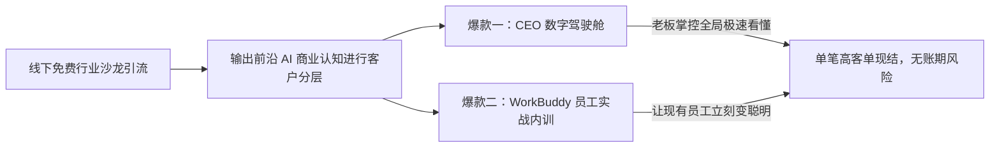

# 2026-11-20 · 刀文AI商业：一人公司破局生死线——深耕行业做单点工具卖给同行、砍掉FDE重交付做轻量双爆款、Hermes Agent开源底座二次开发与WorkBuddy落地实操

本次直播（Session 156：2026-11-20 02:47:37 至 2026-11-20 06:59:25，有效时长 4.20 小时，全量解码 1 个 AAC 完整分卷，共 26 个自适应重叠转录切片，1,864 段时间戳发言完整审阅，167 条弹幕全量复核并采纳 165 条业务与技术深度互动）是刀文面向一人公司（OPC）、AI 创业者与垂直实体行业老板开展的“商业化破局”硬核专场。在这场深夜高密度切磋中，刀文与多位来自服装制造、跨境电商及独立开发领域的创业老兵深入对话，戳破了初创团队盲目切入陌生公域大市场的幻想，确立了“扎根熟悉垂直赛道、做极端单点痛点工具卖给同行”的一人公司核心生存法门；严厉警示初创团队切勿过早把自己定义为重交付的 FDE（现场部署工程师）而陷入需求拉锯与账期泥潭，公布了团队以“CEO 数字驾驶舱”与“员工 WorkBuddy 实战内训”轻量双爆款实现极速现结的商业打法；深度剖析了开源社区自主智能体底层选型逻辑，针对开发者自研智能体笨重落后的困境，力推 Nous Research 开源的持续自适应智能体框架 Hermes Agent 作为业务二次开发底座；并全景拆解了 WorkBuddy 搭配飞书打通传统企业组织数据流的极简落地交付闭环。

---

## 一、一人公司破局生死线：深耕垂直行业，做极端单点工具卖给同行

在直播中，一位拥有十几年电商实操经验的老板连麦请教转型方向，他提到自己在做一款面向同行的垂直提效工具。刀文听罢当即拍案叫绝，指出这是 99% 的 AI 初创者根本未能领悟的高维商业认知。

### 1. 为什么开拓陌生公域市场是一人公司的“自杀之路”
大量技术背景的超级个体往往抱有宏大的平台梦，试图做一款面向全网自媒体、全行业白领通用的“全能 AI 助理”：
- **获客成本高昂**：公域获客需要极其庞大的投流预算、持续的内容矩阵和复杂的运营团队，单兵作战的超级个体在买量成本上瞬间被大厂和头部机构淹没；
- **痛点浮于表面**：由于缺乏对陌生行业的深度浸润，做出来的工具往往是“花拳绣腿”，用户试用几分钟觉得新鲜，随后弃用，留存率极其难看。

### 2. 破局之道：抓住同行不可承受之痛，做极端单点工具
真正的商业捷径是在自己耕耘多年的老本行里找切口：
- **痛点认知降维打击**：你在行业里摸爬滚打十几年，同行每天在哪个环节被卡脖子、被罚款、浪费多少人力，你比任何外部产品经理都清楚（例如服装外贸厂版型自动设计、电商高频竞品价格采集与爆款监测）；
- **激发危机感，实现极速变现**：刀文一语道破商业心理：“你去做陌生市场，市场哪有那么好做？只有你的同行突然发现你做出了一个极其牛逼的工具，他觉得你要成为他无可匹敌的竞争对手的时候，他就会拼命找你买。”
- **单点突破胜过大而全**：一人公司不要试图解决客户企业的所有问题，只解决一个极其痛的刚需点，做深做透，一个工具就足以支撑一人公司数百万的健康现金流。

---

## 二、商业化交付心法：砍掉沉重定制，聚焦“CEO驾驶舱 + 入企培训”轻量双爆款

在 2026 年底的企服市场中，很多团队动辄言必称 FDE（现场部署工程师），试图驻场进入大中型企业定制端到端自动化业务流。刀文结合团队血淋淋的教训，严正告诫初创者：**不要盲目把自己包装成 FDE！**

### 1. 为什么过早定位成重交付 FDE 必死无疑
- **需求无底洞与沟通拉锯**：传统老板对数字化缺乏具象概念，在定制开发过程中需求朝令夕改，驻场人员被拖入无休止的扯皮中，一个项目做三五个月无法结项；
- **回款风险与账期黑洞**：传统企业账期动辄半年甚至一年，一人公司或初创团队根本没有雄厚的资本垫资，尾款收不回来，公司直接现金流断裂。

### 2. 刀文团队跑通的轻量双爆款商业模型
刀文团队坚决砍掉一切沉重非标定制，只聚焦两款高周转、高确定性、现金现结的轻量爆款：
1. **CEO 数字驾驶舱**：
   - **核心卖点**：企业一把手最焦虑的是对公司业务失去掌控感。驾驶舱不碰底层复杂的 ERP，而是通过极简的飞书多维表格与协同中枢，将业务流水、员工产出、客户跟进统一汇总为直观的可视化看板；
   - **交付极速**：一周内甚至两三天即可搭建完毕，老板在手机和电脑端“一眼看透公司全貌”，立刻获得强烈的安全感与掌控爽感；
2. **企业实战内训（教员工用 WorkBuddy）**：
   - **切中老板省钱心理**：老板好不容易招来并培养的员工舍不得开除，但又苦于员工效率低下。内训直击痛点：“帮老板让现有员工变聪明”；
   - **标准化实操课程**：进场两天手把手培训员工掌握 WorkBuddy 与 Codex 等主流桌面提效工具，把繁琐工作自动化，单场培训收费数万元，现场全款现结，无任何后顾之忧。

---

## 三、技术选型实战：借助开源持续进化 Agent 底座（Hermes Agent）二次开发，拒绝从零手搓

连麦中，一位技术背景的电商创业者反思：自己折腾了半年，从零手搓智能体系统，结果上个月上线后发现“可笨了”，跟 WorkBuddy、Codex 差距巨大。后来他果断改变方向，选用开源社区的持续进化底座 **Hermes Agent** 进行二次业务定制，开发进度呈爆发式提升。

### 1. 从零手搓智能体的三大致命陷阱
- **架构落后**：单纯依靠单次 Prompt 调用或简单的硬编码工作流，缺乏自主规划（Planning）、记忆自增殖（Memory Evolution）与报错自愈（Self-Correction）机制；
- **工具生态贫瘠**：现代 Agent 依赖强大的沙箱环境（MicroVM）、终端调用、浏览器接管与 MCP（Model Context Protocol）协议支持，个人开发者从零实现这些基建无异于自造轮子；
- **技能不可沉淀**：普通脚本跑完即忘，无法随着用户的交互持续总结新技能并自我固化。

### 2. Hermes Agent 的二次开发优势
刀文与技术专家高度赞同该开发者的底层转变：
- **开源自主进化标杆**：由开源先锋 Nous Research 推出的 Hermes Agent，核心特色在于“伴随用户共同成长的智能体”（The agent that grows with you）。它将成功的执行轨迹自动沉淀为持久层 Markdown 技能文件，具备自适应学习闭环；
- **开箱即用的工程底座**：原生支持微虚拟机（MicroVM）安全隔离、多工具调用与 MCP 生态，支持本地 CLI/TUI 或轻量 VPS 极速部署；
- **超级个体的技术策略**：**善借开源巨人之力，把全部精力集中在垂直行业业务逻辑的封装上。** 底座用成熟的开源架构，业务层写入电商选品、竞品爬取或版型匹配的专有算法，以最低的研发代价构建起坚固的商业护城河。

---

## 四、WorkBuddy + 飞书实操心法：极简工具打通数字鸿沟，重塑老板掌控感

针对很多学员“不知道怎么给传统企业落地”的困惑，刀文拆解了如何用最接地气的工具组合打穿传统企业的组织管理壁垒。

### 1. 为什么选择 WorkBuddy + 飞书？
很多传统老板连复杂的云平台后台都不会登录，推销大模型 API 或复杂的代码平台只会引发老板的抵触和恐惧。
- **飞书的协同穿透力**：国内大量企业已经普及或熟悉飞书，其消息推送、多维表格与组织架构具备极强的易用性；
- **WorkBuddy 的端侧自动化能力**：作为扎根桌面环境的自主智能体系统，WorkBuddy 能够直接接管本地 Excel、PDF、文档及工程文件，无需改变员工原有的电脑办公习惯。

### 2. 闭环落地方案
- **员工侧**：员工在工位电脑上运行 WorkBuddy，自动处理日常表格清洗、客户咨询初筛与日报归集；
- **中枢侧**：通过标准化脚本将清洗后的业务数据实时同步至飞书多维表格；
- **老板侧**：老板只需打开手机飞书，在 CEO 驾驶舱中查阅实时汇总的经营数据大盘，员工、教师、业务员与管理层被一条极简的数据链路无缝串联。

---

## 五、一人公司破局行动清单

1. **确立精准商业定位**：立刻停止在公域研发通用型 AI 产品，深入自己拥有 3~5 年以上行业积淀的垂直赛道，寻找同行的极端痛点；
2. **严控交付边界**：拒绝任何需求模糊的重定制 FDE 项目，主推以数据汇总为核心的“CEO 驾驶舱”与以岗位提效为核心的“WorkBuddy 员工培训”；
3. **技术底座拥抱开源**：停止从零编写 Agent 底座，借助 Hermes Agent 等开源自主框架，将研发重心倾斜在业务规则与专有数据的打磨上；
4. **坚持现金现结底线**：采用“免费沙龙破冰 + 双轻量爆款收钱”的流水线打法，杜绝任何有账期拖欠隐患的商务合作。
