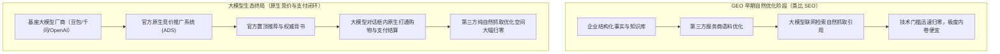
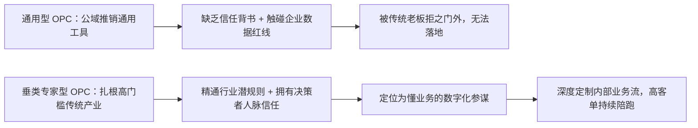

# 2026-11-20 · 企智AI落地派：20.65小时超级跨夜马拉松——GEO生成式引擎优化终局演化、一人公司（OPC）扎根垂直行业壁垒、企服平台化陷阱与FDE落地边界

本次直播（Session 157：2026-11-20 21:47:49 至 2026-11-21 18:26:32，长达 20.65 小时超级跨夜马拉松大直播，全量解码 6 个 AAC 完整分卷，共 126 个自适应重叠转录切片，7,123 段时间戳发言完整审阅，1,894 条弹幕全量复核并采纳 1,866 条业务与技术深度互动）是企智AI落地派探讨生成式 AI 商业化底层变迁、一人公司（OPC）深水区交付与 B 端企服本质的重磅实战里程碑。在这场跨越昼夜、高潮迭起的切磋中，郭总与来自搜索营销、工程建筑、酒店集团数字化及资深独立开发者的多位一线老兵深度复盘：前瞻性透视了当下火热的生成式引擎优化（GEO，Generative Engine Optimization）演化路径，犀利指出第三方纯自然结构化优化必将迅速内卷，大模型生态的下半场必然重现搜索引擎历史——由大模型官方平台（如豆包、通义千问）直接掌控竞价投流（ADS）并在模型内闭环商品交易与支付；深度拆解了一人公司（OPC）与大客户建立合作的生死命脉，论证了脱离垂直行业积累的通用型 OPC 必然遭遇信任与数据壁垒阻击，唯有依托垂直细分领域（如传统工程施工、酒店精细化运营）不可替代的专业纵深与决策者信任，才能跑通长期高客单陪跑；并严厉批驳了试图将各行各业的流量、GEO、FDE 统一打包进一个标准化 SaaS 平台的空想，阐明了各垂直行业底层业务流不可抹平的离散复杂度。

---

## 一、GEO 生态终局大洗牌：从自然引用优化走向大模型原生付费投流（ADS）

在直播上午时段，多位从事搜索优化与数字营销的一线嘉宾就“GEO（生成式引擎优化）的商业前景”展开了激烈的交锋。有团队试图将 GEO 包装成面向中小企业收取高昂年度服务费的“黑科技神话”，郭总结合二十余年互联网商业演进历史，对其底层逻辑进行了彻底祛魅。

### 1. 为什么说当前的 GEO 只是早期 SEO 的像素级复刻
- **语料收录与结构化事实的短暂红利**：当前所谓的 GEO，主要是利用知识库构建、高权重站点外链、结构化数据标记（Schema/JSON-LD）以及语料投喂，让大模型在实时联网检索（如 ChatGPT Search、Perplexity、豆包）时更容易抓取并引用客户的品牌信息；
- **边际成本骤降与迅速内卷**：这种单纯依靠提示词工程与知识库挂载的技术，没有任何真正的底层算力壁垒。郭总直言：“为什么说 GEO 只会越来越便宜？因为 GEO 类比于原来的 SEO。技术一旦普及，第三方做自然抓取优化的门槛瞬间抹平，全网都会做，很快就会卷成白菜价。”

### 2. GEO 的下半场：平台官方竞价置顶与模型内交易闭环
真正决定流量商业价值的是大模型平台（基座厂商）自身的商业化诉求：
- **官方竞价投流（ADS）是必然终局**：传统搜索引擎的终局不是 SEO，而是百度的竞价排名与 Google Ads。大模型厂商绝不可能长期任由第三方免费在自己的回答中获取商业流量。未来，大模型官方必然会推出属于自己的“推荐竞价系统”，只有付费客户的答案才能在生成结果中获得强置顶与信任背书；
- **生成端闭环购物与支付**：类似阿里通义千问、字节豆包等平台，核心演进方向是通过自主 Agent 直接在对话框内部打通选品、比价、下单与资金划扣。一人公司如果只做中间商帮客户刷第三方自然引用，一旦平台收紧算法或上线官方广告位，业务链条将在顷刻间瓦解。

---

## 二、一人公司（OPC）落地生根法则：背靠垂直行业门槛与决策者信任

直播中，很多年轻的 OPC（一人公司）开发者诉苦：“我们学了一身 AI 技能，去拜访传统企业老板，老板连公司数据都不愿意透露，根本接不到单。”

对此，现场几位常年陪跑传统工程机械与酒店连锁集团的资深操盘手分享了其“隐形暴利”的生存真相。

### 1. 为什么“通用型 OPC”在 B 端寸步难行
- **天然的资质与背书匮乏**：一人公司缺乏正规集成商的体系认证、财务审计与赔偿能力。中小企业老板虽然渴望提效，但最怕核心财务流水、客户名单被泄露或被删库；
- **不懂行话与业务真实断点**：拿着通用的技术名词（Prompt、Agent、RAG）去套老板的业务，根本无法切中老板的真实痛点，双方完全不在一个频道上。

### 2. 扎根垂直赛道：专业壁垒与老板人脉的降维威力
成功突围的一人公司操盘手具有高度一致的特征：
- **深耕高门槛传统产业**：一位工程类 OPC 嘉宾分享，他只专注为大型工程施工项目提供 AI 流程陪跑。由于建筑工程行业涉及极其繁琐的招投标资质审查、安全台账、材料进场核销与复杂工期排布，外行哪怕技术再强也根本看不懂图纸与定额表；
- **不可替代的深度信任**：因为自身就是行业老兵，甚至与老板有多年的业务合作基础，老板完全信任其人品，愿意全盘开放经营数据与管理权限；
- **一人公司的定位演变**：不再自称卖软件的“AI 开发者”，而是将自己定位为“懂业务、懂管理、恰好又精通 AI 工具的董事长数字化参谋”。这种陪跑模式客单价高、客户黏性极强，且没有任何公域竞品能够杀入。

---

## 三、企服平台化迷思：各垂直行业 FDE 的深度复杂度不可聚合

在直播深度对话中，有连麦创业者提出了一个雄心勃勃的平台构想：“我想做个统一的企服大平台，左手聚合全网各行业的 AI 流量与 GEO，右手撮合全网的 FDE（现场部署工程师），把所有垂直行业的企业需求统一平台化撮合。”

郭总对此给出了当头棒喝：**这种“平台化大一统”的思维，是典型的互联网流量思维在工业企服深水区的严重水土不服。**

### 1. 为什么垂直行业的 FDE 无法被标准化聚合
- **离散工业的非标性远超想象**：一个五金模具厂的工序报工、计件工资与质检逻辑，跟一家跨境服装外贸公司的供应链排期、海关清关与面料损耗核算，底层数据流存在着银河系般的鸿沟；
- **FDE 的核心是“非标工程实施”而非“标准化代码分发”**：FDE 必须进驻车间、蹲守工位，理解工人的方言、老师傅的手工习惯以及老板的灰色博弈。这种强线下、重人性的定制交付，其复杂度与信息密度根本不可能被封装成平台上的标准化订单。

### 2. 给一人公司与 AI 创业者的终极建议
- **做针尖大的深井，不做一米深的大海**：放弃做全行业平台的虚妄执念，把一个具体场景（例如“酒店OTA动态调价与差评归因”、“工程招投标废标点前置筛查”）做到极致；
- **利润永远在深水区**：越是脏活、累活、外行看不懂、传统软件大厂看不上的细分领域，越是超级个体正向现金流的丰沛水源地。

---

## 四、超级个体实战行动清单

1. **审慎对待 GEO 商业泡沫**：不要将一人公司的核心营收建立在帮客户刷自然检索引用上，警惕大模型厂商官方竞价投流（ADS）和闭环支付对自然流量的收割；
2. **锁死自身优势垂直赛道**：立刻盘点自己过去的行业积淀，退守到具备专业门槛与信任基础的传统细分领域做深做透；
3. **拥抱高信任陪跑模式**：以“数字化参谋”身份切入企业一把手痛点，不推销宏大系统，只解决特定管理断点；
4. **摒弃平台化妄念**：拒绝做无所不包的聚合平台，深耕垂直行业的深度定制，在垂直利基市场建立绝对统治力。
