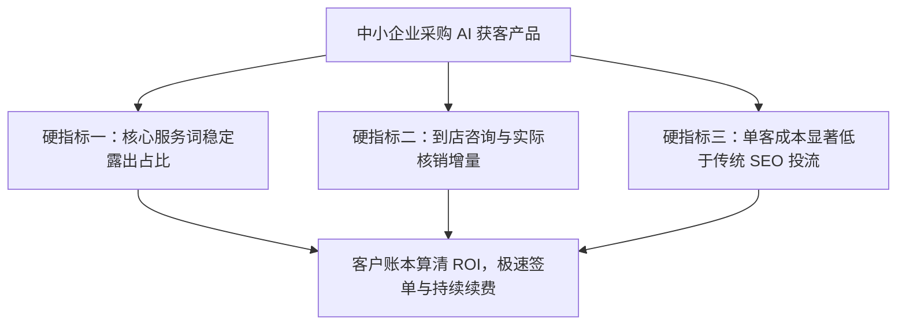
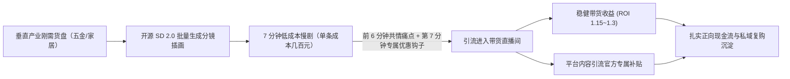

# 2026-11-21 · 刀文AI商业：AI到底如何变成一个产品？——中小商家GEO落地三大量化指标、SD 2.0极低成本慢剧引流带货闭环与汽车4S店集群裂变

本次直播（Session 158：2026-11-21 10:45:17 至 2026-11-21 20:11:18，时长 9.43 小时全景大直播，全量解码 5 个 AAC 分卷，共 59 个自适应重叠转录切片，3,107 段时间戳发言完整审阅，259 条弹幕全量复核并采纳 252 条业务与技术深度互动）直击当前 AI 商业化中最尖锐的命题——**“AI 到底如何从炫技的 Demo 变成企业真正愿意付钱的产品？”**。刀文与多位来自本地生活代运营、内容短剧孵化及汽车后市场的实战老兵高密度连麦，破除了传统大企业全量虚无报告的遮羞布，确立了中小企业验证 GEO（生成式引擎优化）效果的三大硬核指标；系统拆解了一条正在爆发的内容带货新路径：利用开源文生图模型 Stable Diffusion 2.0（SD 2.0）将单条慢剧制作成本压减至数百元，不盲目追求头部影视画质，而是紧密结合五金、家居等特定窄人群货盘，以 1.15~1.3 的稳健 ROI 撬动平台内容补贴与带货闭环；并全景复盘了切入汽车 4S 店高客单经销场景时，打通“核销溯源跑通首家样板店、借同品牌商圈集群效应极速裂变”的商务实战打法。

---

## 一、AI 产品化验收生死线：中小商家检验 GEO 效果的三大硬核指标

在当前 AI 搜索优化的商业风口下，大量服务商向中小企业主推销模糊的“品牌 AI 曝光方案”，收费数万元却拿不出具有说服力的商业回报。刀文在直播中指出：**产品之所以叫产品，是因为它能在客户真实的账本上算清账。**

### 1. 拒绝大企业“虚无报告”，锚定中小商家实战体感
中小企业老板没有耐心听向量嵌入、上下文窗口与抓取权重等技术术语，也不需要花里胡哨但无法变现的 PDF 宏观公关报告。他们需要的是一眼能看懂、每天能感受到的线索增量。

### 2. 评判 GEO 是否成立的三大硬指标
1. **核心服务词稳定露出占比（Visibility Share）**：
   - 使用平台自带搜索或轻量监测工具，直接检索自家最赚钱的垂直服务词（如“杭州城西宝马底盘异响维修”、“深圳宝安精密五金件加急打样”）；
   - 检验在豆包、ChatGPT Search、通义千问等生成式 AI 给出答案时，自家品牌与门店地址是否稳定占据推荐前三名；
2. **到店咨询与实际核销增量（Verified Conversions）**：
   - 彻底告别泛曝光自嗨，将 AI 入口带来的咨询通过专属优惠码、企业微信客服以及抖音来客平台进行强绑定核销；
   - 统计从 AI 推荐渠道涌入的精准高意向线索量，只要到店客流实现真实净增长，客户就会坚定续费；
3. **对比传统 SEO 的单客获客成本（Cost Per Acquisition）**：
   - 相比于传统百度竞价或大众点评昂贵的点击扣费，测算 GEO 带来的单条有效客户获取成本；
   - 只要单客成本显著低于传统投放渠道，且线索成单率更高，该 AI 获客产品就拥有绝对的商业溢价权。

---

## 二、内容电商新套利闭环：开源 SD 2.0 极低成本慢剧引流带货

直播中，一位从事短剧带货的学员与刀文交流了其反直觉的落地打法：戳破红果等头部短剧“高制作、高投流、薄利润甚至亏损”的假象，另辟蹊径跑通了**“极简慢剧引流直播间”**的闷声发财模式。

### 1. 传统影视级短剧的伪盈利陷阱
- **制作与宣发成本失控**：一部标准实拍短剧动辄数十万元，投流成本吞噬掉 90% 以上的流水，整体投流 ROI 很难超过 1.1，一旦某天素材衰减，团队立刻陷入巨额亏损；
- **泛流量无法承接**：霸总、战神等泛娱乐剧情吸引来的大多是缺乏明确购买意图的泛人群，很难导流到具体的实物商品销售。

### 2. SD 2.0 极低成本慢剧的差异化打法
- **数百元极速产出（Stable Diffusion 2.0）**：
  - 放弃追求电影级动态视频与逼真面部捕捉，利用开源 **SD 2.0** 批量生成风格统一的漫画/写实分镜插画，搭配 AI 语音旁白制作成 7 分钟的极简“慢剧”；
  - 单条慢剧生产成本从数万元压低至几百元以内，一人一天即可产出多条；
- **窄人群垂类货盘强绑定**：
  - 不做宏大叙事，专挑五金工业配件、家居收纳、特定手工工具等刚需垂直领域；
  - **剧情前置埋钩子**：剧情中巧妙设计痛点冲突（如“家里装修螺丝滑牙断裂，主角寻遍全城找不到特殊规格螺栓，最终通过工厂定制解决”），前六分钟烘托情绪，第七分钟精准卡住直播间开播节点，释放“工厂专属定制低价”，将追剧人群无缝导入带货直播间；
- **双重利润叠加**：
  - 单次投放 ROI 稳定在 1.15~1.3 之间；
  - 叠加平台对优质原创内容引流直播间的专属流量补贴，并将进店客户沉淀到私域复购池，利润扎实且抗风险能力极强。

---

## 三、本地生活高客单拓客法：汽车 4S 店单店样板与同品牌集群裂变

针对许多一人公司“不知道去哪找付得起高客单价客户”的痛点，刀文复盘了团队打入汽车经销商圈层的经典实战案例。

### 1. 为什么汽车 4S 店是极佳的 AI 企服切口
- **客单价高与利润丰厚**：卖出一台车或做一次大型底盘维修保养，毛利动辄数千至数万元；
- **获客极其饥渴且传统渠道失灵**：汽车经销商受困于传统垂直汽车网站线索造假、重复买量与高昂年费，对能够带来本地真实到店顾客的渠道具有刚性买单意愿。

### 2. 样板跑通与集群裂变战术
- **第一步：攻坚单店，打通核销闭环**：
  - 免费或以极低试用成本进驻一家 4S 店，利用 GEO 优化与抖音来客团购券，将本地有保养、置换或购车意向的车主引流到店；
  - 配合店内销售用企业微信建立核销溯源，彻底消除老板对“线索真实性”的抵赖顾虑；
- **第二步：借同品牌商圈集群裂变**：
  - 汽车 4S 店通常呈同品牌或同集团集群化分布（如某地级市的几家宝马店或广汽丰田店，总监和投资人彼此高度熟稔）；
  - 拿着首家店真实增加的几十个到店核销案例与降低的获客成本数据，直接去拜访邻近的同品牌经销商。同行在强烈的危机感与成功样板诱惑下，成单周期极短、客单价高且现场现结。

---

## 四、超级个体产品化行动指南

1. **以量化硬指标定义产品**：交付 AI 获客或提效方案时，摒弃玄学包装，直接用“露出占比、核销增量、获客成本对比”与客户结算；
2. **探索低成本视觉内容杠杆**：善用 SD 2.0 等开源生成模型压降制作边际成本，以慢剧、微插画卡位垂直人群情绪，打通直播与商品闭环；
3. **锁定高客单本地集群客户**：深耕汽车后市场、高端医美、工业定制等高客单行业，跑通首家可溯源样板后，依靠商圈集群效应规模化复制收钱。
