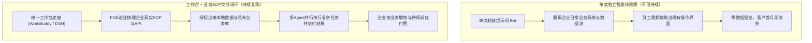

# 2026-11-21 · 企智AI落地派 · 第1场直播

本次直播（Session 159：2026-11-21 21:52:30 至 2026-11-22 08:23:42，长达 10.52 小时跨夜攻坚大直播，全量解码 4 个高保真音频分卷，共 72 个自适应重叠转录切片，3,782 段时间戳发言完整审阅，557 条弹幕全量复核并采纳 557 条技术与企业落地互动）是企智AI落地派在企业端智能体落地、桌面工作台生态变革与一人公司（OPC）交付深水区的又一次高密度实战复盘。在这场通宵达旦的实战研讨中，郭总与多位来自企服开发、传统企业数字化转型的技术嘉宾及一线 FDE（现场交付工程师）展开深度碰撞：不仅系统性祛魅了“单卖独立智能体（Agent）”的商业幻觉，深入论证了企业端必须依托统一工作台承载标准化业务 SOP 的底层逻辑；更是全面剖析了腾讯 WorkBuddy 等桌面级 AI 工作台在传统大型企业（如金融保险、本地龙头）中的极速渗透；同时在架构层面彻底厘清了“调度层桌面工作台”与“底层开源自进化智能体（如 Hermes Agent）”的本质差异；并复盘了 FDE 进驻现场直接使用 Agent 调取数据写 SQL 生成自动化报表、降维颠覆传统几十万软件定制开发的一线打法。

---

## 一、破除“单卖智能体”幻觉：从单点Agent玩具到工作台SOP闭环

在直播前半场，多位刚刚入局 AI 创业的嘉宾分享了试图通过包装独立智能体（如文案 Bot、客服 Bot）向中小企业售卖却遭遇严重复购困境的挫折。郭总直击痛点，彻底揭穿了“单卖智能体”的商业死穴。

### 1. 为什么说单卖独立智能体是不长久的伪需求
- **边际效应递减与易被替代**：单点智能体本质上是一段封装了系统提示词（System Prompt）的对话接口，既没有沉淀企业专有数据，也没有嵌入企业的日常操作流水线。客户在新鲜感消退后，发现大模型原生 App（如豆包、Kimi、通义千问）完全能免费实现类似功能，续费率几乎为零；
- **业务割裂与员工抵触**：如果让企业员工每天切换到第三方的独立网页或小程序去单独问答，这种割裂的交互体验严重违背既有工作习惯。员工没有动力主动为一个外部 Bot 录入上下文，导致智能体沦为孤岛式的摆设。

### 2. 商业闭环的本质：工作台底座 + 定制调优服务
- **把工作台当成业务承载的“母港”**：真正能让企业持续付费的，是能够无缝嵌入员工日常桌面的工作台底座（例如腾讯 WorkBuddy、DSH 或内部统一门户）。工作台提供了多智能体协同、本地文件授权访问、第三方 API 调用的调度中枢；
- **卖调优服务而非卖提示词**：正如连麦资深企服嘉宾在 `F01-L013-S028` 中所断言：“如果是单卖智能体的话，它是不长久的。底座平台无论是 WorkBuddy 还是 DSH，底座本身可以拿给客户用，甚至底座都是通用的；真正有价值、客户愿意付费的，是我们为企业定制调优的业务 SOP、清洗私有知识库、打通内部系统的工程交付。”



---

## 二、腾讯 WorkBuddy 深度透视：桌面级 Agent 渗透传统企业的现实图景

直播深入探讨了近期在深圳及一线城市企服市场引发巨大反响的明星产品——**WorkBuddy**（由腾讯云代码助手团队孵化升级的全场景职场 AI 智能体桌面工作台）。现场嘉宾结合本地企业实地调研，披露了大厂桌面工作台的攻势与实战定位。

### 1. 传统龙头与大型企业已被大厂工作台抢先覆盖
- **大厂品牌的信任背书与合规准入**：在 `F01-L015-S048` 与 `L016-S014` 中，一线服务商透露：“像现在深圳的大公司、像平安这种集团企业，员工桌面端基本上已经被腾讯等大厂的 WorkBuddy 抢先占据了。”对于大型金融、制造类企业而言，第三方的未知软件根本无法通过 IT 安全合规审计，而依托大厂生态的桌面端 Agent 拥有天然的准入特权；
- **从代码助手跃迁为全场景职场工作台**：WorkBuddy 不再局限于程序员写代码的场景，而是进一步打通了微信公众号、腾讯文档、腾讯会议、本地私有文件夹等系统权限，支持多 Agents 并行协同，直接根据老板的一句话规划任务并生成报表、PPT 及合同初稿。

### 2. 本地服务商的新定位：成为大厂工作台的落地实施与实施顾问
- **不做重复造轮子的底座，专注应用层装配**：面对大厂在桌面级操作系统的强势卡位，一人公司（OPC）和服务商切忌妄想去自研一套竞品工作台。聪明的服务商选择以“官方服务商/落地实施合伙人”身份切入，帮助企业把具体的业务逻辑配置进 WorkBuddy 的专家技能库（Skill）中；
- **解决大厂“最后一公里”的落地真空**：大厂虽然提供了强大的桌面客户端与 API，但大厂绝不会为一家 50 人的传统贸易公司定制其报关单校验流程。这种散落在全国各行各业的“微型自动化集成”，正是 FDE 与 OPC 赖以生存的高利润蓝海。

---

## 三、架构层级彻底厘清：调度层工作台与开源自进化智能体的分工

在直播中段，弹幕与多位麦上嘉宾对“WorkBuddy、DSH、Hermes Agent 与 Claude Code”等概念产生了混淆，甚至有人误将 WorkBuddy 与底层自进化大模型框架等同视之。郭总与资深极客嘉宾展开了教科书式的架构分级剖析。

### 1. WorkBuddy：负责手脚与连接的应用层调度工作台
- **本质是任务规划与工具调用的界面**：如在 `F01-L044-S022` 与 `L044-S029` 中清晰定义的，WorkBuddy 本身并不是一个独立的模型，它是一个桌面级工作台。它的核心功能是承载 MCP 协议、调度各垂直领域的专家 Skill，并具备调用本地文件系统与外部网络 API 的执行能力；
- **扮演企业的“手脚与打工人”**：用户要求订机票、汇总 Excel 报表、抓取网页信息，WorkBuddy 负责把自然语言拆解为一系列工具执行动作并汇总呈现。

### 2. Hermes Agent：负责长效记忆与自主进化的智能体骨架
- **开源全自主自进化底座**：相比之下，Nous Research 推出的 **Hermes Agent** 属于底座级的智能体架构。它不仅拥有更深层次的自主反思（Self-reflection）和长效状态保持机制，还支持通过连续对话与环境交互实现权重的微调自进化；
- **骨架与血肉的关系**：技术嘉宾作了极为生动的比喻：“你可以把 Hermes Agent 理解成机器人的身体骨架与神经中枢，而 WorkBuddy 则是给机器人穿上的工装和赋予它的各种工具钳。没有底座的强大推理与记忆，工作台只是一具空壳；而没有工作台的工程封装，开源智能体底座也无法被普通办公室文员所理解。”

| 维度 | 桌面调度工作台 (如 WorkBuddy / DSH) | 底座自进化智能体 (如 Hermes Agent) | 终端深度开发智能体 (如 Claude Code) |
| :--- | :--- | :--- | :--- |
| **核心定位** | 职场桌面交互中枢、多Agent调度面板 | 开源自主推理、自反思自进化智能体框架 | 面向多文件代码重构与命令行自主执行的编程Agent |
| **主要功能** | 本地文件操作、生成PPT/报表、连接第三方API | 复杂长链路逻辑推理、自适应任务策略生成、状态长效保持 | 跨目录语法树解析、Git版本联动、终端命令直接执行 |
| **部署方式** | 桌面客户端安装，一键授权本地权限 | 本地/局域网服务部署，开源模型微调挂载 | 终端命令行或容器沙箱环境运行，挂载中转API |
| **适用人群** | 企业普通职场员工、行政、销售、运营 | 极客开发者、垂直领域解决方案架构师 | 专业软件工程师、一人公司独立全栈开发者 |

---

## 四、FDE 现场降维实战：Agent 打通接口写 SQL 自动出报表，直接淘汰传统定制软件

在直播下半场，一位资深企服软件老兵分享了其团队在制造和电商企业现场的落地攻坚经验（`F01-L042-S059`），揭示了生成式 AI 对传统企业软件开发模式的颠覆性重构。

### 1. 传统软件定制外包的死穴与高成本困局
- **数十万成本与数月开发周期**：在传统模式下，企业如果需要将多个 ERP、CRM 及第三方电商后台的数据汇总生成自定义财务与运营看板，通常需要聘请定制开发团队，经历漫长的需求评审、数据库建模、后端开发与前端页面设计，起步费用动辄数十万元；
- **维护成本高且难以适应业务变动**：一旦企业的报表字段或统计口径发生微调，传统软件系统往往需要重新走排期、改代码、提测部署，导致企业陷入持续的软件维护费泥潭。

### 2. FDE 极简降维打法：Agent 接口授权 + 本地写 SQL 自动化
- **直接穿透第三方数据接口**：FDE 进驻现场后，协助企业通过官方合法授权接入各业务平台的开放 API 或本地数据库只读副本；
- **智能体实时生成 SQL 与定时清洗**：利用工作台挂载的 Agent，直接根据运营提出的自然语言需求编写 SQL 语句，实时抽取跨库多表数据，并在本地沙箱内自动运行清洗脚本；
- **零前端开发，自动化报表直达决策者**：脚本生成的数据透视表、图表直接通过飞书机器人或微信工作群在每天清晨定时推送到老板手机上。原本需要耗费一个技术团队数月才能交付的系统，FDE 仅需半天配置即可跑通闭环，以极低边际成本对传统软件公司形成降维打击。

---

## 五、海外工具防封与中转替代：Claude Code 遇险与 DeepSeek 跨界工程实践

面对越来越严格的海外服务封控，麦上一线开发者分享了其在海外高强度使用 Claude Code 时遭遇封号的真实经历与实操解法。

### 1. 账号封禁后的痛点与技术自救
- **官方风控收紧的常态化**：随着海外厂商对 API 滥用、跨区域访问（如住宅代理检测）的打击力度持续上升，许多重度依赖海外账号的国内独立开发者频繁遭遇无预警封号；
- **中转 API + 软件壳的改造方案**：正如嘉宾在 `F01-L045-S030` 中指出，开发者不必放弃 Claude Code 优秀的终端多文件上下文管理与自动化架构，而是通过协议转换工具将 Claude Code 的后端请求重定向至国内高性价比的中转服务或聚合平台；
- **挂载 DeepSeek 满血版模型的实测收益**：实测表明，使用 DeepSeek 满血版中转替代原生模型后，在处理大规模代码重构与自动化脚本编写时，响应速度甚至提升了近 50%，且综合调用成本仅为原版的几十分之一，彻底摆脱了海外封号带来的业务中断风险。

---

## 六、全场核心主张与交付事实交叉验证 (Claims)

```json
[
  {
    "claim_id": "CLM-QZ159-001",
    "statement": "单卖智能体缺乏商业长效性，企业服务必须依托WorkBuddy等基座工作台承载SOP闭环",
    "decision": "approved_with_qualification",
    "qualification": "企智与连麦嘉宾指出：单卖独立智能体难以形成壁垒和复购，必须依托工作台底座（如WorkBuddy、DSH等），由服务商深入业务定制SOP和API接口调试，按调优服务与增量交付向企业收费。",
    "evidence": [
      {
        "segment_id": "F01-L013-S028",
        "file_id": "F01",
        "chunk_id": "F01-L013",
        "start": 7500.02,
        "end": 7536.48
      }
    ]
  },
  {
    "claim_id": "CLM-QZ159-002",
    "statement": "智能体打通第三方接口写SQL出报表，直接降维取代传统高价定制软件",
    "decision": "approved_with_qualification",
    "qualification": "嘉宾以企业报表业务为例指出：传统帮企业抓取第三方数据做定制报表的软件壁垒已被打破，如今通过AI工作台授权连接第三方系统后，直接写SQL自动抓取并定时发送报表，使传统数十万的低附加值定制开发丧失生存空间。",
    "evidence": [
      {
        "segment_id": "F01-L042-S059",
        "file_id": "F01",
        "chunk_id": "F01-L042",
        "start": 25112.61,
        "end": 25152.13
      }
    ]
  },
  {
    "claim_id": "CLM-QZ159-003",
    "statement": "智能体架构分层：WorkBuddy充当调度工作台（手脚），Hermes Agent充当自进化底座（骨架与大脑）",
    "decision": "approved_with_qualification",
    "qualification": "连麦技术嘉宾澄清生态认知混淆：WorkBuddy并非纯粹独立的独立大模型智能体，而是集成各种skill与外部调用的工作台（负责发指令、订机票、执行操作）；而底层如Hermes Agent才是具备深度持续推理反思的自进化智能体骨架。",
    "evidence": [
      {
        "segment_id": "F01-L044-S029",
        "file_id": "F01",
        "chunk_id": "F01-L044",
        "start": 25982.64,
        "end": 25997.81
      },
      {
        "segment_id": "F01-L044-S037",
        "file_id": "F01",
        "chunk_id": "F01-L044",
        "start": 26044.1,
        "end": 26054.89
      }
    ]
  }
]
```
