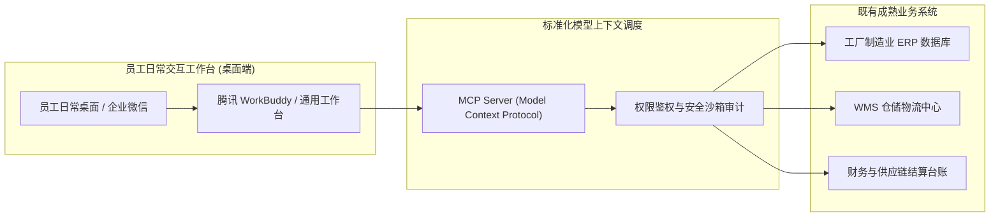

# 2026-11-22 · 刀文AI商业：企业赋能深水区——MCP与WorkBuddy打通传统ERP、车企GEO千万级战略试错与初创AI团队融资避坑

本次直播（Session 160：2026-11-22 00:08:07 至 2026-11-22 02:19:35，时长 2.19 小时，全量解码 1 个高质量音频文件，共 14 个自适应重叠转录切片，904 段时间戳发言完整审阅，24 条核心弹幕全量复核并采纳）是刀文AI商业探讨企业级 AI 深度落地、制造业 FDE（现场交付工程师）实战、GEO 战略分层以及 AI 初创公司融资避险的高浓度复盘。在深夜的高强度连麦博弈中，刀文与多位来自企服开发、实体制造业供应链以及资深科技投资领域的操盘手深入复盘：针对“企业端智能体伪需求”，犀利指出单独开发或售卖提示词 Bot 毫无商业价值，唯一可行的落地工程路径是基于通用工作台（如腾讯 WorkBuddy）配合标准化 MCP（模型上下文协议）连接并激活企业既有 ERP 数据库；针对火热的生成式引擎优化（GEO），深入剖析了奇瑞、长安等主流车企豪掷千万做战略试错买防御确定的决策机制，严肃告诫中小商家切勿盲目跟风买单；并从资本运作底层逻辑出发，深度拆解了早期 AI 初创团队切忌过早引入具有严苛返投与穿透核查属性的政府引导基金（ZF基金）的生死教训。

---

## 一、企业赋能深水区：破除独立Bot幻象，以 MCP + 工作台激活企业既有 ERP

在直播开场阶段，多位技术开发者探讨如何为传统中大型企业（如制造业工厂、商贸供应链公司）交付 AI 解决方案时，刀文团队与资深技术合伙人展开了深入交锋（`F01-L002-S035`）。

### 1. 为什么“单出任何独立智能体”都是徒劳无功
- **企业核心资产在既有业务数据库**：传统实体企业的日常运转高度依赖运行了十几年的 ERP、WMS、CRM 等成熟系统。这些系统沉淀了企业最核心的进销存数据、供应链台账与财务往来。
- **孤立 Bot 无法产生业务闭环**：如果开发者只是包装一个网页版对话框或独立小程序，要求业务人员手动把 ERP 里的报表导出来投喂给大模型，这不仅没有提升效率，反而增加了员工的搬运负担与数据泄露风险。刀文技术团队明确断言：“现在你出任何单一的智能体都没有意义，企业根本不会为这种玩具买单。”

### 2. 标准化打通路径：通用桌面工作台 + MCP 协议直连 ERP
- **MCP（模型上下文协议）的中枢价值**：企业服务不应重复造轮子去开发专属客户端，而是利用 Anthropic 发起、行业普遍认可的 MCP 协议，将企业既有 ERP 系统的只读 API 封装为标准的工具接口（Tools）；
- **依托企业微信与桌面端生态快速落地**：如 `F01-L004-S059` 与 `S067` 中讨论，制造业工厂与供应链企业员工的日常沟通高度依托企业微信。选择像腾讯 **WorkBuddy** 这样的全场景桌面工作台，挂载封装好的 MCP 插件，员工在日常办公界面中即可用自然语言下达指令（如“查询华东仓库本周库存告警并导出补货建议”），由 WorkBuddy 调度 MCP 自动从 ERP 提取全量数据并生成格式化报表。



---

## 二、GEO 商业分层真相：车企大厂的战略试错 vs 中小商家的 ROI 陷阱

直播中段，多位嘉宾对“汽车行业与大厂疯狂做 GEO（生成式引擎优化）”的现象进行了激烈讨论（`F01-L010-S004` 至 `S019`）。刀文从甲方商业决策心智出发，彻底撕开了大企业与中小商家在 GEO 投入上的认知鸿沟。

### 1. 为什么奇瑞、长安等车企大厂愿意砸千万做 GEO 试错
- **大模型推荐位已成为汽车品牌必争之地**：随着年轻购车群体习惯使用豆包、通义千问、Kimi 等 AI 工具进行“15万级国产混动SUV推荐对比”，大模型的问答生成结果直接影响终端潜客的购车心智；
- **董事长的核心诉求是“买确定性与买结论”**：刀文一针见血地指出：“董事长看到竞品奇瑞在做、长安在做，他给团队批一千万去做试错，核心不是为了短期的线索转化 ROI，而是要团队给出一个权威结论——这个东西未来到底能不能做？不做会不会被大模型在推荐中抹除？大厂是在用容错预算对冲时代的战略风险。”

### 2. 为什么中小实体商家盲目跟风做 GEO 是必死陷阱
- **产出周期长与黑盒算法风险**：GEO 依赖大模型底层训练语料收录与联网检索权重的更新，算法调控高度黑盒，无法像信息流广告那样实现“今天投流、明天进店核销”；
- **中小商家的生存法则在于极简的高转化确定性**：刀文严肃告诫中小创业者和本地商家：“中小商家本就资金匮乏，非要去跟风做高大上的 GEO，或者折腾开源 GUI 工具，有这个闲工夫，不如踏踏实实多拍几条高质量的抖音短视频！在抖音、美团上做好本地生活团购和私域沉淀，那是看得见摸得着的真实到店核销。”

| 决策维度 | 车企与大厂 (奇瑞/长安等) | 中小商家与本地生活实体 |
| :--- | :--- | :--- |
| **核心诉求** | 战略防御、竞品对抗、买未来业务结论 | 快速获客、现金流回血、高单客核销 ROI |
| **预算容忍度** | 800万 ~ 1,500万元试错容错预算 | 极其敏感，要求每笔营销支出两周内见成效 |
| **考核指标** | 大模型问答正面露出率、全网舆情声量 | 到店咨询人数、核销团购券量、单客获客成本 |
| **战术建议** | 构建企业官方知识库、全面做高权重语料覆盖 | 坚守抖音短视频、大众点评本地运营、企微私域转化 |

---

## 三、AI 创投生存法则：早期融资结构风险与资本陷阱规避

在直播尾声，连麦资深投资人与创业操盘手针对“AI 初创团队如何选择资金类型”分享了残酷的实操避坑经验（`F01-L013-S024` 至 `S034`）。

### 1. 早期切忌过早引入政府产业引导基金（ZF基金）
- **严苛的返投比例与产业落地约束**：政府引导基金的核心目标是为本地招商引资和拉动税收，通常附带 1.5 倍乃至 2 倍的本地返投指标（要求企业在当地设立实体、招聘本地研发人员并产生纳税）；
- **穿透底审查与无限连带担保风险**：ZF基金在尽调与风控上要求极度苛刻的“穿透底审查”，一旦企业发展不如预期触发回购条款，往往要求创始人团队承担不可免除的连带责任。

### 2. 对后续市场化融资的“毒药效应”
- **主流市场化 VC 对 ZF 基金心存顾忌**：刀文团队与投资嘉宾强调：“新业务如果在天使轮或早期阶段就带上了 ZF 基金，未来的融资路径就会被严重卡死。后续主流的市场化 VC（无论是美元基金还是一线人民币机构）一看到复杂的返投和国有资产保值退出条款，直接就会选择放弃投资；”
- **正确的资本节奏策略**：AI 初创企业早期应该靠创始团队自筹、业务自造血跑通正向现金流，或者引入理解技术周期的市场化天使投资；只有等企业估值上规模、业务模式完全跑通、需要大规模拿地建厂或扩展地方产业园区时，才是引入政府引导基金的最佳时间窗口。

---

## 四、全场核心主张与交付事实交叉验证 (Claims)

```json
[
  {
    "claim_id": "CLM-DW160-001",
    "statement": "单卖智能体缺乏商业长效性，企业服务必须依托MCP协议接入既有ERP数据",
    "decision": "approved_with_qualification",
    "qualification": "刀文团队与技术嘉宾明确指出：单纯开发独立智能体无法打通企业真实业务，合理的工程路径是采用通用桌面工作台（如WorkBuddy）并基于MCP协议连接企业既有的ERP核心数据，实现对历史数据的调用与跨流程响应。",
    "evidence": [
      {
        "segment_id": "F01-L002-S035",
        "file_id": "F01",
        "chunk_id": "F01-L002",
        "start": 904.83,
        "end": 924.94
      }
    ]
  },
  {
    "claim_id": "CLM-DW160-002",
    "statement": "车企做GEO属于千万级战略试错与竞品防御，中小商家跟风易陷入极低ROI陷阱",
    "decision": "approved_with_qualification",
    "qualification": "针对奇瑞、长安等车企布局GEO现象，刀文深度剖析大厂与中小商家的决策断层：大企业做GEO是为了防止被大模型推荐抹除而进行战略试错，并不苛求短期单客成本；而中小实体商家若将有限精力投入GEO，远不如直接制作高转化短视频进行本地生活引流划算。",
    "evidence": [
      {
        "segment_id": "F01-L010-S004",
        "file_id": "F01",
        "chunk_id": "F01-L010",
        "start": 5413.86,
        "end": 5430.12
      }
    ]
  },
  {
    "claim_id": "CLM-DW160-003",
    "statement": "初创AI团队早期接入政府引导基金会导致后续市场化融资路径严重受限",
    "decision": "approved_with_qualification",
    "qualification": "从股权架构与融资策略出发，实战投资嘉宾警示：早期AI项目若过早引入具有严苛返投倍数、穿透到底核查及退出刚兑属性的政府产业引导基金（ZF基金），将直接劝退后续主流美元/人民币市场化VC，大幅缩窄业务调整与跨境出海的空间。",
    "evidence": [
      {
        "segment_id": "F01-L013-S027",
        "file_id": "F01",
        "chunk_id": "F01-L013",
        "start": 7476.38,
        "end": 7490.92
      }
    ]
  }
]
```
