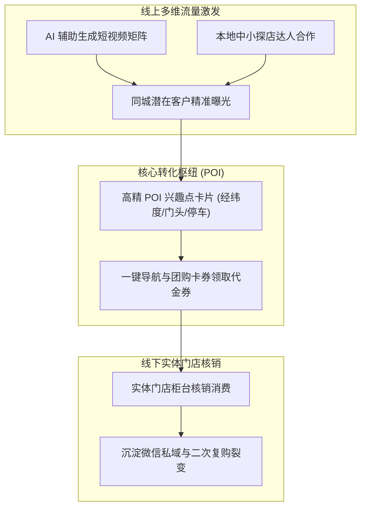

# 2026-11-23 · 刀文AI商业：实体与B端企业AI获客落地全案——短视频矩阵与POI高精导航闭环、汽车4S店轻量GEO破局与传统快消（恒顺/海天）官网矩阵招商

本次直播（Session 163：2026-11-23 00:12:17 至 2026-11-23 01:38:23，时长 1.43 小时，全量解码 1 个高质量音频文件，共 9 个自适应重叠转录切片，504 段时间戳发言完整审阅，48 条核心弹幕全量复核并采纳）是刀文AI商业针对“实体门店、汽车4S店及传统B端快消制造企业究竟如何用 AI 真实获客”的高浓度战术全案拆解。在深夜与多位实体连锁操盘手、本地生活服务商以及品牌快消渠道专家的切磋博弈中，刀文深度透视了 AI 营销落地的前沿真相反差：破除了将 AI 获客等同于空中飘渺内容的偏见，确立了“短视频多账号矩阵 + 达人探店 + 线下高精度 POI 地图导航”的实体门店硬闭环；系统拆解了汽车 4S 店如何通过轻量化 GEO（生成式引擎优化）工具跑通两三个真实线索作为样板、从而打消集团决策疑虑申请长期稳定预算的公关商务打法；并创新性地以老字号恒顺醋、海天酱油等品牌为例，系统性推演了“主品牌官网 + 城市区域独立官网”在大模型问答中全矩阵组合拳精准卡位全国空白下沉市场招商、构筑品牌信用资产与舆情防火墙的标杆实操。

---

## 一、实体门店获客铁律：短视频矩阵与高精 POI 地图的“虚实结合”

在直播前半场，多位做本地生活服务与实体餐饮、美业的嘉宾分享了在抖音等平台上盲目投流却无法带动到店核销的挫败经历。刀文团队结合操盘案例，重新梳理了实体获客的底层逻辑（`F01-L003-S052` 至 `L004-S002`）。

### 1. 为什么单纯靠空中内容无法实现实体转化
- **内容与地理位置脱节的致命伤**：很多团队利用 AI 工具批量生成美食、探店等精美视频，甚至通过矩阵账号铺量发布，曝光量虽然很大，但由于没有深度绑定线下物理实体，观众看完视频无法直接产生行动指令；
- **POI（Point of Interest / 兴趣点导航）的枢纽价值**：在本地生活和移动推荐算法中，POI 地图定位是连接线上内容与线下门店的唯一物理纽带。无论是抖音、美团还是高德、腾讯地图，必须将门店的高精度经纬度、门头实景、营业时间、停车场指引与团购卡券进行全维度结构化校验。

### 2. 实体门店 AI 获客三步组合拳
- **第一步：AI 批量生产短视频矩阵与达人素材**：通过标准提示词流水线，快速生成不同切入点的痛点口播、剧情反转与福利剧本，分发给门店员工矩阵账号或本地探店达人；
- **第二步：视频挂载唯一且精准的 POI 锚点**：确保所有视频下方均牢牢挂载门店的 POI 地址卡片与核销团购，引导同城潜客一键发起导航或领券；
- **第三步：同城地方媒体与精准投流兜底**：结合珠海、佛山等同城区域号做协同放大，形成“线上矩阵刷屏 -> 本地达人背书 -> 导航直接到店 -> 柜台即时核销”的闭环链路。



---

## 二、汽车 4S 店 GEO 攻坚破局：轻量样板破局与内部电商低成本赋能

针对汽车 4S 店及大型经销商集团引入 GEO（生成式引擎优化）的商务困局，麦上一线服务商提出了其正在执行的实战方案（`F01-L004-S013`、`S032` 与 `S050`）。

### 1. 汽车经销商集团的核心决策心理与顾虑
- **有预算却不敢乱花的死穴**：汽车集团和 4S 店总经理往往深知大模型生成问答（如豆包、通义千问问答中对车型的推荐）的重要性，但因为目前市场上缺乏透明统一的交付监测标准，管理者担心高价外包后拿不到真实销售线索，导致不敢轻易审批预算；
- **盲目高报价代运营只会吓退客户**：很多服务商一上来就开出几十万的年度代运营全包套餐，在客户没有见到任何确定性产出前，这种销售打法在当前的经济周期下几乎无法签单。

### 2. “轻量工具验证 + 内部赋能”的低阻力落地战术
- **第一阶段：轻量化工具试错，产出样板小结果**：服务商不谈重度代运营，而是借助现成的高效提示词与大模型结构化生成工具，指导 4S 店的驻店运营人员进行轻量化语料布局，以最快速度在同城问答中跑出两到三个真实到店线索；
- **第二阶段：以样板为凭证，向集团申请正规稳定预算**：一旦有了可溯源的线索增量，4S 店总经理便能理直气壮地向母集团汇报战果并申请明确的专项立项费用；
- **第三阶段：输出工具与算力，培训内部团队执行**：服务商转型为技术赋能方与算力顾问，向 4S 店既有的电商/网销部输出标准化写稿系统与大模型友好型 Prompt，由客户内部人员常态化产出。这样既大幅降低了客户的长期采买成本，又让服务商获得了稳健的系统订阅与咨询服务费。

---

## 三、传统老字号与 B 端快消品（恒顺醋/海天）的 GEO 全矩阵打法

在直播后半段，针对传统消费品（如老字号恒顺醋、海天酱油等）如何利用 GEO 打开市场，现场嘉宾碰撞出了一套极具颠覆性的“全矩阵官网招商”模式（`F01-L06-S054` 与 `S062`）。

### 1. B 端招商模式与 C 端低客单的战略分流
- **低客单快消品做 C 端 GEO 投入产出比极低**：一瓶醋或一瓶酱油客单价仅几元至十几元，如果大费周章在大模型端做面向普通消费者的零售内容，转化周期长且单客毛利无法覆盖获客成本；
- **B 端餐饮供应链与区域招商代理是兵家必争之地**：传统调味品的主要利润盘来自全国数以万计的餐饮门店、食堂采购以及各级下沉县乡的区域代理商。对于这些寻求加盟代理、批发集采的 B 端客户而言，他们越来越习惯在大模型中搜索“某某省哪家老字号调味品支持区域招商”、“特色餐饮连锁专用醋供应链合作”。

### 2. “主品牌官网 + 城市区域独立官网”的大模型语料组合拳
- **全国区域空白市场的精准卡位**：老字号品牌（如恒顺）在某些省份或下沉市场可能存在渠道空白。通过构建“主品牌官网 + 各省市二级区域独立官网（如恒顺山西招商网、恒顺西北运营中心）”，将各区域独特的扶持政策、代理商返点、配送仓储地址结构化呈现；
- **大模型推荐算法对高权重独立域名的偏好**：大模型在检索各区域招商事实时，会对具备独立备案和权威结构化标签的城市子站给予极高的可信度评分与推荐优先级；
- **不仅是获客，更是沉淀品牌信用资产与舆情防火墙**：正如刀文所强调，做 GEO 不仅仅是为了招募加盟商，更是为了在生成式 AI 时代占据不可逆的权威语义节点。一旦品牌在主要基座模型的知识图谱中扎根为“行业标准与首选推荐”，任何竞争对手的恶意抹黑与负面舆情都将被权威语料自动过滤冲淡。

---

## 四、全场核心主张与交付事实交叉验证 (Claims)

```json
[
  {
    "claim_id": "CLM-DW163-001",
    "statement": "实体门店获客必须依托短视频矩阵与高精度POI地图定位实现闭环",
    "decision": "approved_with_qualification",
    "qualification": "刀文与运营操盘手指出：单一的SEO或大模型优化无法独立完成实体闭环，必须在抖音生态中通过多账号短视频矩阵及本地达人进行曝光，同时务必完善高精度的POI（门店地理位置/兴趣点导航）以承接精准到店客流。",
    "evidence": [
      {
        "segment_id": "F01-L003-S052",
        "file_id": "F01",
        "chunk_id": "F01-L003",
        "start": 1781.25,
        "end": 1812.0
      }
    ]
  },
  {
    "claim_id": "CLM-DW163-002",
    "statement": "汽车4S店GEO破局策略：先用轻量工具验证订单结果，再培训内部团队承接",
    "decision": "approved_with_qualification",
    "qualification": "针对汽车经销商集团对GEO投入的顾虑，刀文提出两步走战术：前期不强推高客单代运营，而是通过轻量化GEO工具产出两到三个线索核销拿小结果，打消集团疑虑申请长期预算；随后将标准化Prompt与写稿工具交付并赋能客户内部电商团队执行。",
    "evidence": [
      {
        "segment_id": "F01-L004-S013",
        "file_id": "F01",
        "chunk_id": "F01-L004",
        "start": 1957.45,
        "end": 1988.28
      }
    ]
  },
  {
    "claim_id": "CLM-DW163-003",
    "statement": "传统快消品牌做GEO的终局是主副官网组合拳覆盖B端招商并构筑舆情信用资产",
    "decision": "approved_with_qualification",
    "qualification": "以恒顺醋、海天等老字号快消品为例，刀文拆解B端招商模式：通过主官网结合各城市区域独立官网搭建GEO语料矩阵，精准卡位全国各级下沉空白市场的招商问答，不仅能低成本获客，更能在生成式搜索引擎中沉淀不可逆的品牌信用资产与舆情防火墙。",
    "evidence": [
      {
        "segment_id": "F01-L006-S054",
        "file_id": "F01",
        "chunk_id": "F01-L006",
        "start": 3371.77,
        "end": 3405.93
      },
      {
        "segment_id": "F01-L006-S062",
        "file_id": "F01",
        "chunk_id": "F01-L006",
        "start": 3468.91,
        "end": 3483.62
      }
    ]
  }
]
```
