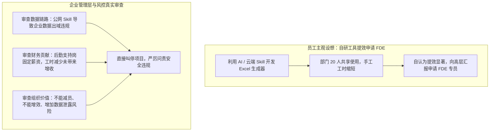
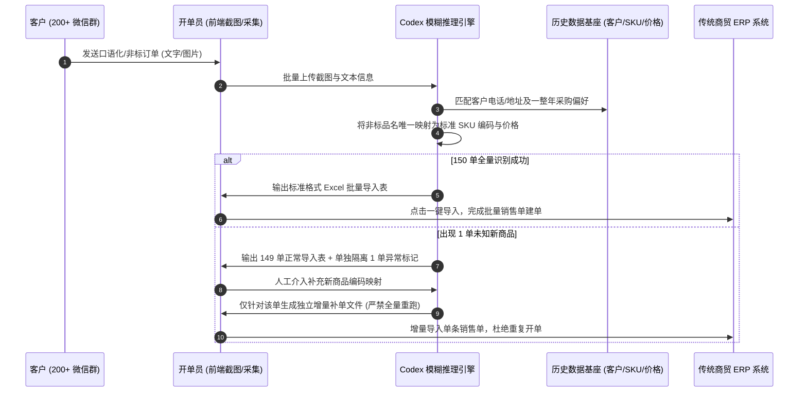
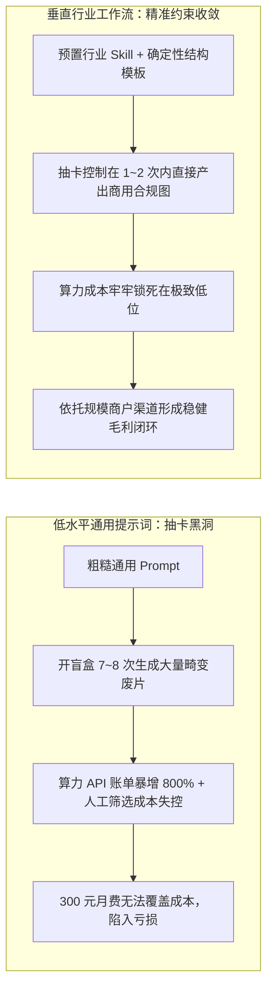

# 2026-11-23 · 企智AI落地派 · 第1场直播

本次直播（Session 165：2026-11-23 21:51:32 至 2026-11-24 16:20:46，跨越昼夜持续录制达 18.47 小时的超级马拉松大直播，全量解码 3 个无损音频分卷，共 116 个自适应重叠转录切片，6,329 段时间戳发言完整审阅，1,570 条弹幕全量复核并采纳）是企智AI落地派针对传统商贸供应链自动化、企业内部推行 AI 合规红线、微信/企微客服纯视觉操控防风控机制、实体店低价代运营算力账本，以及传统工业场景数据前置基座的一次全息深度复盘。在这场横跨 18 个多小时的实战交锋中，主播郭总与来自商贸供应链一线操盘手、桌面视觉自动化开发者、企业职能部门员工及工业视觉服务商展开了高密度的业务拉扯：深入剖析了一位物流后勤员工试图靠自研 Excel 工具转型内部 FDE 时遭遇的数据出域与业务无挂钩的现实壁垒；全景还原了商贸老兵大刘如何利用 Codex 深度喂养一年历史订单，把 400 个客户微信群里杂乱无章的截图和口语非标订单，一键对齐清洗并导入 5000 SKU 的传统 ERP 系统，并确立了“增量隔离、防全量重复开单”的工程铁律；深入辩析了客服端纯视觉识别获取消息与防封回复的底层逻辑，以及企业知识库因报价单与话术相悖导致 Agent 陷入死循环的翻车教训；并从算力线性计费与提示词抽卡概率的视角，深度拆解了 300 元实体店代运营打法的真实成本与可行性边界。

---

## 一、企业内推 AI 的生存红线：数据安全出域风险与职能部门“伪提效”解构

在直播前半夜（`F01-L005-S035` 至 `S068`），一位来自企业物流支持部门的员工连麦分享了其自学 AI 工具为部门 20 人开发表格生成器的经历，引发了现场关于“企业内部推 AI 的合规底线与管理层考核逻辑”的深度交锋。

### 1. 基层员工自研工具的典型困局
- **业务痛点**：公司内部有一个主数据表，物流部 20 名员工每天都需要基于该主表各自处理细分事务，手工拆解和汇总耗时费力；
- **自制解决方案**：该员工发现飞书多维表格在内部使用非常不便，于是利用 AI 编写了一个 Excel 本地表格生成器，并将其部署到公司局域网共享盘中，供部门 20 人使用，同时在本地走通了邮件发送流程；
- **个人诉求**：该员工自认为做出了重大提效成果，计划向公司高层领导汇报立项，并借此申请转岗成为部门专属的“FDE（Forward Deployed Engineer）专员”。

### 2. 致命盲区一：私自引入公网 Skill 与数据出域合规红线
- **员工的主观误判**：当麦上评委询问“表格中是否有敏感数据”时，该员工脱口而出“不敏感，绝对不敏感”；
- **严厉警示与安全边界**：现场评委和主播当场严肃打断并指出：“**普通员工绝对没有资格替公司判断数据是否敏感！**”
  - **云端数据同步陷阱**：该员工在工具中调用了飞书或豆包的云端 Skill，而这些公网 Agent 会将处理上下文和表格数据同步至大模型供应商的服务端，这些服务器完全不在企业内部网络或私有云的受控范围内；
  - **本地共享盘与公网传输的脱节**：即使生成器文件存放在公司共享盘、邮件服务器也是内网搭建，但只要数据流经了未经企业信息安全部门审批的公网 API 或云端插件，在法务和安全合规层面就已经构成了严重的数据资产泄露风险。

### 3. 致命盲区二：非业务岗位的“伪提效”无法换来管理层买单
- **固定成本岗位的提效悖论**：主播深入追问该员工的岗位职责，得知其为物流部纯职能后勤，拿固定工资，工作结果完全不直接与公司销售额或利润挂钩；
- **管理层的算账逻辑**：
  - 如果一个销售或一线业务员，借助 AI 将工作时间压缩到每天 4 小时，同时为公司多做了 20 万的业绩，这是管理层愿意真金白银重奖的“真提效”；
  - 但对于拿固定薪资的后勤支持岗，即使自研工具帮大家每天省下两个小时，**如果省下来的时间无法转化成新增业务增量，也无法直接裁减外部采购预算，在老板眼中就是“让员工多摸了两个小时鱼”**，根本不具备立项或升职加薪的商业说服力。

---

## 二、商贸供应链 5000 SKU 非标群单入库实操：大刘的 Codex 映射与增量防重开单工程

在直播中段（`F02-L010-S003` 至 `L012-S047`），老兵大刘全景复盘了其深入一家 30 人传统供应链商贸公司、利用 Codex 解决 400 个微信群非标订单快速录入 ERP 系统的完整全案。

### 1. 传统中小商贸的现场炼狱与 ERP 历史坏账
- **组织与业务结构**：公司共 30 余人，仅 4 名销售，却对接了 3,000 多家客户（几个大型批发商，几百家中小长期客户），系统内沉淀了 5,000 多个商品 SKU；
- **开单现场堵塞**：客户习惯在 200~400 个微信群中通过文字、语音转换文字或拍照发单。每天早晨开单高峰期，4 名开单员根本处理不过来，导致仓库出库严重卡死；
- **ERP 底层坏账遍地**：由于历史管理混乱，ERP 系统中的商品品名极不规范，存在大量同名异码、编码重复，甚至过去有员工直接把汉字输入到 ERP 编码字段中，基础数据严重失真。

### 2. 基于 Codex 的非标订单结构化解析方案
大刘没有尝试直接魔改 ERP 源码，而是选择在前端开辟 AI 转换外挂流水线：
1. **构建基座数据上下文**：从公司原有 ERP 中全量导出过去一整年的真实订单流水、全量客户名单（包含收货地址、常用联系人）、全量商品库（5000 SKU 及其标准系统编码）以及客户价格档案（记录哪些客户开特价、哪些走统一定价）；
2. **多群消息无差别截图截流**：开单员在早晨巡查 200 多个群，将客户下单的聊天记录直接截图或复制长文本，集中丢给基于 Codex 构建的识别应用；
3. **模糊推理与唯一映射**：
   - 客户在微信群中下达的品名往往是口语或简称（如“红牛两件”、“大白菜五箱”）；
   - Codex 结合发单群名称、联系电话、收货地址关键词，先唯一定位到 ERP 里的具体客户 ID；再结合该客户过去一年的历史采购偏好与常用关键词，将非标品名唯一映射为 ERP 系统内部的标准商品名称与系统编码；
4. **生成标准格式一键入库**：处理完毕后，AI 直接输出符合 ERP 批量导入规范的 Excel 销售单模板，开单员点击 ERP 的“一键导入销售单”功能即可瞬间完成数百单录入。

### 3. 关键工程踩坑：单单对齐与增量防重开单规则
在实际交付测试中，大刘遭遇了极其凶险的工程事故隐患（`F02-L012-S037`）：
- **全量重新生成的灾难**：假设一批识别了 150 单，其中 149 单正确，只有 1 单因客户发了新商品或生僻地址未能识别。如果人工修改后让 AI “重新生成”，AI 极容易将 150 单全部重新输出并重复导入 ERP，导致前 149 单在财务和仓库账目上产生二次重复开单的严重灾难；
- **增量兜底设计**：大刘在工具逻辑中增加了严格的隔离规则——**未识别成功的异常单必须单独拎出作为异常队列；人工介入补齐后，AI 只能且仅能针对这 1 单生成独立补录文件**，严禁与既有正确订单合并重刷。

### 4. 实施阻力与深层反思
- **老员工的防御心理**：开单员担心掌握 AI 后自己会被裁员，一开始拒绝提供客户习惯，故意冷眼旁观；
- **黑盒规则的维护断层**：当大刘将工具打包放到员工电脑上时，普通员工根本不懂提示词与模型识别规则。一旦 ERP 增加了新商品或新客户，AI 无法自动识别，员工不知道如何重新喂养清洗数据，系统再次退化为必须依赖开发者手工维护；
- **大刘的痛切领悟**：“企业落地 AI 绝不能只盯着做单点小工具。单点工具治标不治本，如果前端销售录入不规范、ERP 原生接口不打通，外挂工具做得再花哨，最后都会变成开发者的运维噩梦。”

---

## 三、客户沟通自动化与纯视觉操控争辩：曹总实操录屏识别演进与知识库相悖翻车教训

在深夜的技术争论中（`F02-L025-S049` 至 `L027-S048`），麦上开发者曹总围绕微信/企业微信自动化方案，与现场同行展开了激烈的方案辩析。

### 1. 传统 Hook / 协议破解的封号死局
- **协议与内存 Hook 必死**：多位麦上开发者指出，过去通过逆向微信客户端、内存 Hook、修改包体或调用非官方 API 的做法，在腾讯日益严密的多维度行为风控体系下早已无路可走，封号率几乎达到 100%；
- **操作系统辅助功能（Accessibility API）的陷阱**：即使采用类似 QDOS 的系统级辅助功能进行句柄注入和窗口捕获，企微一旦监测到非自然的控件聚焦与无序的击键频次，同样会触发强制下线甚至封禁。

### 2. 纯视觉（Screen Vision OCR）路线的成熟与边界
曹总详细介绍了其自研桌面端纯视觉自动化应用的实现机制：
- **权限与工作机制**：用户下载客户端后，仅需授予操作系统级别的“屏幕录制（Screen Recording）”权限。AI 客户端在本地屏幕上像真人一样“肉眼”观察窗口画面，通过多模态视觉模型实时识别聊天气泡中的文字、图片和表情；
- **模型推理速度的关键转折点**：曹总指出，纯视觉路线在过去无法商用，核心瓶颈在于端到端延迟太长（截图上传到云端大模型解析需要 10 秒以上，无法满足即时沟通）。直到今年多模态模型（如 GPT-4o、Claude 3.5 系列以及国产优秀视觉模型）推理速度实现质的飞跃，端到端屏幕解析被压缩到 1~2 秒内，纯视觉客服才真正具备了商业落地可行性；
- **关键认知：“纯视觉只能保证‘读’不违规，防封的核心在‘发’！”**：
  - 纯录屏读屏在操作系统底层属于被动感知，完全不向微信注入任何代码，因此获取消息是 100% 安全合规的；
  - 但**在回复消息时，必须极度拟人化**：必须模拟真人鼠标移动轨迹、输入框物理点击、随机打字延迟与断句，绝不能瞬间向文本框粘贴大段长文，否则立刻会撞上平台频率风控。

### 3. 企业知识库多文档相悖导致 Agent 死锁的真实案例
在谈及客服 Agent 落地时，曹总分享了一个极其典型的翻车案例（`F02-L027-S029`）：
- **事故还原**：某手机批发商客户接入 AI 客服，客户在知识库中上传了产品底价表，其中明确标明“iPhone 18 Pro Max 批发价 10,000 元”；但客户又自作聪明地上传了一份过去的销售话术文档，话术里为了吸引客户写着“底价八千多、九千多可谈”；
- **Agent 逻辑死锁**：当终端买家进群咨询“18 Pro Max 多少钱”时，大模型在检索增强（RAG）时同时检索到了这两份互相冲突的数据。大模型无法在底层断定谁是真实标准，直接陷入自相矛盾，向客户输出：“抱歉，当前价格存在异常，我需要向主管再次确认，请您稍候……”，并在每一次追问中不断重复这一混乱推诿的话术；
- **清洗准则：单源真相（SSOT）**：曹总强调，**给 Agent 喂数据，必须严格遵循“单源真相”原则**。核心业务参数（价格、库存、退换货条件）必须有且仅有一份权威数据表，严禁把包含历史价格的旧话术、宣传文案与现行报价单混合喂入知识库。

---

## 四、300元实体店代运营打法穿透：SaaS与Token线性算力的本质冲突、抽卡废片率与批发差价真相

在直播凌晨四点至五点半（`F02-L068-S079` 至 `F03-L003-S035`），围绕“一个月向实体店收 300 元做 AI 图文代运营、批量洗牌传统代运营市场”的商业设想，现场展开了一场透彻的财务算账与技术本质大讨论。

### 1. 300元代运营的低价倾销设想
- **商业设想**：实体商家（如餐饮、美容、花店）对本地生活（小红书、大众点评、抖音图文）有强烈的获客需求，但传统代运营一个月收费 2,000~5,000 元，中小商家难以承受。某团队设想通过 AI 自动文生图、自动配文、自动排版，将每个商家的月度代运营费用直接打到 300 元，试图通过低价在全国批量横扫实体商户。

### 2. 算力成本陷阱：传统 SaaS 与大模型 Token 线性计费的本质对立
麦上一位资深工程师直击该模式的死穴（`F02-L070-S022`）：
- **传统 SaaS 的规模效应**：传统软件一旦开发完成，边际成本几乎为零，服务器带宽可以无限均摊，客户越多毛利率越高；
- **大模型算力的线性消耗**：大模型无论是调用 GPT-4、Claude 还是 MiniMax，其底层成本是**按 Token / 每张图片 / 每秒视频绝对线性计费的**。商户数量从 10 家扩大到 1,000 家，每家每天生成 10 篇图文，算力账单会呈几何级数放大，根本不存在“用户多了算力成本自然归零”的可能。

### 3. 压降真实成本的唯一钥匙：消灭“抽卡废片率”
- **纸面成本与现实成本的脱节**：
  - 纸面上看，单次文生图调用 API 的直接成本可能只有一两分钱；
  - 但在真实商业交付中，未经深度工程微调的通用提示词具有极高的随机性。普通用户为了得到一张符合商户审美、没有文字错乱和多指畸变的可用营销图，往往需要反复“抽卡（开盲盒）”7~8 次，实际算力消耗直接飙升 8 倍，外加人工筛选的时间损耗，300 元收费根本无法覆盖隐性成本；
- **成熟工作台的技术解法**：真正能够把成本做低的团队，核心技术能力不在于“买到了低价 API”，而在于**围绕特定行业构建了高度工程化的 Prompt 模板与预置 Skill**，将生成可用图片的“抽卡率”严格控制在 1~2 次以内，从而在源头上掐死无谓的算力浪费。

### 4. 独立开发者的闭门造车警告
- **渠道为王，严禁无商户自研**：麦上评委严厉警告技术开发者：“如果你自己手头没有现成的实体店客户资源，也没有能够跑通的地推销转团队，千万不要脑子一热自研代运营自动化工具！”
- 只有本身就手握数百家实体商户渠道、或者自己开着实体连锁店的经营者，才有资格以自用验证为起点去开发此类工具；脱离客户渠道的纯技术开发，99% 会烂尾在服务器账单和客户流失中。

---

## 五、工业质检与图像联想在现实中的边界：从“看图辨西瓜”到传统企业数据基座的前置铁律

在直播后半程（`F03-L006-S042` 至 `L020-S043`），针对部分开发者试图将通用大模型直接套用到工业制造质检的冲动，麦上展开了一场关于“工业级确定性与前置数据基座”的深刻清算。

### 1. 通用多模态与工业质检的鸿沟：从“辨西瓜”看工程虚火
- **西瓜熟不熟的经典诘问**：麦上一位制造业老兵面对台上高谈阔论大模型视觉质检的开发者，抛出了一个极其尖锐的现实问题（`F03-L011-S024`）：
  > “你把大模型吹得天花乱坠，我问你，我现在给你一张图片，画面里有一百个西瓜，你的大模型能不能分出来哪一个熟了？切开之后它真的保熟吗？”
- **分类联想不等于工程判定**：通用大模型擅长的是“概念联想与艺术发散”（比如根据一张涂鸦联想出一副油画，或者用自然语言描述画面），但**工业级质检要求的是微米级的几何尺寸测量、光照自适应补偿以及 99.99% 以上的确定性瑕疵检出率**。把擅长概率联想的通用大模型直接拉到流水线上当质检工人，是极其荒谬的外行空想。

### 2. 传统企业的真实底色：连结构化数据都没有，何谈智能化
- **空中楼阁式的 AI 方案**：许多 AI 创业者进厂跟老板谈“全厂 Agent 调度”、“智能化自进化中台”，却发现工厂现场连最基本的工序日报都是手写在纸质白板上，仓库库存全凭老师傅脑子记，设备运行数据根本没有联网（`F03-L020-S043`）；
- **数字化转型的残酷进阶铁律**：
  1. **第一阶段：数据基座补课**——先帮企业把业务流程理顺，把进销存、生产报工和财务数据规范化沉淀到数据库中；
  2. **第二阶段：业务流程数字化与规则化**——在干净的数据基座上建立自动化报表与规则流；
  3. **第三阶段：局部智能化探索与特定场景 Agent 辅助**——只有前两步完全夯实后，AI 大模型才有发挥推理和提效的真实土壤。连数据底座都缺失的企业，任何所谓的 AI 升级都是彻底的自欺欺人。

### 3. 生态分工与长期主义
- **分层合作生态**：面对传统产业的复杂深水区，杭州、深圳等成熟服务团队正在形成新型分工——懂行业痛点的本地服务商负责商务破冰与前置需求梳理，专业工程团队负责后端稳定可靠的代码与数据流搭建，拒绝任何一家团队试图包揽从算法、硬件到地推的自负心态；
- **耐住寂寞做脏活累活**：真正值钱的商业机会，永远隐藏在那些需要长期驻场、帮客户搬数据、改表单、调流程的“脏活累活”之中。脱离了产业实操的轻巧套壳软件，终将在行业认知被普遍拉平的时代被彻底淘汰。
