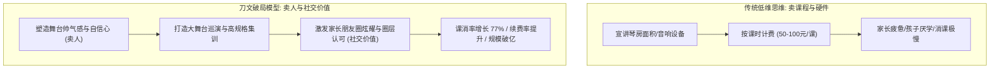
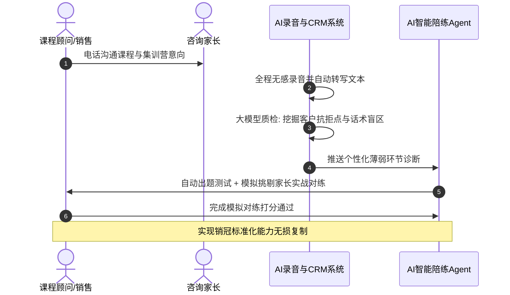

# 2026-11-24 · 刀文AI商业：线下教培与工作室AI数字化全案——少儿街舞从2700万到1.03亿实操、AI视频矩阵获客、销冠录音智能质检与县域商业点位战

本次直播（Session 166：2026-11-24 12:14:23 至 2026-11-24 13:19:31，录制时长 1.08 小时，全量解码 1 个高保真音频文件，共 38 个自适应重叠短转录切片，332 段时间戳发言完整审阅，2 条弹幕全量复核并采纳）是刀文AI商业针对“线下少儿才艺/街舞培训机构、各类教培工作室与县域实体门店，如何通过 AI 工具实现数字化升级与十倍人效跃迁”的深度咨询与操盘实录。刀文结合自身深度辅导少儿舞蹈连锁品牌从 2,700 万元规模跨越至 1.03 亿元的真实成长史，破除了传统线下实体“只能靠名师、人多成本高、异地难复制”的人效诅咒；提出线下艺术教培不是卖产品课程而是“卖人”（孩子在舞台上的帅气自信）与家长的“社交价值”溢价模型；系统拆解了如何用 AI 批量生成短视频矩阵抢占同城高性价比流量，以及如何通过 AI 销售录音质检与自动出题陪练实现销冠能力的无损复制；并在组织战略上阐明了县域商业多点卡位竞争与“拒绝无目标流浪、穿透拆解量化动作”的执行铁律。

---

## 一、少儿教培与工作室商业本质：不是“卖产品”而是“卖人”，社交价值是最高溢价源泉

在直播开场与案例剖析阶段（`F01-L001-T01-S001` 至 `L003-T03-S005`），刀文面对很多做舞蹈、音乐、美术培训工作室的负责人“为什么招生成本越来越高、家长续费意愿低”的困惑，一针见血指出了认知偏差。

### 1. 艺术教培的底层价值定位：卖人的自信与蜕变
- **脱离硬件和课时思维**：很多机构负责人总觉得自己是在卖“几十块钱一节的课程”，或者向家长介绍“我们店里有十几万的高端音响硬件设备”。刀文强调，家长给孩子报名街舞或才艺班，根本不是为了消耗几节课，也不是来享受几万块的音响；
- **“卖人”的心理映射**：家长在看到其他孩子跳舞帅气、舞台气场强大的那一刻（`F01-L001-T01-S001`：“结果旁边人起来跳得好帅啊！我儿子跟我说跳得好帅”），内心买下的是“我孩子未来也能在台上闪闪发光、变得帅气自信”的心理投射。教学机构经营的本质是人的蜕变，是卖“未来的孩子”。

### 2. 家长朋友圈与大舞台背后的“社交价值”
- **社交价值超越功能价值**：普通快消品可能靠功能买单，但高端教育与才艺培训的溢价完全取决于能否满足家长的社交价值（`F01-L003-T03-S005`：“价值就是很多人的社交价值，你的产品价值越多，能满足的客户需求就越多”）；
- **从 2,700 万到 1.03 亿的增长支点**：刀文操盘少儿街舞机构时，课消率同比暴增 77%，核心机制就在于**把枯燥的日常排课转化为大舞台汇演、城市级巡演与外地集训营**。当孩子登上聚光灯下的大舞台，家长录制视频发到朋友圈获得数十个点赞时，家长的社交满足感达到顶峰，第二年的集训住宿费、考级费与长期学费便会主动续交，彻底摆脱传统工作室“求着家长消课”的被动局面。

---

## 二、破除人效诅咒：AI 批量短视频矩阵抢占同城公域流量

传统才艺工作室和线下教培普遍面临“长不大”的死穴：多开两家店，管理成本急剧攀升，营销团队和授课老师成本失控（`F01-L004-T04-S003`：“你的人越多其实沟通成本越大，不能快速做到流程优化，这个时候 AI 工具就起到很大价值”）。

### 1. 传统教培视频宣传的痛点
- **专业团队成本过高**：专门请摄像师拍摄、剪辑师剪片，一条精美舞蹈视频成本数百上千元，更新频率低；
- **同城流量争夺惨烈**：同行如果借助新渠道抢先占领了同城几千上万的自然推荐流，传统老机构的生源就会被迅速切断。

### 2. AI 短视频生成工作流实操打法
- **高光片段智能截取**：将日常练习、集训排练的大段录像交给 AI 视频处理工具，自动识别精彩动作与节拍节奏（Freestyle、卡点跳步）；
- **批量化宣发矩阵生成**：利用 AI 自动匹配爆款 BGM、生成炫酷舞台光影特效与动感转场，并自动配上具有吸引力的文案标签；
- **矩阵分发挂载 POI**：每个老师、学员家长及机构员工的短视频账号统一分发，精准挂载门店本地定位（POI），以近乎零的边际成本每天在同城产生几十条高质感短视频，形成区域流量霸屏。

---

## 三、AI 销售录音质检与智能陪练：低成本无损复制“金牌销冠”

教培与实体机构规模化的最大瓶颈往往不在于教练，而在于**前端销售顾问（课程顾问）能力的不可复制性**（`F01-L005-T01-S006` 至 `T02-S001`）。

### 1. 销售团队管理的传统盲区
- **开单全凭个人天赋**：销冠离职带走客户，新员工上手慢、成单率低；
- **通话黑盒无法监控**：销售每天给家长打电话沟通，到底说了什么、哪里说错了、为什么被拒绝，管理者根本无从知晓。

### 2. 刀文落地的 AI 销售录音质检与模拟培训闭环
- **全流程录音自动转录与智能评估**：所有销售与家长的沟通录音全部进入 AI 质检系统。AI 自动分析：“你哪里讲得好，哪里引起了客户的反感，对方抛出价格异议时你为什么没有接住”；
- **自动生成针对性出题问卷**：AI 系统根据该销售当天的失误点，自动生成 3~5 道情景模拟试卷（如“当家长说学街舞耽误文化课时，最佳回应话术应该包含哪三个关键点？”）；
- **AI 角色扮演智能陪练**：新员工每天上岗前先与扮演“刁钻家长”的 AI Agent 对话 20 分钟，直到合格率达到 90% 方可接听真实咨询电话。这样不仅降低了对方拒绝率，更实现了将金牌销冠的应答知识库无损复制给全员。

---

## 四、县域商业点位卡位战与“拒绝流浪式管理”的目标穿透

直播后半段（`F01-L006-T02-S010` 至 `L007-T02-S011`），刀文将视角上升到企业战略与县域实体下沉市场的竞争格局，给出了极具震撼力的经营箴言。

### 1. 县域下沉商业的物理防御壁垒
- **区域多点卡位锁死竞争**：在同一个县城或地级市，不要只做一家孤零零的精品大店。必须在城南、城北、商业中心等交通枢纽多点布子，形成“互为犄角”的品牌网格。即使单店面积适中，也能在心理认知和物理距离上彻底封死竞品进入的生存空间。

### 2. 企业战略：没有拆解目标就是在“盲目流浪”
- **刀文深度警示**（`F01-L007-T02-S011`）：“你的工作其实就是在盲目的流浪。一个公司没有目标，你就在流浪，因为你根本不知道你自己要去哪里！当你有目标的时候，你就会看到你自己的事情”；
- **自上而下的量化动作拆解**（`F01-L006-T02-S010`）：
  - **年度战略目标**：比如年度营收目标与总学员规模；
  - **部门月度指标**：例如某校区当月必须招收 70 个新学员；
  - **穿透到周动作与日动作**：70 个学员意味着需要 350 个试听到店，意味着需要 1,400 个有效外呼咨询，分配到 4 名销售头上，就是每人每天必须完成 15 个深度回访并产生 3 个到店邀约。只有把宏大目标拆解为每人每天看得见、摸得着的动作，团队才不会陷入迷茫与消极流浪。

---

## 五、核心认知与工具项目双台账

### 1. 核心认知与战术台账（Cognition & Tactics Ledger）
| 序号 | 战术/认知维度 | 核心落地要点 | 对应时间戳证据 |
| :---: | :--- | :--- | :--- |
| **01** | **商业本质与社交价值** | 艺术教培不是卖课时，而是卖“人”的自信与帅气蜕变；大舞台汇演与集训营深度满足家长的朋友圈社交价值，是课消增长 77% 的关键引擎。 | `F01-L003-T03-S005` (1477.34s) |
| **02** | **AI 赋能与人效复制** | 面对人多管理成本高的死穴，前端用 AI 批量制作街舞高光短视频矩阵获客，后端用 AI 销售录音质检与自动出题陪练无损复制销冠。 | `F01-L004-T04-S003` (2185.86s) `F01-L005-T02-S001` (2515.00s) |
| **03** | **战略拆解与点位竞争** | 县域市场通过城南、城北多点卡位构筑护城河；拒绝无目标的流浪式管理，将招收 70 人等总指标穿透拆解至每人每天的外呼与邀约动作。 | `F01-L006-T02-S010` (3190.71s) `F01-L007-T02-S011` (3834.27s) |

### 2. 落地工具与实战项目台账（Tools & Projects Ledger）
| 工具/技术标准名称 | 类别与定位 | 实战应用场景 | 会话内状态 |
| :--- | :--- | :--- | :--- |
| **AI短视频矩阵生成工作流** (AI Video Workflow) | 多模态视频与分镜高光混剪生成 | 自动识别少儿街舞精彩动作，匹配动感转场与 BGM，批量制作矩阵宣发视频抢占同城流量 | 核心应用工具 |
| **AI销售录音质检与模拟培训系统** (AI Sales Coach & QA) | 语音识别与大模型智能质检/陪练系统 | 自动分析顾问全流程通话录音，诊断沟通抗拒点，自动出题考核与模拟对练，赋能新员工极速上手 | 重点落地场景 |
| **教培机构AI数字化大屏与客户管理系统** (AI CRM & Ops BI) | 经营分析与课消续费指标数据化看板 | 穿透跟踪学员消课节奏、集训报名与续费周期，告别糊涂账管理 | 管理底座 |

---

## 六、总结与实操建议

刀文在本场直播中展现了顶级商业操盘手的战略穿透力与落地敏锐度：
1. **商业模式端**：立刻审视自家机构的宣发话术，停止强调冷冰冰的硬件与课时单价，将重心转向“孩子能登上的舞台规格、孩子神态与气质的蜕变、家长能分享的社交高光时刻”；
2. **AI 工具端**：不盲目追逐高大上的通用大模型概念，从两个最痛的环节切入——**用 AI 生成短视频解决获客素材荒**，**用 AI 录音质检解决销售能力复制难**；
3. **团队运营端**：告别“流浪式”经营，对照标杆把每月的核心学员招募目标层层剥开，落实到每位员工每天清晨明确的执行待办。

本场直播的实录与方法论，为所有挣扎在生源焦虑、名师依赖与规模瓶颈中的线下实体机构，指明了一条清晰可见的 AI 数字化破局之路。
