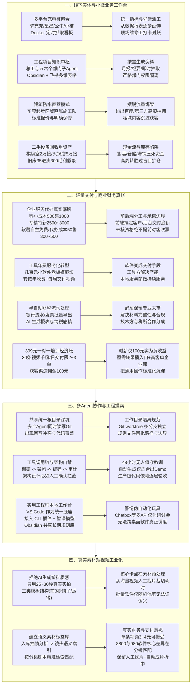

# 2026-10-26 · 第1场直播

这一晚的实战研讨从线下实体小微业务（充电桩统一监控、工程项目中枢、防水维修、同城二手重资产压库）贯穿到企业级交付博弈（企服代办底牌、半自动财税末审、多Agent架构门禁、真实素材语义剪辑与培训经济账）。本文彻底清洗内部合规防御套话与免责官话，以案卷化视角还原真实技术拓扑、商业算账、试错代价与可落地的工程实践。



## 一、企业AI服务起步：分清客户池、真实需求与代办底牌

在企业服务转型AI的早期阶段，极易将三种资产混为一谈：**通讯录里的联系方式、企业对个人的旧信任、以及企业真实愿意为AI掏钱的预算**。

一位原企服老兵转型AI代理一个月未成一单，核心原因就在于误以为“手里有几百家老客户就能转化”，但把AI产品拿给老客户后发现对方根本没有使用场景，所谓“一单十万利润”全来自上游机构宣传。

### 1. 企业服务渠道代办的真实底牌与加价链条

现场企服服务商公开了代办业务的底层成本与真实渠道加价：

- **科技型中小企业评价（科小）**：上游交付成本约 **500元**，渠道对外常规报价 **1,000元**；
- **专精特新认定**：基础材料整理与申报成本约 **2,500 ~ 3,000元**，面对终端客户则根据补贴额度加收提成；
- **软件著作权代办**：企业自主向版权局提交完全免费，渠道代办加急成本约 **50元/件**，中介对外收费 **300 ~ 500元/件**；
- **注册资本实缴与垫资**：正规实缴验资报告收费 **8,000 ~ 10,000元**（周期1~2个月），市场上所谓3,000元快速搞定的多为虚假过账走过场，存在严重的工商与法律追溯风险。

> **操盘铁律**：企服必须坚决执行“前端商务与后台交付隔离”。销售与渠道对接客户时，严禁为促单在现场擅自承诺资格（例如成立未满一年的企业申报高新）；所有申报条件、底价与交付边界必须由后台技术团队书面确认后再对外报价。

### 2. 从卖几百元小软件，转为按年交付视频服务

一家代理营销工具的服务商发现，单卖几百元的AI批量生成小软件极难成交——本地实体老板根本没有时间学习复杂的参数配置。

他们果断改变交付形态：**不卖软件所有权，改卖年费服务**。老板每年支付固定服务费，服务团队每周固定交付约定数量的实拍营销短视频。工具直接变成内部交付的生产力杠杆，客户买的是“每周有视频发小红书/抖音”的确定性结果，而非一套吃灰的桌面软件。

---

## 二、技术、渠道与售后分润：卖得动不等于交付得起

技术人员直接面向终端客户常因缺乏商务耐心而失败，但把工具交给渠道伙伴后，又迅速暴露另一大暗坑：**渠道拿大头拍拍屁股走人，复杂的安装配置、数据对齐、故障排查与无限期答疑全部甩给技术方**。

### 1. 分润必须按全生命周期五步拆解

为避免合作崩盘，双方利润分成严禁简单按“谁拉来客户”一刀切，必须拆分为五个权责阶段核算：

1. **售前阶段**：需求调研、方案演示与商务公关；
2. **环境部署**：私有化配置、API打通、服务器调试；
3. **客户培训**：专岗操作SOP编写、员工面对面答疑培训；
4. **日常售后**：BUG修复、底层模型升级适配、提示词微调；
5. **持续维护**：算力账单监控、数据备份与业务规则演进。

### 2. 开源与源码交付的伪命题

一名开发者为酒吧定制了一套管理小程序，用户反馈极好，但因厌烦售后沟通，直接将源码开源发在群里让人自行部署。结果发现，即便提供了源码和完整的Markdown文档，90%的人依然因为Node版本、数据库连接或微信鉴权问题无法运行。

“把仓库发给客户”与“让系统稳定商用”之间，隔着极其沉重的部署与排错劳动。没有售后团队支撑的低价交付，最终都会沦为技术负债。

---

## 三、工程项目知识中枢：从跨部门反复要数据到按需抽取

大型建筑工地项目总工的核心痛点，并非日常办公写文字，而是**跨部门资料的反复索取与低效核对**。工程部每天记录施工进度，物资部掌握水泥钢筋进场台账，计划部到了月底做月报或向甲方汇报时，又得把所有人折腾一遍重新拉表。

总工设想的工程中枢架构遵循“总Agent下设五六个部门子Agent”模型：

```
各部门人员 -> 专属子Agent入口（仅上传不随意篡改）
                  ↓
       项目级向量化知识中枢（关联施工图纸、规范与台账）
                  ↓
       按需触发自动化任务（月报/会议纪要/突发进度即时抽取）
```

### 落地关键边界：

- **权限必须物理级隔离**：物资人员绝不能修改工程进度，部门只读自身管辖范围；
- **格式结构化前置**：在让AI生成月报前，必须把往期优秀月报模板、国家现行施工验收规范作为固定System Prompt输入；
- **文件目录映射**：本地以项目为根目录，子目录严格划分经验库、踩坑记录与任务输出，由Obsidian统一挂载读取。

---

## 四、200多个充电桩的经营工作台：先聚合看数，再闭环派工

一位同时经营快递网点与200多个充电桩的跨界创业者（齐总），真实还原了轻量化AI介入线下资产的演进全流程。

### 1. 第一阶段：四大异构平台统一看板

充电桩分别挂靠在 **驴充充、星星充电、公牛充电、小桔充电** 四大第三方平台。过去老板每天需要登录四个App/网页后台，人工肉眼统计当天总充电量、订单数并排查离线故障。

- **输入**：四大平台各自的账号爬虫/API数据流；
- **载体**：轻量级 Docker 容器挂机运行定时抓取脚本（解决本地电脑不能关机的痛点）；
- **输出**：每天早晨自动推送一份包含四个平台总收入、总度数、离线异常桩号的飞书/微信汇总报表。

### 2. 第二阶段：从经营报表延伸到运维闭环

看数跑通后，业务自然延展到线下派工：系统识别到某个桩异常离线 -> 自动生成运维工单 -> 指派就近电工 -> 记录耗材与施工量 -> 现场维修打卡对账。

齐总的核心原则是：**“工具一开始能帮我替代60%~70%的机械劳动就是巨大成功”**。先用小工具解决肉眼查数的急迫痛苦，再在业务运转中逐步填补边界，绝不一开始就花重金开发所谓的全功能大屏。

---

## 五、多Agent协作与工程摸索：共享目录踩坑与架构门禁

现场关于多Agent开发的交锋极为尖锐，彻底揭开了早期AI协作的伪命题。

### 1. 共享统一Git根目录的致命灾难

多位开发者分享了让多个编程Agent同时读写同一本地项目目录的惨痛教训：即使有Git版本管理，Agent并发执行时依然频繁出现**代码回写冲突、互相覆盖修改、甚至声称“已全部实现”但本地代码空空如也**。

### 2. 生产级多Agent工程铁律

- **工作目录物理隔离**：严格采用 `git worktree` 为不同任务的Agent创建独立分支工作树，互不干扰；
- **架构设计设立人工拦截门禁**：任务执行链必须拆分为“调研 -> 架构 -> 编码 -> 局部测试 -> 安全审计”。在架构设计完成后，**必须由资深工程师人工审查签字，才允许向后分派编码任务**；
- **警惕伪自动化玩具**：使用 Chatbox AI 接入多个模型API，本质上只是拉了一个“多模型研讨聊天群”，根本无法对本地终端、IDE和跨桌面软件发起确定性调用调度。真正的生产力依赖命令行 CLI 与 MCP（模型上下文协议）接口。

### 3. 一线工程师推荐的轻量工作台组合

```
[统一工作台] VS Code
     ├── 插件集成：Claude Code / Codex CLI / Grok
     ├── 底层模型：智谱 GLM / DeepSeek API（成本可控）
     └── 知识底座：Obsidian 本地 Markdown 规则目录
```

在项目根目录下维护 `agent.md` 和规则库：项目开始前，Agent必须强制读取路径规则、执行约束与防踩坑红线，以Markdown契约替代反复口头提示。

---

## 六、AI财税的真实流程：半自动流水处理 + 专业末审

财税领域的AI落地经历了一次重大去伪存真：宣称“全自动从税务局爬数据、自动记账报税”在现阶段法律与技术上均不可行。

### 真实的商用半自动闭环：

1. **材料准备**：人工从银行网银导出流水清单、税务系统导出已开具发票、扫描凭证规整归档；
2. **AI清洗与凭证生成**：通过专门定制的提示词与映射规则，自动解析流水对手方、归类会计科目、生成利润表与资产负债表底稿；
3. **专业会计末审与纳税申报**：**必须由具备中高级资质的专业会计进行最终人工复核**，核验无误后，由会计在官方申报系统完成最终提交。

> **行业水深警示**：生活美容与医疗美容的财务账目逻辑完全不同，医美涉及直客、渠道大额返佣、器械药品耗材合规等极度敏感科目。缺乏专业财务常识的纯技术团队贸然承揽企业财税，一旦遭遇漏税或错报，将面临连带涉税法律风险。

---

## 七、真实素材短视频工业化：拒绝塑料感与语义素材库

做营销短视频的团队普遍面临一个两难困境：完全用大模型生图生视频，画面假、塑料感重、人物五官变形，企业客户一眼拒收；纯人工剪辑，耗时费力，产能无法放大。

### 1. 25~30秒真实实拍混剪的黄金标准

服务商团队探索出的高完播结构模板：

- **前3秒**：视觉强冲突钩子（问题痛点暴露/反常识画面）；
- **中间15~20秒**：连续运镜实拍展示（明确的工序步骤、近景特写、环境交代）；
- **后5秒**：转化引导与品牌标识。

### 2. 核心瓶颈：素材前置语义分析

从海量实拍素材中人眼翻找镜头极其耗时。市场上花 8,800 元购买的所谓“批量混剪软件”，其底层不过是按照分镜文件夹进行随机拼装，无法理解视频画面中人物到底在做什么，导致成片常常出现声画错位。

### 3. 语义素材库解耦方案：

```
[原始长视频入库] 
       ↓ (调用视觉大模型抽帧分析 / 关键动作打标)
[镜头切片与语义索引库] (如: 00:15~00:18 为"工人拧螺丝特写")
       ↓ (根据分镜脚本语义精准拉取)
[按指定模板自动化粗剪] -> [人工精修校对与配乐] -> [高质量成片]
```

- **财务测算**：团队能承受的单条成片成本为 **3 ~ 4元**，每月工具预算控制在 **200 ~ 500元**。通过“前置语义打标入库，一次分析多次复用”，避免每做一条视频都全量扫描整个素材库，显著降低了视觉 API 的调用开销。

---

## 八、399元一对一培训的经济账：时薪100元的负收益陷阱

一名个人讲师推出了“399元 3小时一对一教搭建电商工作流”的辅导服务。其个人账号发了30条视频、积累了1,000个粉丝。

### 算清一笔残酷的商业账：

- **交付上限**：每天最多交付 2 ~ 3 单（6 ~ 9小时高强度连麦），个人时间被彻底锁死；
- **渠道提成**：若与外部获客渠道合作，渠道每单强制分走 **99 ~ 100元** 佣金，个人仅得约 **300元**；
- **真实时薪**：300元 ÷ 3小时 = **100元/小时**。这还没有计入课前沟通、备课、课后答疑排错、以及客户未学会导致的退款损失！

> **破局路径**：将通用基础工具操作录制成标准化入门课程（定价 39.9 ~ 99元），一对一环节仅针对企业特定业务痛点提供定制化咨询与工作流搭建，拉升客单价至数千元级别，方可跳出“卖时间打零工”的泥潭。

---

## 九、二手设备回收与实体经营：表面毛利与库存压仓陷阱

一位从新媒体转行同城二手设备回收的创业者，揭示了实体资产接盘的隐秘账本。

### 1. 设备轻资产入股模式

- **棋牌室案例**：原店主装修及设备投入约 **30万元** 因亏损倒闭；接盘人以 **2万元** 整体打包全部空调、麻将桌与家具，与房东商定短租试水，再由执行人运营，接盘人享受30%纯利润分成；
- **火锅店案例**：原投资 **200万元** 的高档火锅店，以 **5万元** 极低价格打包全套厨房不锈钢设备、桌椅与冷柜。

### 2. 二手倒卖的库存压死现金流警示

虽然设备收购价格极低（例如收购旧床仅需 **35 ~ 50元/张**，仓库转手可标价 **300 ~ 400元/张**，账面毛利高达数倍），但真实的财务成本往往被忽视：

- **隐形成本**：装卸搬运工费、厢式货车运费、大面积仓库租金、长期积压产生的折旧与破损；
- **致命后果**：表面每单都在赚钱，但赚来的现金全部变成了仓库里沉甸甸的死库存，一旦资金链断裂，整批设备便形同废铁。**高周转分销永远胜过盲目扩充仓库囤货**。

---

## 十、实战落地行动指南与避坑清单

基于本场案例沉淀的可执行落地 Checklist：

### 1. 充电桩及线下多平台数据聚合实施 SOP
- [ ] **第一步（盘点入口）**：整理所有经营平台的账号、密码、验证码接收手机，优先确认网页版后台是否具备导出 Excel 报表功能；
- [ ] **第二步（运行环境）**：租用一台月费 20~30 元的低配云服务器或配置本地 Docker 容器，避免用日常办公笔记本挂机导致断网断电；
- [ ] **第三步（异常告警先行）**：优先编写“离线与故障”告警推送（飞书 Webhook 或微信机器人），抓取频率设为每小时一次，次日生成聚合日报；
- [ ] **第四步（打通现场对账）**：报表成熟后，再加入线下电工派工字段（桩号、异常代码、耗材、修复签名），切忌一步到位开发复杂系统。

### 2. 真实素材剪辑与语义标签库搭建 SOP
- [ ] **杜绝纯 AI 假人**：严禁直接用文生视频交付严肃实体企业客户，坚持实拍素材打底；
- [ ] **拆解镜头单元**：将 5~10 分钟实拍长视频按“镜头切换”切碎为 3~5 秒独立片段；
- [ ] **前置语义命名**：入库时通过视觉 API 提取动作关键词并写入元数据（格式：`场景_人物动作_景别_时长.mp4`）；
- [ ] **人工终审把关**：生成脚本后自动抓取对应切片合成粗剪版，由剪辑师微调前 3 秒钩子与背景音效。

### 3. 多 Agent 研发环境隔离与门禁规范
- [ ] **禁止单目录并发**：多 Agent 协作必须通过 `git worktree` 创建物理隔离的任务分支；
- [ ] **设立架构确认门禁**：在 Agent 完成需求拆解与架构设计后，必须由技术负责人审查确认，方可触发编码 Agent；
- [ ] **统一规则文件绑定**：在代码根目录固定 `agent.md`，写清框架版本、不可修改的核心文件、严格测试用例要求。

---

## 十一、工具项目台账与待核实线索

### 明确用途与状态的工具库

| 工具/项目 | 本场具体用途与实战经验 | 状态与边界 |
| :--- | :--- | :--- |
| **VS Code + CLI** | 统一工程师开发台，集成 Claude Code / Codex / Grok 等命令行插件与智谱模型 | 生产力实测推荐，依赖本地规则文件规范 |
| **Docker** | 挂载充电桩爬虫、多平台对账脚本，保证24小时稳定在线 | 推荐部署载体，成本极低 |
| **Obsidian** | 团队经验规则库、工程踩坑日记与项目规范本地 Markdown 存储中心 | 适合与多 Agent 共享本地知识目录 |
| **讯飞录音卡** | 硬件售价约 999 元，磁吸手机录音，用于导出原始转写文本与生成纪要对比复核 | 个人自购实测，长会话纪要校对利器 |
| **超级编导 / 科莫多** | 商业短视频批量混剪软件（年费 2,980 ~ 8,800 元不等），多为按预设目录随机拼装 | 实测无法精确理解镜头语义，需配合人工挑选素材 |
| **Dify / 扣子 (Coze)** | 用于搭建工程项目报表抽取流与表格原型 | 适合快速验证业务逻辑，复杂权限需自研拦截 |
| **驴充充 / 星星 / 公牛 / 小桔** | 充电桩主日常经营后台，数据源头 | 依赖逆向抓取或官方报表导出，缺少统一公开开放接口 |

### 待核实原词与技术线索

| 原词线索 | 现场讨论背景与用途 | 待核实边界 |
| :--- | :--- | :--- |
| **anything-CLI** | 试图将各类桌面软件封装为 CLI/MCP 统一调用的开源探索项目 | 现场反馈无法稳定穿透控制所有桌面应用，仓库地址待核 |
| **CtSwitch** | 开发者提到的用于本地修改客户端上下文配置的工具 | 原词音译，需核对具体开源实现 |
| **微信小V** | 微信内测中的新 AI 入口，参与者观察其对同城本地生活搜索分发的影响 | 属灰度内测功能，尚未形成稳定的获客打法 |
| **派 + ORCA** | 讲者介绍的多 Agent 编排流水线（派充当总管，ORCA负责任务调度） | 单人自述架构，非公开通用标准包 |
| **Hermes + DeepSeek** | 讨论尝试用于社交平台评论区自动化线索挖掘的组合设想 | 现场仅为提问讨论，无成熟跑通闭环 |\n